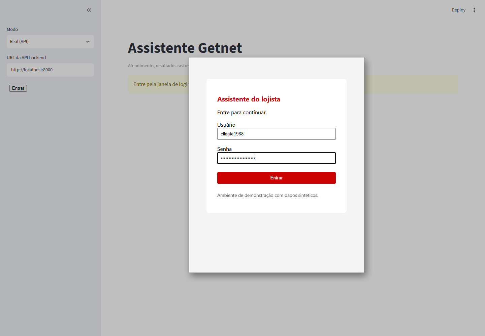
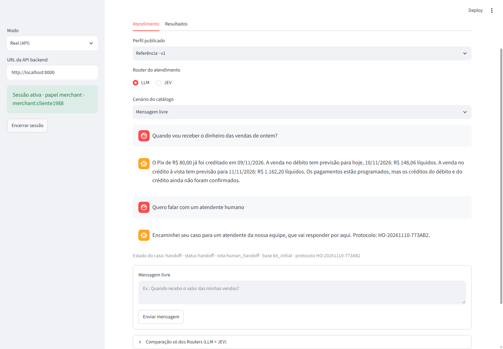
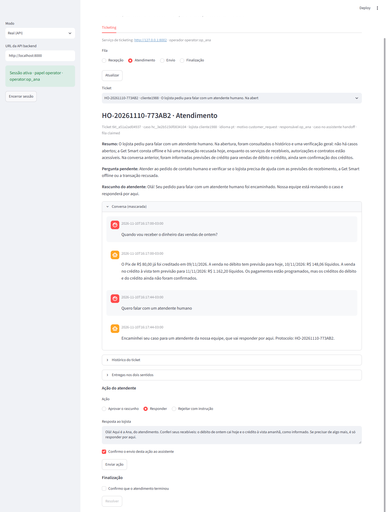
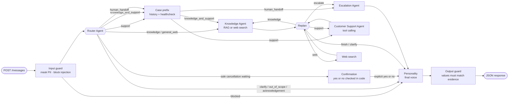

# Getnet Merchant Assistant — Multi-Agent Support System

A multi-agent assistant that answers Getnet merchants about their sales, payouts, card machines and Getnet products
over one HTTP endpoint, and hands the case to a human operator when it needs one. It serves merchants asking
questions, support operators working the hand-off queue (in a web screen or on Telegram) and the team that runs and
measures it (judge, retrieval metrics, traces and a budget guard). A **Router** sends each message to a **Knowledge
Agent** (RAG over Getnet's official website, or the web), a **Customer Support Agent** with tools over the merchant's
synthetic account or an **Escalation Agent**, and a **Personality** step writes every reply of the assistant in one voice; a reply written by a human operator
reaches the merchant in the operator's own words.

**Status:** v1.1.0 (not released). The merchant asks about their human-support tickets in any conversation and gets
the protocol, its state and the attendant's reply; the interface brings back the latest conversation after the page
is reloaded; profiles and Router engines whose provider key the backend lacks show as unavailable. It builds on
v1.0.0: the image on GHCR per release tag with the dependencies pinned in `uv.lock`, the demonstration through a
tunnel with the sign-in by redirect, the [10-minute walkthrough](#10-minute-walkthrough) and the
[before and after table](#what-changed-since-v0100). Since v0.13.0 it has sign-in by redirect, external OIDC issuers,
two API workers, webhook resend, the operator on Telegram and OTLP spans; the campaign judge is `judge.v5` and hybrid
retrieval reranks by default. What each version added is in
[Beyond the challenge](#beyond-the-challenge), measured quality in [Testing and evaluation](#testing-and-evaluation),
and what comes next in the [Roadmap](#roadmap).

Run it in one of two ways (Docker with Compose v2 and an OpenAI key; details in [Run it](#run-it)):

```bash
cp .env.example .env                 # set OPENAI_API_KEY
docker compose up -d --wait          # 1) the published image ghcr.io/lauropereira/ai-getnet-case; built locally when none can be pulled
docker compose up -d --wait --build  # 2) or build the image from this checkout
TOKEN=$(curl -s localhost:8000/v1/auth/token -d grant_type=password -d username=cliente1988 \
  -d password=cliente1988-fictitious -d client_id=merchant-assistant-cli | python -c "import sys,json;print(json.load(sys.stdin)['access_token'])")
curl -s localhost:8000/messages -H "Authorization: Bearer $TOKEN" -H 'content-type: application/json' \
  -d '{"message": "When will the money from yesterday'"'"'s sales be deposited?"}'
```

Since v0.7.0 `POST /messages` requires a token: the merchant comes from the token, not from the body. The user and password above are fictitious demo values from `.env.example`.

### What changed since v0.10.0

Each figure comes from the versioned evidence linked in its row; all data is synthetic. The index of every result is
in [docs/evidence](docs/evidence/README.md).

| Area | v0.10.0 | Now | Evidence |
| --- | --- | --- | --- |
| Attendance | Last full campaign (v0.8.0, `judge.v3`): 44 development cases × 3 runs, groundedness 4.56, factual correctness 4.62, relevance 4.77, usefulness 4.53; business journeys 13/13, 12/13, 12/13 | No new full campaign. Replanning can be switched off and compared: on 4 paired cases, 0 model-decided replans with `REPLAN=off` and 8 with `REPLAN=on`. Sale cancellation runs only after an explicit yes | [v0.8.0 campaign](docs/evidence/v080-all-r3.md), [v0.8.0 journeys](docs/evidence/v080-d12-pre-holdout-r6.md); [v0.12.0](docs/evidence/v0120-resultado.md) |
| Evaluation (judge) | Default `judge.v3` against one human rater (the owner, 24 answers): unsupported-claim agreement 0.667, kappa −0.200; 0 of the 4 generic claims flagged | Default `judge.v5`, claim by claim, against adjudicated gold labels on 36 sealed answers (rated by the owner and a model panel; disagreements settled by model proposals the owner accepted): kappa 0.647 (95% CI 0.28–0.92), against 0.538 for `judge.v3` on the same answers and labels; ±1 agreement 0.972 / 0.972 / 1.000 / 1.000; US$0.000945 per judgement (`judge.v3`: US$0.000398) | [v0.10.0 calibration](docs/evidence/v0100-juiz-v4.md); [v0.11.0](docs/evidence/v0110-resultado.md) |
| Retrieval | Hybrid (BM25 + dense), no reranker; sealed holdout of 25 questions: Recall@6 1.000, MRR 0.920, nDCG@6 0.921 | Hybrid with the reranker by default; same holdout: Recall@6 1.000, MRR 1.000, nDCG@6 0.972 (same-depth control `hybrid@36`: 0.907); 1,752 ms per query, against 501 ms for `hybrid` in the same run | [v0.9.0 retrieval](docs/evidence/v090-retrieval.md); [v0.11.0 retrieval](docs/evidence/v0110-retrieval.md) |
| Memory | Recent turns only; multi-turn conversations 4/4 (2 to 3 turns each) | Rolling summary and a register of facts taken from tool results; a 27-turn conversation kept the exact facts, warned when context was missing and recovered it | [v0.8.0 conversations](docs/evidence/v080-conversations-r4.md); [v0.12.0](docs/evidence/v0120-resultado.md) |
| Identity | Own issuer only, every tool call audited (4 tool calls, 4 audit rows); the web client sent the user's password (password grant) | Sign-in by redirect on the issuer's page (authorization code with PKCE, rotating refresh) and external OIDC issuers; 10 logins in a real browser: 10 sessions, no orphan login, a code issued on one worker exchanged on the other | [v0.7.0](docs/evidence/v070-resultado.md); [v0.13.0](docs/evidence/v0130-resultado.md) |
| Operation | One API worker; a comparison killed after 1 of 6 cells resumed the other 5 to `completed`, each cell paid once; `/metrics` and 4 alert rules | Two API workers sharing a comparison lease: owner suspended before and after a paid reservation, no cell paid twice; exhausted webhooks resent; operator on Telegram; OTLP spans and a dashboard. v1.0.0 adds the image per release tag, `uv.lock` and the tunnel profile | [v0.10.0 operation](docs/evidence/v0100-qa-ops-r1.md); [v0.13.0](docs/evidence/v0130-resultado.md) |
| Automated tests | Strict suite: 2,148 passed | Strict suite: 2,698 passed (v0.12.0), 2,944 passed (v0.13.0), no skips | [v0.10.0 build](docs/evidence/v0100-candidato-r1.json); [v0.12.0](docs/evidence/v0120-resultado.md), [v0.13.0](docs/evidence/v0130-resultado.md) |

The two judge rows use different references: the v0.10.0 figures compare the judge with one human rater on 24
answers; the current ones compare it with gold labels on 36 sealed answers, where the owner and a model panel rated
each answer and their disagreements were settled by model proposals the owner accepted. The fair comparison is
inside the current row: `judge.v3` 0.538 against `judge.v5` 0.647 on the same answers and labels.

### Where each part of the challenge lives

The project started from the *AI Hardcore Engineer — Multi-Agent Support System* challenge; each item maps to a
section and to code:

| Challenge item | Section | Code |
| --- | --- | --- |
| Three or more cooperating agents and how they communicate | [Architecture](#architecture), [Message workflow](#message-workflow) | `orchestration/graph.py`, `orchestration/state.py` |
| Router as entry point and workflow manager | [Architecture](#architecture) | `agents/router.py`, `prompts/router.v7.md` |
| Knowledge Agent: RAG over Getnet's site plus web search | [RAG pipeline](#rag-pipeline) | `rag/`, `agents/knowledge.py` |
| Customer Support Agent with tools | [Support tools and data](#support-tools-and-synthetic-data) | `tools/`, `agents/support.py` |
| HTTP endpoint with a JSON body | [Run it](#run-it), [Message workflow](#message-workflow) | `api/app.py`, `api/schemas.py` |
| Docker | [Run it](#run-it) | `Dockerfile`, `docker-compose.yml` |
| Testing strategy | [Testing and evaluation](#testing-and-evaluation) | `tests/`, `evaluation/` |
| Prompts and use of LLM tools | [How the LLM tools are used](#how-the-llm-tools-are-used) | `prompts/`, `llm/` |
| Bonus: human escalation agent, guardrails, handoff, evaluation and observability | [Guardrails and reliability](#guardrails-and-reliability), [Observability](#observability), [Testing and evaluation](#testing-and-evaluation) | `agents/escalation.py`, `guardrails/`, `observability/` |

Code paths are shortened from `src/merchant_assistant/`; `prompts/`, `tests/`, `Dockerfile` and `docker-compose.yml` are at the repository root. Features built beyond the challenge (an interface, model profiles, an alternative Router engine, a versioned knowledge base, MCP) are described in [Beyond the challenge](#beyond-the-challenge).

---

## Contents

1. [Run it](#run-it) ([10-minute walkthrough](#10-minute-walkthrough)) · 2. [Configuration](#configuration) · 3. [Architecture](#architecture) ·
4. [Message workflow](#message-workflow) · 5. [RAG pipeline](#rag-pipeline) · 6. [Support tools and data](#support-tools-and-synthetic-data) ·
7. [How the LLM tools are used](#how-the-llm-tools-are-used) · 8. [Guardrails and reliability](#guardrails-and-reliability) ·
9. [Observability](#observability) · 10. [Testing and evaluation](#testing-and-evaluation) · 11. [Design decisions](#design-decisions) ·
12. [Beyond the challenge](#beyond-the-challenge) · 13. [Operating notes](#operating-notes) · 14. [Roadmap](#roadmap) ·
15. [Repository layout](#repository-layout)

---

## Run it

### With Docker (recommended)

Requirements: Docker with Compose v2 and an OpenAI API key.

```bash
cp .env.example .env               # set OPENAI_API_KEY; nothing else is required
docker compose up -d --wait         # API on http://localhost:8000, ticketing on http://127.0.0.1:8002, plus Qdrant and mocks
```

Compose uses `ghcr.io/lauropereira/ai-getnet-case:${APP_VERSION:-latest}`. Set `APP_VERSION=v1.1.0` to select a
release tag. Compose checks the registry when the tag is missing locally and always checks for `latest`. If it
cannot pull the image and has no local copy, it builds from the `Dockerfile`. Use `docker compose up --build` to
build from your checkout. If the package is private, authenticate to GHCR to pull it. The application dependencies
come from `uv.lock`. With a fixed `APP_VERSION`, a local fallback build is reused even after that tag is published;
run `docker compose pull --policy always` after publication to replace it with the published image, then
`docker compose up -d --wait`.

On first start the container seeds the synthetic data (dates relative to *today*) and builds the vector index from
the versioned snapshots (about 37k embedding tokens, ≈ US$0.001). Later starts reuse the index. Startup to healthy:
about 20 s.

Try it (two calls: a token, then the message):

```bash
TOKEN=$(docker compose exec -T api merchant-assistant auth token --url http://localhost:8000)   # cliente1988, demo password
curl -s localhost:8000/messages -H "Authorization: Bearer $TOKEN" -H 'content-type: application/json' \
  -d '{"message": "My card machine won'"'"'t connect to the internet, what should I do?"}'
```

Useful endpoints:

| Endpoint | Purpose |
| --- | --- |
| `GET /v1/auth/authorize` | Sign-in by redirect (authorization code with PKCE S256) for web clients: a login page served by the API, then back to the registered `redirect_uri` with a one-time code |
| `POST /v1/auth/token` | OAuth 2.0 token (form encoded): `authorization_code` and `refresh_token` (rotating) for web clients, `password` for the demo users (smoke test and CLI), `client_credentials` for the ticketing and Telegram services; returns a JWT (RS256) |
| `POST /messages` | The assistant. Header `Authorization: Bearer <token>`. Body: `{"message": "...", "conversation_id": "conv_..." (optional), "user_id": "..." (optional; must match the token, otherwise `403 identity_mismatch`)}` |
| `GET /health`, `GET /ready` | Liveness; readiness reports index size, database and remaining budget |
| `GET /traces/{request_id}` | Step-by-step trace with a token: merchants see only their own (demo mode, on with the shipped `.env.example` and in compose) |
| `GET /.well-known/jwks.json` | Public keys that validate the tokens |
| `GET /docs` | OpenAPI UI with the 10 challenge examples preloaded |

Run the 10 challenge examples against the running API (≈ US$0.03); the command gets the token itself:

```bash
docker compose exec api merchant-assistant smoke --url http://localhost:8000
```

Stop and clean: `docker compose down` (add `-v` to drop the index, traces and budget ledger).

The optional interface, the `/v1` API and the MCP server are described in [Beyond the challenge](#beyond-the-challenge).

### Locally (development)

Use uv 0.13.7, the version used by the Dockerfile, for the commands below and for maintaining `uv.lock`.

```bash
uv sync --frozen --extra ingest --extra dev
source .venv/bin/activate                                    # PowerShell: .\.venv\Scripts\Activate.ps1
merchant-assistant bootstrap                                  # seed data + build the index (embedded Qdrant)
uvicorn --factory merchant_assistant.main:create_application --reload
merchant-assistant ask "Qual a cotação do euro hoje?" --trace  # one message, in process, with its trace
```

### Tests and evaluation

```bash
pytest                                   # backend tests; use tools/scripts/lint_and_tests.py --strict for strict validation
ruff check .
merchant-assistant eval --scripted       # end-to-end evaluation offline (wiring only, zero cost)
merchant-assistant eval --judge          # real evaluation; paid, check the current budget before running
merchant-assistant eval --judge --include-replan --split dev --limit 5 --no-conversations --name v080-cost-sample  # five-case cost sample
merchant-assistant eval-estimate --from docs/evidence/v080-cost-sample.json --out docs/evidence/v080-cost-estimate.json  # D12 estimate; no model call
merchant-assistant eval --campaign v080-qa --include-replan --judge --repeat 3 --split all  # fixed campaign cap + installation ledger
merchant-assistant eval --campaign v080-qa --judge-repeat 3 --answers-from docs/evidence/v080-all.json --name v080-all-judge  # judge variation; the agent does not run
merchant-assistant eval --campaign v080-qa --judge --repeat 3 --split holdout_v080  # sealed holdout: once, as the last technical step
merchant-assistant eval-calibrate --sample 24 --from docs/evidence/v080-all-r3.json   # CSV for the owner to rate, without the judge's scores; no model call
merchant-assistant eval-retrieval --mode hybrid --split dev --out docs/evidence/retrieval.md   # Recall@6, MRR, nDCG@6 per mode; --split holdout_v090 once, last
merchant-assistant eval --judge-repeat 3 --answers-from docs/evidence/v080-all-r3.json --only-sample docs/evidence/v080-calibracao-amostra.csv --rubric v4 --name my-run  # re-judge the calibration sample under another rubric or judge
merchant-assistant eval-calibrate --import docs/evidence/v080-calibracao-amostra.csv  # human × judge agreement and kappa; no model call
merchant-assistant eval-retrieval        # Recall@k of the RAG index; reranking is enabled by default and can be disabled with RERANK=off
merchant-assistant eval --judge --replan off --name ablation-off   # evaluate the same cases without replanning (REPLAN=off)
merchant-assistant eval-compare --a docs/evidence/ablation-off.json --b docs/evidence/ablation-on.json --out docs/evidence  # paired report; no model call
merchant-assistant ingest                # re-collect the official pages into snapshots (network)
```

After changing the dependencies or the version in `pyproject.toml`, regenerate `uv.lock` with `uv lock` and include
it with the change. Verify that the lockfile is current with `uv lock --check`.

`eval --judge` uses the independent judge (`JUDGE_PROVIDER`, `JUDGE_MODEL`). `--repeat 3` measures the variation of the assistant (the judge grades each answer once); `--judge-repeat 3 --answers-from` measures the variation of the judge over recorded answers. `--campaign v080-qa` mounts its fixed cap once (US$0.50; US$1.00 or US$1.10 with `--campaign-estimate` and a verified `eval-estimate`).

### Run the tests inside the image

The `test` target of the `Dockerfile` is the runtime image plus the `dev` extra of the same `uv.lock` and the
repository files. It runs the strict suite with no network, so nothing comes from PyPI or a model provider:

```bash
docker build --target test -t ai-getnet-case:test .   # network only here, to build
docker run --rm --network none ai-getnet-case:test    # strict suite (pytest, Ruff, links, skills); basetemp in /tmp
docker image rm ai-getnet-case:test
```

Arguments after the image name go to pytest, replacing the default `--basetemp=/tmp/pytest-image`
(for example `docker run --rm --network none ai-getnet-case:test --basetemp=/tmp/t -x`).

## 10-minute walkthrough

One merchant asks, asks for a person, an operator answers from the ticketing screen and the merchant reads the reply;
then one answer is evaluated. You need Docker with Compose v2, an OpenAI key in `.env`, and Python for the
`ai-getnet-case-web` interface (a sibling repository; see [Streamlit interface](#streamlit-interface)). Every user and
password below is a fictitious value of `.env.example`. The paid calls are the index on the first start, each
message and the one evaluation, all under the budget guard (`BUDGET_LIMIT_USD`).

1. **Start the stack and the interface.**

   ```bash
   cp .env.example .env              # set OPENAI_API_KEY
   docker compose up -d --wait       # API on localhost:8000, ticketing on 127.0.0.1:8002
   curl -s localhost:8000/ready      # "ready": true

   # in the ai-getnet-case-web checkout, with its own Python environment
   python -m pip install -e ".[test]"
   export BACKEND_API_URL=http://localhost:8000 AUTH_ISSUER=http://api:8000   # PowerShell: see Streamlit interface
   streamlit run app.py
   ```

   Open `http://localhost:8501/` (this exact address: it is the registered redirect). `AUTH_ISSUER` is the issuer the
   compose gives the API (`JWT_ISSUER`).
2. **Sign in as the merchant.** In the sidebar choose **Modo: Real (API)** and click **Entrar** (allow the popup).
   The popup is the API's own login page (`/v1/auth/authorize`); the interface has no password field. Sign in as
   `cliente1988` / `cliente1988-fictitious`. Expected: the popup closes, the sidebar shows
   `Sessão ativa · papel merchant`, and the tabs **Atendimento** and **Resultados** appear.
3. **Ask as the merchant.** In **Atendimento**, keep the profile **Referência**, type
   “Quando vou receber o dinheiro das vendas de ontem?” in **Mensagem livre** and click **Enviar mensagem**.
   Expected: the payment dates and amounts of yesterday's three synthetic sales, and a caption that starts with
   `Estado do caso: awaiting_customer · status answered · rota support`. **Resultados** shows that run: route, steps
   and tools (`get_receivables_schedule`, `get_payout_status`), sources, tokens and cost per agent.
4. **Hand off to a person.** In the same conversation send “Quero falar com um atendente humano”. Expected: a reply
   with a protocol, and the caption with `status handoff` and `protocolo HO-…`. The case reaches the ticketing service
   as a new ticket.
5. **Answer as the operator.** Open a private window at `http://localhost:8501/` (it keeps this login apart from the
   merchant's), choose **Real (API)**, click **Entrar** and sign in as `op_ana` / `op-ana-fictitious`. Expected: only
   the **Ticketing** tab. In **Fila: Recepção** pick the ticket `HO-… · cliente1988 · …` and click **Assumir**
   (expected: “Ticket assumido. Ele aparece na fila Atendimento.”). In **Fila: Atendimento** pick it again, choose
   **Ação: Responder**, write the reply, tick **Confirmo o envio desta ação ao assistente** and click
   **Enviar ação**. Expected: “Ação enviada e aceita pelo assistente.”
6. **Read the reply as the merchant.** Back in the merchant's window send “Alguma novidade?”. Expected: the operator's
   text, marked `Atendente humano · rota human_reply` (no model call for this turn). With the optional
   [Telegram profile](#operator-on-telegram) the operator can claim and reply from the bot chat instead. Reloading
   the page and signing in again brings this conversation back (**Conversa retomada**) with the operator's reply, and
   after **Nova conversa** the question “Tenho algum ticket aberto?” returns the protocol, its state and that reply.
7. **Evaluate an answer.** In **Resultados** choose, under **Execução**, the run of step 3 (the list starts with the
   most recent run, so it is the last one) and click
   **Estimar avaliação por IA (sem custo)**. Expected: method, rubric, evaluator and the estimated cost. Tick
   **Confirmo a avaliação e o custo estimado** and click **Avaliar com IA**. Expected: under
   **Avaliação por IA (sob demanda)** the state `completed`, the evaluator, the evaluation cost (separate from the
   attendance) and its scores, graded on the stored reply without running the attendance again.

Screenshots of this walkthrough, taken on the compose stack with the synthetic data:

| | |
| --- | --- |
|  Step 2: the API's login page |  Steps 3 and 4: answer and handoff |
|  Step 5: the operator's reply |  Step 6: the reply reaches the merchant |
|  Step 7: the evaluation |  A knowledge question: sources and retrieved passages |

Without the interface, the same flow runs with `curl` and the operator commands in
[Identity and human in the loop](#identity-and-human-in-the-loop-v070). Without a model key, the scripted evaluation
checks the wiring offline, from the [local development](#locally-development) environment, and prints the path of
its Markdown report:

```bash
merchant-assistant eval --scripted --split dev --limit 5 --no-conversations --out "${TMPDIR:-/tmp}/ai-getnet-case-walkthrough"
```

To end: **Encerrar sessão** in both windows (it revokes the login), stop Streamlit, then `docker compose down`.

## Configuration

All settings come from environment variables (or `.env`). Defaults are safe for a single OpenAI key.

| Variable | Default | Meaning |
| --- | --- | --- |
| `OPENAI_API_KEY` | — | Required for real calls (agents, embeddings, web search) |
| `AGENT_MODEL` | `gpt-6-luna` | Default model for every agent; the `/v1` model profiles can set another model per agent |
| `EMBEDDING_MODEL` | `text-embedding-3-small` | RAG embeddings |
| `QDRANT_URL` | empty (embedded store) | Compose sets `http://qdrant:6333` |
| `BUDGET_RUNTIME_DIR` | `data/runtime` locally, `/app/runtime` in Docker | Persistent budget ledgers for the `eval` campaigns; keep it pointed at the project budget volume when `RUNTIME_DIR` is isolated for an evaluation run. The API and `bootstrap` write their ledger under `RUNTIME_DIR` |
| `MOCKS_URL` | `http://mocks:8001` | Internal synthetic pricing and charge service; Compose only |
| `BUDGET_LIMIT_USD` | `1.00` | Limit for paid calls in this persistent ledger. Accepted range 0–5.00; US$5.00 is the implementation ceiling per ledger, separate from an operational campaign or cycle cap; the first limit recorded beside a ledger (`budget.sqlite3.limit`, native 1.00 for a ledger that predates it) can never be raised by a later value |
| `MAX_REQUEST_COST_USD` | `0.05` | Cap per request |
| `MAX_MODEL_CALLS`, `MAX_TOOL_CALLS`, `MAX_REQUEST_SECONDS` | `8`, `8`, `90` | Per-request limits |
| `WEB_SEARCH_MAX_CALLS` | `1` | Searches per general question |
| `REPLAN` | `on` | `off` runs the fixed edges of v0.7.0, without the `replan` and web-search steps (the ablation measured by `eval --replan off` and `eval-compare`) |
| `DEMO_MODE` | `false` in code; `true` in `.env.example` and in compose | Enables `GET /traces/{id}` (token required; merchants see only their own) |
| `TIMEZONE` | `America/Sao_Paulo` | Used to resolve "yesterday", "today" |
| `DEMO_SESSION_MESSAGE_LIMIT` | `20` | Paid actions one demo session may start: messages, new comparison executions, Router comparisons and AI evaluations; refusals and skipped comparison cells without a model call do not count (they are given back); enforced by the backend |
| `EVALUATOR_PROVIDER`, `EVALUATOR_MODEL` | `openai`, `gpt-6-luna` | Fixed on-demand evaluator, independent of the evaluated profile and recorded with every evaluation |
| `JUDGE_PROVIDER`, `JUDGE_MODEL` | `deepseek`, `deepseek-flash` | Independent judge for `eval --judge`; the default uses `judge.v5`, requires `DEEPSEEK_API_KEY` and must differ from the agent model |
| `RERANK` | `on` | Reorders the first 12 hybrid retrieval candidates with one metered model call; set `off` to disable |
| `DEMO_USER_PASSWORDS` | fictitious values in `.env.example` | `user:password` pairs of the synthetic users (`cliente1988`, `cliente_demo_002`, operators `op_ana`, `op_bruno`); stored as PBKDF2 hashes |
| `API_DEMO_PASSWORD`, `API_ADMIN_PASSWORD` | empty (off) | Passwords of the `demo` and `admin` users of the `/v1` interface |
| `JWT_ISSUER`, `JWT_PRIVATE_KEY_PATH`, `JWT_JWKS_URL` | own issuer, key generated in the runtime | Token issuer; `JWT_JWKS_URL` switches verification to an external OIDC issuer |
| `OAUTH_REDIRECT_URIS` | the interface on this host (`http://localhost:8501/`, `http://127.0.0.1:8501/`) | Registered redirect URIs of the public clients for the sign-in by redirect (`<client_id>=<uri>`, exact match, https or http on the loopback); empty turns it off |
| `STREAMLIT_UPSTREAM` | `host.docker.internal:8501` | Where the proxy of `docker compose --profile tunnel up` finds the interface; see [Open the demonstration through a tunnel](#open-the-demonstration-through-a-tunnel) |
| `OIDC_ISSUERS` | empty (own issuer only) | External OIDC issuers also accepted, with their `groups` (or another claim named by `groups_claim`) mapped to a role; `docker compose --profile oidc up` starts Dex with synthetic users, whose static accounts emit no `groups`, so the matching value in `.env.example` maps their e-mail by exact address; the e-mail must come with `email_verified: true`. Use `OIDC_ISSUERS` for a standard OIDC provider next to the own issuer; use `JWT_JWKS_URL` only to replace the own issuer by one that signs tokens in the assistant's format (`role`, `scope`, `customer_id`) |
| `RATE_LIMIT_PER_MINUTE` | `30` | Requests per principal |
| `API_WORKERS` | `2` (compose) | API worker processes; see [Operating notes](#operating-notes) |
| `TICKETING_WEBHOOK_URL`, `CONVERSATION_WEBHOOK_URL` and their secrets | Compose values | Signed webhooks to the ticketing service and to the merchant receiver; an empty URL turns a destination off; a URL without a secret is warned at startup |
| `WEBHOOK_MAX_ATTEMPTS`, `WEBHOOK_RETRY_WAITS_S`, `WEBHOOK_TIMEOUT_S` | `3`, `1,2`, `3` | Delivery attempts (total per event and destination, also across restarts) |
| `TELEGRAM_BOT_TOKEN`, `TELEGRAM_OPERATOR_CHAT_ID`, `TELEGRAM_WEBHOOK_URL`, `TELEGRAM_WEBHOOK_SECRET`, `TELEGRAM_CLIENT_SECRET` | empty (off) | Operator on Telegram with `docker compose --profile telegram up`; see [Operator on Telegram](#operator-on-telegram) |
| `OTEL_EXPORTER_OTLP_ENDPOINT` | empty (off) | Base URL of an OTLP/HTTP collector for the request spans; see [Observability](#observability) |

`DEEPSEEK_API_KEY` is required for the default `eval --judge` evaluator and optional for the DeepSeek model profiles (Hybrid: Router; Adjusted: Router and Support). `TYPESAFE_API_KEY` enables the alternative Router engine; neither key is needed for `POST /messages`. `GET /v1/profiles` reports which profiles and Router engines the configured keys allow, never a key value, and the web app marks the others as unavailable and names the missing key. Every secret in `.env.example` is a fictitious demo value named as such; the API warns at startup when one of them is in use. The web app signs in on the API's login page (authorization code with PKCE) and never receives a provider key.

## Architecture



This is the workflow from the challenge diagram (Router → specialists with tools → **Personality** → output), with
the "custom agent" slot filled by the Escalation Agent. After each Knowledge, web-search or Support result, the
replanner can finish, call a different specialist, search the web, escalate or ask a clarifying question. Clear cases
are decided by rules; `replan.v2` is reserved for ambiguous decisions, and at most three plan changes are allowed.
The reported route remains the Router's initial plan; the trace records the path that actually ran.

| Component | Kind | Responsibility |
| --- | --- | --- |
| Router Agent | LLM, structured output | Picks one of the 8 routes below, the language, the support topic and a safety label |
| Knowledge Agent | LLM + RAG / web search | Answers from retrieved official passages (with citations) or one web search; gives the official procedure on combined routes |
| Customer Support Agent | LLM + function calling | Looks up the merchant's data and human-support tickets with 11 tools (plus 2 run by code at case opening) and explains it; asks to choose when needed; flags escalation; may ask for a sale cancellation, which waits for the merchant's yes |
| Replanner | Rules + LLM on ambiguity | Reviews specialist evidence after each step and selects the next action within a three-hop limit |
| Cancellation confirmation | Deterministic code | While a sale cancellation waits, an explicit yes or no (the Router's label, validated in code) confirms or declines it; any other turn follows the Router's route and counts as unanswered |
| Escalation Agent | LLM + persistence | Writes the handover summary, opens an idempotent case with an `HO-` protocol and pauses the graph until an operator acts on the ticket ([human in the loop](#identity-and-human-in-the-loop-v070)) |
| Personality | LLM | Turns the agents' structured contributions into one reply, in the merchant's language, without changing facts |
| Input / output guards, case prefix | Deterministic code | Masking and injection blocking; history + healthcheck at case opening; evidence check of values |
| Conversation memory | LLM summary + deterministic register | Rolling summary of the older turns of a long conversation and a register of the facts its tools returned ([details](#conversations-and-case-follow-up)) |

**Communication mechanism.** A LangGraph `StateGraph` over a typed Pydantic state. Agents are plain functions that
read the state and return updates (direct calls, no queue). The Router's decision is validated by code and then
applied by conditional edges. A per-request context (passed through the graph config) carries the model client,
tools, budget meter, limits and the trace recorder.

**Routes.**

| Route | When | Path |
| --- | --- | --- |
| `knowledge` | Product and service questions (Get Smart vs Clássica, Pix, antecipação, crediário, Payment Link) | Knowledge (RAG, official pages only) |
| `general_web` | Harmless general questions (weather, exchange rate) | Knowledge (one web search) |
| `support` | Needs the merchant's own data (yesterday's sales) | Prefix → Support |
| `knowledge_and_support` | A problem with an official procedure *and* account data (machine offline, declined sale) | Prefix → Knowledge (procedure) → Support |
| `human_handoff` | Merchant asks for a person | Prefix → Escalation |
| `clarify` | Too vague | Personality asks one question |
| `out_of_scope` | Unsafe, sensitive or injection | Personality declines and says what it can do |
| `acknowledgement` | Reaction to the previous reply with no new request ("it works now", "thanks"); a message that asks something (`?`) goes to `support` instead | Personality; case state updated |

## Message workflow

Example: *"When will the money from yesterday's sales be deposited?"* (`cliente1988`).

1. **Input guard** masks card numbers (Luhn), CPF/CNPJ, e-mails and credentials, and blocks clear prompt-injection
   patterns before any model call.
2. **Router** returns `{"route": "support", "topic": "receivables", "language": "en", "safety": "none", ...}`.
3. **Case prefix** (no model): `get_complaint_history` and `run_customer_healthcheck` for the topic, once per case.
4. **Customer Support** calls `get_receivables_schedule(period="yesterday")`, then
   `get_payout_status([...ids])`, and returns structured points.
5. **Personality** writes the reply; the **output guard** checks that every amount and date appears in the tool
   results.

```json
{
  "answer": "Yesterday's sales have different payment dates: R$ 80,00 from Pix was credited on October 25, 2026; R$ 148,06 from debit is expected today, October 26, 2026; and R$ 1.162,20 from credit is expected on October 27, 2026. The debit and credit payouts are scheduled, but their credits have not yet been confirmed in your account.",
  "status": "answered",
  "route": "support",
  "agents": ["router", "customer_support", "personality"],
  "language": "en",
  "sources": [
    {"type": "tool", "title": "Receivables schedule (your account)", "observed_at": "..."},
    {"type": "tool", "title": "Payout status (your account)", "observed_at": "..."}
  ],
  "request_id": "req_...",
  "conversation_id": "conv_...",
  "resolution": {"state": "awaiting_customer", "evidence": null},
  "handoff": null
}
```

`status` is one of `answered`, `needs_clarification`, `handoff`, `refused`. `resolution` is separate from the
request status: answering does not close the case. Handoffs add `{"protocol": "HO-…", "reason": "..."}`; replies also carry `via` (`agent`, or `operator` for a human reply).


### Replanning, as it ran

Since v0.8.0 the assistant observes each specialist's result and can change the plan: a `replan` node runs after Knowledge, web and Support and decides `finish`, `knowledge`,
`web`, `support`, `escalate` or `clarify`; named rules decide the clear cases, `replan.v2` decides only when no rule
applies or two disagree, each specialist runs at most once, and `MAX_PLAN_HOPS=3` bounds the plan changes. Every
decision carries its origin in the trace. A real request from the v0.8.0 validation (`req_eval866ca888dc9d`, 2 hops: the
Router planned `support`, replanning added the official procedure and then the web):

```text
 2 router          2668 ms  route=support
 6 support         7035 ms  (3 tools)
10 replan             0 ms  next=knowledge  origin=rule:procedure_gap           hops=1  "support covered the account part; the how-to part needs the official procedure"
11 knowledge       5199 ms
12 replan             0 ms  next=web        origin=rule:evidence_insufficient_web hops=2  review=incomplete
13 web             5394 ms
14 replan             0 ms  next=finish     origin=rule:complete                 hops=2  review=complete
15 personality     2691 ms
```

Across the whole v0.8.0 validation runtime (400 `replan` steps), 382 decisions came from rules and 18 from the model; the
model decided only ambiguous cases (9 → `support`, 8 → `web`, 1 → `finish`). Rules first is a design choice:
deterministic, free, and auditable by name. The four replanning scenarios passed 3/3 each with real models
(`REPLAN-ACCOUNT` 2 hops, `REPLAN-WEB` 1, `REPLAN-PROCEDURE` 0 extra, `REPLAN-TOOL-DOWN` 1 with an `HO-` protocol
instead of an invented number) ([pre-holdout validation](docs/evidence/v080-d12-pre-holdout-r6.md)).

Since v0.12.0 the gain is measurable on the whole case set: `REPLAN=off` (or `eval --replan off`) keeps the Router's
initial plan and the fixed edges of v0.7.0, and `eval-compare --a <off> --b <on>` pairs the two reports by case and
repetition, per criterion and per route, with a bootstrap interval of the difference, the replanning decisions
counted by origin and each decision the model made listed. Why a graph with rule-based replanning and not a
supervisor calling the specialists as tools is in [ADR 0024](docs/architecture/decisions/0024-desenho-da-orquestracao.md),
with the condition that would reopen it.

## Conversations and case follow-up

Since v0.2.0 a conversation carries memory and a case state.

- **Ownership.** `conversation_id` belongs to the merchant that started it; another merchant's token gets
  `404 conversation_not_found`. Without an id, the server creates one and returns it.
- **History.** The last turns (up to 10 messages / 1,200 tokens, masked) go to the Router, Customer Support and
  Personality as data, so "I already did that" is understood in context.
- **Long conversations (v0.12.0).** Older turns are folded into a rolling summary (`summary.v1`, at most 200
  tokens, masked) after three turns leave the window, in a model call outside the per-request call limit. Up to 12
  uncovered messages are also passed to the reply-writing agents, with older-message text capped at 600 characters
  per message. The summary receives each covered message in full, so its input can be larger while remaining bounded
  to 12 messages. If reply context clips a message or older unsummarized messages exceed that bounded context, the
  assistant says the history is incomplete and asks the merchant to repeat any missing detail. A failed summary keeps
  the cursor and warning; stored messages are retried when a later call succeeds. A fact register preserves
  protocols, amounts, dates, products and statuses taken only from tool results and cases, never from model text.
  Support and Personality may quote registered facts as recorded; the summary is context, never a source of values,
  and the output guard accepts registered values, not summarized ones. `GET /v1/conversations/{id}` returns both the
  summary and the fact register.
- **Case state.** `in_progress` → `awaiting_customer` after each reply → `resolved` only with evidence
  (`customer_confirmed` when the merchant says it works, or `tool_verified` when a tool shows it) → or `handoff`.
  "Thanks" alone never resolves. The state is returned in `resolution`.
- **Technical follow-up.** Each suggested step is recorded per cycle with the merchant's feedback; steps are never
  repeated; after two failed cycles (or on request) the case goes to a human with the attempts. A case already with
  a human keeps one protocol.
- **Prefix reuse.** History and healthcheck run once per case and topic, refreshed after 30 minutes or when the
  topic changes.
- **Latest conversations (v1.1.0).** `GET /v1/conversations` lists the token merchant's conversations, most recently
  updated first (`limit` 1 to 20, default 5), with state, dates, the handoff protocol and whether an attendant's reply
  is still undelivered, never message text; operator and service tokens get `403 insufficient_scope`. The web
  interface uses it to bring back the latest conversation after a reload; it sends the `message_id` of the
  attendant's reply it already showed (`displayed_operator_message_id` in `POST /v1/messages`), so the next message
  gets its own answer instead of that reply again. In any conversation, the merchant can ask
  about their human-support tickets (`get_handoff_cases`, [Support tools](#support-tools-and-synthetic-data)).

```bash
curl -s localhost:8000/messages -H "Authorization: Bearer $TOKEN" -H 'content-type: application/json' \
  -d '{"message": "Já fiz isso e continua sem conexão", "conversation_id": "conv_..."}'
```

## RAG pipeline

**Ingestion → storage → retrieval → generation.**

1. **Sources.** [`data/sources/public-sources.json`](data/sources/public-sources.json): 32 official pages verified
   by hand on 2026-10-26: `https://www.getnet.net/en/` (required) plus the Brazilian site pages behind the challenge
   examples (card machines, Pix, crediário, Payment Link, antecipação, Wi-Fi setup, machine errors, sales status,
   FAQ). `robots.txt` allows all of them.
2. **Collection** (`merchant-assistant ingest`, explicit, never at startup). HTTP fetch with an identified user
   agent and 1 s delay; extraction with trafilatura and BeautifulSoup, keeping the richer result; removal of
   repeated site boilerplate; pages with too little text fail loudly. Two pages are built by JavaScript (the card
   machine catalogue and the rates table); their rendered text was captured in a browser and is versioned in
   `data/snapshots/public/rendered/`.
3. **Snapshots.** Every page is stored as JSON in `data/snapshots/public/pages/` (URL, title, collection date,
   capture method, content hash, text). The index is always rebuilt from these files, so Docker builds and
   evaluations never depend on the live site.
4. **Demo corpus.** Eight synthetic operating procedures (`data/knowledge-demo/`, `source_kind =
   simulated_internal`) describe how the demo back-ends behave (for example, documented decline codes). They are
   cited as demo procedures, never as official Getnet rules.
5. **Chunking.** Section-aware (Markdown headings or paragraphs), ~1,200 characters with overlap; each chunk keeps
   its title, URL, source kind, collection date and hash. 40 documents → 145 chunks.
6. **Storage.** Qdrant (service in compose, embedded locally, in-memory in tests), `text-embedding-3-small`. The
   index manifest records model, corpus hash and size; bootstrap builds the index only when its collection does not exist and never rebuilds or replaces an existing one (a new knowledge base version is always a new collection, created through the admin API).
7. **Retrieval.** Hybrid by default since v0.9.0: dense top-18 by cosine similarity (minimum score) and BM25 over the
   same chunks, fused by reciprocal rank fusion (`k=60`, dense tie-break) into the top-6; a source-kind filter (official
   pages only for product questions; official + demo procedures for problems) applies to both lists. The default
   `RERANK=on` reorders the first 12 hybrid candidates with one metered model call. Set `RERANK=off` to use the RRF
   order; set both `RETRIEVAL_MODE=dense` and `RERANK=off` to restore the v0.8.0 retrieval behavior (see ADR 0023).
8. **Generation.** Numbered passages go to the Knowledge Agent, which must answer only from them, list the passages
   it used and set `evidence_sufficient = false` when they do not cover the question. Citations are built by code
   from the passage numbers.

**Retrieval quality.** Measured with real embeddings on the 19-question development set and the sealed 25-question
holdout `retrieval_holdout_v090` (13 in Portuguese; relevance graded by chunk; [v0.11.0 results](docs/evidence/v0110-retrieval.md)):

| Split | Metric | dense | hybrid | hybrid@36 | hybrid + reranker |
| --- | --- | ---: | ---: | ---: | ---: |
| dev (19) | Recall@6 / MRR / nDCG@6 | 0.895 / 0.860 / 0.868 | 1.000 / 0.965 / 0.974 | 1.000 / 0.965 / 0.974 | 1.000 / 0.974 / 0.981 |
| holdout_v090 (25) | Recall@6 / MRR / nDCG@6 | 1.000 / 0.871 / 0.880 | 1.000 / 0.920 / 0.921 | 0.960 / 0.913 / 0.907 | 1.000 / 1.000 / 0.972 |
| holdout_v090 | time per query | 420 ms | 501 ms | 391 ms | 1,752 ms |

The reranker became the default only after `hybrid@36` separated its effect from the deeper fusion: nDCG@6 is higher
than the control on both splits (0.981 vs 0.974 in dev; 0.972 vs 0.907 on the holdout). It adds one model call per
Knowledge search and can be disabled with `RERANK=off` ([ADR 0023](docs/architecture/decisions/0023-juiz-por-afirmacao-evidencia-web.md)).
English questions retrieve Portuguese content directly, so no query translation is used.

## Support tools and synthetic data

The Support Agent has eleven tools, plus two used by code at case opening.

| Tool | Arguments from the model | Returns |
| --- | --- | --- |
| `get_receivables_schedule` | `period` (yesterday, today, last/next 7 days) or dates; filter by sale or payment date | Net/gross amounts, fees, expected payment dates, original and normalized status |
| `get_payout_status` | `receivable_ids` | Payout stage and whether the credit is confirmed |
| `get_device_status` | `device_id` (optional) | Model, connectivity, status, last signal; asks to choose when there are several |
| `find_authorization_events` | `period`, `status`, `limit` (no transaction id needed) | Declines with documented reason and next step; unknown codes stay unknown |
| `get_contract_snapshot` | — | Products, settlement account type and plan |
| `simulate_pricing` | `period`, `payment_type`, `installments`, `sale_date` (optional filters) | Independent pricing rule and charge evidence, compared in integer cents |
| `get_fee_breakdown` | Same bounded sale filters | Read-only recorded charge components |
| `get_enablement_requests` | `scheme` (optional) | Existing protocol, request/activation status and device availability |
| `get_sale_cancellation_context` | `period`, `payment_type`, `installments`, `channel`, `sale_date`, `amount` (cents) | Each sale of the period (filtered by what the merchant named) with payment type, installments, channel, amount and date, its cancellation (or none) and its latest cancellation request; the cancellation records, each with its sale and the protocol of one confirmed in the conversation. The status the merchant reads is written by code from this result |
| `request_sale_cancellation` | `sale_id` | A cancellation request for the sale, with amount and date, waiting for the merchant's explicit yes (scope `support:write`); nothing changes in the account yet |
| `get_handoff_cases` | `protocol` (optional: the full protocol or its last 4+ letters or digits) | The merchant's human-support tickets from any conversation, newest first, at most 5: protocol, queue state, reason, when it was opened, claimed, answered and closed, and the attendant's reply; no operator id. Another merchant's protocol returns an empty list |
| `get_complaint_history` *(prefix)* | `topic` | Previous cases and attempts |
| `run_customer_healthcheck` *(prefix)* | `topic` | Predefined checks: ok, pending, attention, unknown, unavailable |

- **Customer binding.** The customer comes from the verified token (see [Identity](#identity-and-human-in-the-loop-v070)),
  never from model arguments; no tool schema contains a customer field. Asking for another merchant's resource returns
  `FORBIDDEN_RESOURCE`, no data, and an audit record.
- **Synthetic data** (SQLite, seeded at startup): `cliente1988` has three sales from *yesterday* (debit, credit, Pix),
  a Get Smart that went offline three hours ago, a declined transaction today and a previous Wi-Fi case;
  `cliente_demo_002` exists to test isolation. All dates are relative to the day the seed runs; tests use a fixed
  clock (2026-10-26).
- **Status vocabulary.** Original status names are preserved and mapped by a versioned glossary (for example
  `LOT_DONE` = batch processed, *not* money in the account). The agent only says a credit is confirmed when the
  payout tool says so.
- **Pricing services.** Compose runs an internal `mocks` HTTP service with separate versioned pricing and charge
  fixtures. The app selects sales from the bound merchant's synthetic records; no tool accepts a customer ID or
  requires a sale ID from the merchant. Comparisons require matching customer, transaction, currency, conditions
  and internally consistent component/instalment totals. The four outcomes are consistent, different conditions,
  divergence and insufficient evidence. All values and rules are fictional.
- **Read-only journeys.** A pending card-scheme request reuses its protocol; account activation and device
  availability remain separate facts. Contract termination goes to an attendant and does not call sale tools. No
  financial, enablement or contract action is executed.
- **Sale cancellation with explicit confirmation (v0.12.0).** The only write. The Support model can only ask for it:
  the reply shows the sale, amount and date and asks for a yes. Confirming runs in code, never by function calling:
  in the next turn, a message that is only a yes or a no, labelled by the Router and validated in code, confirms the
  request (with a protocol) or declines it; "yes, but first…" is neither; two turns without an answer expire it.
  Without a yes nothing changes. A repeated request or yes returns the same request and protocol; every call is
  audited with the `support:write` scope, which only merchant tokens carry. The MCP server stays read-only.

## How the LLM tools are used

All calls go through one provider-agnostic interface (OpenAI Responses API in production, a scripted model in
tests), with `store=false`:

- **Structured outputs** (`responses.parse` with Pydantic models) for the Router decision, Knowledge drafts,
  Support results, Escalation summaries and the Personality reply. Invalid outputs fall back to safe paths.
- **Function calling** for the Support Agent: a loop that executes the tools the model requests (several per turn
  when it asks), returns results as `function_call_output`, enforces the per-request tool limit and ends with a
  structured answer.
- **Built-in web search** for general questions, capped at one search per question; sources come from the answer's
  citations or from the search call itself.
- **Reasoning effort** is `none` for Router, Escalation and Personality and `low` for the specialists, to keep cost
  and latency down.
- **Prompts** are versioned files in [`prompts/`](prompts/) (`id` + `version`), and every trace records which
  version ran.
- **Prompt design.** Each prompt states the agent's role and what it may use (routes with examples, tools, numbered
  passages), injects the current date and the case facts the code already checked, lists the rules it must never
  break (no refund promises, no internal IDs asked from the merchant, no gaps filled from outside knowledge) and ends
  in a typed output schema. Retrieved passages, tool results and history are marked as data, not instructions.

## Guardrails and reliability

| Risk | Control |
| --- | --- |
| Sensitive data in messages | Masked before any model call, log or web query (cards with Luhn check, CPF, CNPJ, e-mail, credentials) |
| Prompt injection | Pattern block at input; Router safety label forces `out_of_scope`; retrieved text and tool results are framed as data |
| Unsafe or off-topic requests | Declined with what the assistant *can* do; harmless general questions go to web search |
| Hallucinated values | Output guard: every amount, date and percentage in the reply must appear in this request's evidence (tool results, retrieved passages, web answer). Offending sentences are dropped or a deterministic reply is used |
| Missing evidence | "I couldn't find this in the official sources", never a guess; status stays honest |
| Cross-customer access | Server-side binding, `FORBIDDEN_RESOURCE`, audit log |
| Dependency failure | Every agent catches provider, limit and budget errors; failed tools escalate; human handoff works even if all tools fail |
| Runaway cost or loops | Per-request limits (model calls, tool calls, time, cost) and a persistent installation budget with atomic reservations before each paid call; unknown prices block the call |
| Duplicate handoffs | Idempotency key per conversation, message and reason |

## Observability

- **Structured JSON logs** on stdout: one line per step and per request (`request_id`, route, agents, tools,
  duration, tokens, cost, model, errors, and the `pid` of the worker). Message text is not logged.
- **Traces** in SQLite (`runtime/traces.sqlite3`): every node and tool call with duration, status, prompt version,
  retrieval hits and guard results. `GET /traces/{request_id}` in demo mode.
- **Budget ledger** (`runtime/budget.sqlite3`): every paid call with reserved and actual cost; `/ready` shows what
  is left.
- **Metrics** (`GET /metrics`, public like `/ready`): Prometheus text format 0.0.4, computed on demand from the
  traces and the ledger and cached for 5 s, with no Prometheus library. Every label value is checked against a
  closed set in the code (route, status, agent, tool, outcome, replan origin, provider) and anything else becomes
  `other`, so no message text, request id, merchant or operator reaches a label. An empty or locked store does not
  fail the scrape: the last complete read is served again (zeroed families before the first one). The endpoint
  carries only aggregated counts; in production, restrict it by network or by a read token.

  | Metric | Type | Labels |
  | --- | --- | --- |
  | `requests_total` | counter | `route`, `status` |
  | `model_calls_total` | counter | `agent` |
  | `tool_calls_total` | counter | `tool`, `outcome` |
  | `tool_failures_total` | counter | `tool` |
  | `handoffs_total` | counter | — |
  | `replan_total` | counter | `origin` |
  | `request_duration_seconds` | histogram (1, 2, 5, 10, 20, 30, 60 s, +Inf) | — |
  | `cost_usd_total` | counter (settled spend) | `provider` |
  | `budget_remaining_usd`, `budget_limit_usd` | gauge | — |

- **Alert rules** in [`alerts/rules.yml`](alerts/rules.yml) (Prometheus format, group `merchant-assistant`): budget
  below 10% of the limit, tool failure rate above 5% over 15 min, handoff rate above 30% over 1 h, p95 duration
  above 20 s over 15 min. A test checks that every metric in the rules exists in `/metrics`. `requests_total` and
  the duration histogram also count operator replies delivered to the merchant (`route="human_reply"`) and
  resumed requests, so they are in the denominators of the handoff rate and the p95. To scrape it with a
  local Prometheus, add to `scrape_configs` (and `rule_files: [alerts/rules.yml]`):

  ```yaml
  - job_name: merchant-assistant
    static_configs: [{targets: ["localhost:8000"]}]
  ```

- **OpenTelemetry spans** (optional): with `OTEL_EXPORTER_OTLP_ENDPOINT` set, every saved trace is also sent over
  OTLP/HTTP as one `turn` span with one child span per step (node, tool call, operator reply), each with its own
  duration and status. Attributes come from the same closed sets as the metric labels (route, status, step, agent,
  replan origin, provider), so no message text, identifier, token or error text leaves in a span. The export runs in
  a background batch with a 2 s timeout on a provider of its own: a collector that is down never delays or fails a
  reply. It needs the `[otel]` extra (`pip install -e ".[otel]"`; the Docker image has it); without the extra or the
  variable, nothing is exported.
- **Dashboard** in [`observability/grafana/assistant.json`](observability/grafana/assistant.json): route mix, p95
  duration, spend by provider, budget, handoffs and replan origins, all over `/metrics` (a test checks every query
  against the real exposition). The `otel` profile runs the whole stack on this host:

  ```bash
  OTEL_EXPORTER_OTLP_ENDPOINT=http://otel-collector:4318 docker compose --profile otel up -d
  docker compose logs otel-collector   # the spans of each request
  ```

  Prometheus (`127.0.0.1:9090`) scrapes `/metrics` and loads `alerts/rules.yml`; Grafana (`127.0.0.1:3000`, user
  `admin`, password `GRAFANA_ADMIN_PASSWORD`, a fictitious demo value in `.env.example`) opens the dashboard.

## Testing and evaluation

**Strategy.**

| Level | What | Cost |
| --- | --- | --- |
| Unit | Tools (binding, filters, dates, errors), clock and seed, chunking, guards, pricing, budget atomicity, Router rules | 0 |
| Contract | API schemas and error body, agent output schemas, tool schemas without customer fields | 0 |
| Integration (deterministic) | Full graph through HTTP with a **scripted model**, hashing embedder, in-memory Qdrant, seeded data and fixed clock: the 10 examples, Portuguese variants, refusal, injection, masking, handoff idempotency, tool and index failures, unknown user, limits, output guard, traces; multi-turn conversations, ownership, case states, two technical cycles; MCP through an in-process client | 0 |
| Release validation (real) | The 44 labeled cases, 13 business journeys and 4 multi-turn conversations against real models, three runs each, judged by an independent model; sealed holdout run once, last; see the [v0.8.0 evidence](docs/evidence/v080-d12-pre-holdout-r6.md) | Paid, with a fixed cap per campaign |
| Retrieval | Recall@6, MRR and nDCG@6 per mode on the development set and, once, on the sealed retrieval holdout | Embedding-only runs were ≈ US$0.003 per configuration; the default reranker added US$0.005025 across 19 development queries in the measured run. Total varies with split and reranker calls. |
| Docker smoke | Clean build, startup, 10 examples over HTTP | ≈ US$0.03 |

The scripted model follows simple rules for each agent, so the whole system (routing, tool execution, guards,
persistence, tracing) runs without network. It checks the wiring, not answer quality; quality comes from the real
evaluation.

**Historical assistant-run quality (v0.8.0, judged with `judge.v3`).** The main table comes from the [campaign](docs/evidence/v080-all-r3.md), the
[holdout](docs/evidence/v080-holdout-r7.md), the [calibration](docs/evidence/v080-calibracao.md) and the
[judge experiment](docs/evidence/v090-juiz-opus.md). These runs used `deepseek-flash` over an OpenAI agent, with
scores 1–5 against the masked evidence of each answer; "±1" is the share of repeated runs within one point.

| Set (agent runs × judge) | groundedness | factual_correctness | relevance | usefulness | unsupported_claim rate |
| --- | ---: | ---: | ---: | ---: | ---: |
| Development, 44 cases × 3 runs | 4.56 (±1 0.93) | 4.62 (±1 0.96) | 4.77 (±1 1.00) | 4.53 (±1 0.97) | 0.14 |
| Sealed holdout `holdout_v080`, 25 cases × 3 runs, run once | 4.67 (±1 0.96) | 4.61 (±1 0.93) | 4.83 (±1 0.96) | 4.64 (±1 0.93) | 0.08 |
| Judge repeated 3× on the holdout answers (judge variation) | 4.61 (±1 0.99) | 4.59 (±1 0.97) | 4.80 (±1 1.00) | 4.60 (±1 1.00) | 0.11 |

Deterministic checks on the same runs: replanning scenarios 3/3 each, business journeys **13/13, 12/13, 12/13**
(the two refusals are correct paraphrases the literal floor rejects; the judge gave 13/13), conversations 4/4,
holdout 62/75 by the literal floor; the Docker smoke of the same validation passed 10/10.

**Human review of the judge.** The owner rated a stratified sample of 24 answers with the judge's rubric, without
seeing its scores; then the same 24 answers were judged by `claude-opus-5-5` under a decision rule written before
the run (spec D2):

| Agreement with the human (24 answers) | DeepSeek (default judge) | Claude Opus 5.5 |
| --- | ---: | ---: |
| Within one point: groundedness / factual / relevance / usefulness | 0.83 / 0.83 / 1.00 / 0.92 | 0.96 / 0.96 / 1.00 / 0.96 |
| Bias (judge − human), groundedness | −0.33 | −0.17 |
| `unsupported_claim` verdict: exact agreement, kappa | 0.67, −0.20 | 0.88, 0.36 |
| Generic claims the human flagged (4) that the judge flagged | 0 | 1 |
| Self-consistency over 3 repetitions (exact) | 0.76–0.86 | 0.81–1.00 |
| Cost per judgement | US$0.0003 | US$0.0178 |

Both judges are stricter than the human; of the generic claims the human flagged, DeepSeek flags none and Opus one. The pre-registered rule
said that this outcome means the gap is in the rubric, not the model, so DeepSeek stays the default and the rubric
gained a line for generic claims without a source in v0.10.0 (`judge.v4`). The quadratic kappa of the 1–5 scores is
near zero because almost every human score is 5 (ceiling effect); the within-one-point agreement is the usable figure.

The same 24 answers were then re-judged under `judge.v4` by both models, under a second rule written before the run:
v4 becomes the default only if the default judge flags at least 2 of the 4 generic claims without any criterion
worsening by more than 0.05 ([report](docs/evidence/v0100-juiz-v4.md), [ADR 0022](docs/architecture/decisions/0022-rubrica-v4-operacao-retomavel.md)):

| `judge.v3` → `judge.v4`, same 24 answers | DeepSeek (default judge) | Claude Opus 5.5 |
| --- | ---: | ---: |
| `unsupported_claim` verdict: exact agreement | 0.67 → 0.79 | 0.88 → 0.92 |
| Generic claims the human flagged (4) that the judge flagged | 0 → 0 | 1 → 2 |
| Within one point, groundedness / factual / relevance / usefulness | 0.83 / 0.83 / 1.00 / 0.92 → 0.79 / 0.79 / 1.00 / 0.96 | 0.96 / 0.96 / 1.00 / 0.96 → 0.92 / 0.96 / 0.96 / 1.00 |
| Cost per judgement | US$0.0003 → US$0.0003 | US$0.0178 → US$0.0183 |

The new line works when the model can apply it: Opus flags half of the generic claims under v4, DeepSeek still none.
Under the v0.10.0 rule, `judge.v3` stayed the default and v4 remained available with `--rubric v4`.

**Claim-level judge (v0.11.0).** The project owner rated 36 sealed answers. The declared second rater was a model panel
(`claude-opus-5-5` and `gpt-6-luna`); disagreement adjudication proposals were generated by `gpt-6.1-sol` ultra and
accepted by the owner as a batch. The 60-answer calibration set has 36 sealed answers; the decision rule uses the
36 that were both owner-rated and gold-labeled.

| Candidate | Unsupported-claim kappa (36 sealed) | ±1: groundedness / factual / relevance / usefulness | Cost per judgement |
| --- | ---: | --- | ---: |
| `judge.v3` (baseline) | 0.538 | 0.944 / 0.917 / 0.972 / 0.917 | US$0.000398 |
| `judge.v5` | **0.647** (95% CI: 0.28–0.92) | **0.972 / 0.972 / 1.000 / 1.000** | US$0.000945 |

`judge.v5` met the prewritten threshold (kappa ≥ 0.6) and no criterion fell by more than 0.05, so it is the default.
It uses the frozen `judge_claims.v1` prompt to list claims, checks each against the evidence with the frozen
`judge.v5` prompt, and derives `unsupported_claim` in code. Use `--rubric v3` to select the earlier single-call judge;
`judge.v4` is also still available explicitly.

The consolidated results of each version are indexed in [docs/evidence](docs/evidence/README.md); the latest are
[v0.11.0](docs/evidence/v0110-resultado.md), [v0.12.0](docs/evidence/v0120-resultado.md) and
[v0.13.0](docs/evidence/v0130-resultado.md).

## Design decisions

Recorded as ADRs (in Portuguese) in [`docs/architecture/decisions/`](docs/architecture/decisions/):

- **Python 3.13 + FastAPI + Pydantic v2** for strict contracts and OpenAPI out of the box.
- **LangGraph with typed state** so every request follows an explicit, testable path; agents stay plain functions,
  so the framework is confined to one module.
- **Qdrant + versioned snapshots**: reproducible builds and evaluations independent of the live site.
- **Synthetic data in SQLite, tools as domain functions**: testable without network; one place enforces customer
  isolation. The MCP server (v0.2.0) exposes the same functions.
- **OpenAI baseline with a persistent budget guard**: one key is enough to run it; spending is capped before it
  happens.
- **Scope**: reopened in v0.7.0 for production concerns ([ADR 0016](docs/architecture/decisions/0016-reabertura-roadmap-producao.md));
  an Evaluation Agent, an improvement-proposal workflow and an experiment platform stay out of scope
  ([ADR 0015](docs/architecture/decisions/0015-recorte-final-v060.md)). Model evaluation is a judge over persisted
  replies, calibrated against a human sample.

- **A graph with a Router plan and rule-based replanning**, not a supervisor with specialists as tools: every
  decision has a named origin, hop and scope limits live in code, and the whole flow is testable with a scripted
  model ([ADR 0024](docs/architecture/decisions/0024-desenho-da-orquestracao.md)).
- **Standard identity and stateless workers** (v0.13.0): authorization code with PKCE and rotating refresh on the own
  issuer, external OIDC issuers by configuration with roles and scopes kept in code, and coordination between API
  workers through SQLite (comparison lease, `BEGIN IMMEDIATE`) instead of a new service
  ([ADR 0025](docs/architecture/decisions/0025-identidade-e-operacao.md)).

Other choices: a deterministic case prefix (history + healthcheck) instead of letting the model decide; Personality
as a separate, guarded step (from the challenge diagram) so tone changes cannot alter facts; answers in the
merchant's language while code, prompts and this README are in English.

## Beyond the challenge

Later increments built on the same core (graph, agents, tools and guards), each specified, tested and validated with real models; `POST /messages` works without them. What each version added and why:

| Version | Added | Why |
| --- | --- | --- |
| v0.1.0 | The core: Router, Knowledge (RAG and web search), Customer Support with tools, Escalation, Personality, guards, budget guard, Docker | The challenge itself |
| v0.2.0 | [Conversations and case follow-up](#conversations-and-case-follow-up); MCP server | Multi-turn continuity; the same tools for external agents |
| v0.3.0 | Read-only journeys: pricing disputes with an independent pricing service, card-scheme enablement, sale-cancellation status | The questions where a wrong answer becomes a financial promise |
| v0.4.0 | Authenticated `/v1` API, per-agent model profiles (Reference: all `gpt-6-luna`; Hybrid: Router on DeepSeek; Adjusted: Router and Support on DeepSeek), per-request Router engine (LLM or TypeSafe JEV), Streamlit interface | Controlled configuration and comparison; the same validated Router contract for every engine |
| v0.5.0 | Versioned knowledge base: draft, candidate collection, test, activation and rollback by an administrator | Documentation changes are tested before they apply and can be undone |
| v0.6.0 | Interface with Attendance, Results and Administration; labeled scenarios; deterministic checks and on-demand model evaluation of stored replies; small profile comparison | A demonstrable, auditable closing of the case |
| v0.7.0 | JWT identity with scopes checked on every tool call; real human in the loop: the graph pauses on a handoff, a separate ticketing service and its operator screen work the ticket, and the operator's action resumes the graph | The merchant comes from a verified token, and a human answer reaches the merchant in the same conversation |
| v0.8.0 | Replanning after each specialist (rules first, model on ambiguity, three-hop budget, origin in the trace); four-criterion `judge.v3` by an independent judge, repeated runs and a human calibration sample; sealed v0.8.0 holdout | The assistant reacts to what a specialist returned, and answer quality is measured semantically, not only by literal labels |
| v0.9.0 | Hybrid retrieval (BM25 + dense, RRF) chosen on a sealed retrieval holdout by a pre-registered rule; optional reranker; Anthropic judge and a pre-registered judge-model experiment against the human calibration | Retrieval chosen by a rule written before measuring it on unseen questions, and the judge chosen by experiment rather than preference |
| v0.10.0 | `judge.v4` measured against the human calibration with both judges (not promoted by the pre-registered rule); comparison that survives a process kill and resumes; `GET /metrics` and versioned alert rules | The rubric finding of v0.9.0 measured with both judges; a comparison survives a restart without paying a cell twice; the operation gets metrics and alerts |
| v0.11.0 | Web-page evidence for evaluation; `judge.v5` by claim; two-rater calibration; measured `hybrid@36` control and BM25 floor; combined deterministic and content ruler; reranker default enabled by the D7 rule | Answers are checked against cited web text and each individual claim; retrieval uses an independent depth control |
| v0.12.0 | Bounded rolling summary and fact register; `REPLAN=off` and `eval-compare`; sale cancellation with explicit confirmation, idempotency, and audit; [ADR 0024](docs/architecture/decisions/0024-desenho-da-orquestracao.md) | Long conversations keep a bounded context and disclose when older details are missing; replanning can be compared across cases; cancellation executes only after explicit confirmation |
| v0.13.0 | Sign-in by redirect (authorization code with PKCE) and rotating refresh tokens; external OIDC issuers with roles mapped by groups or exact verified email (Dex in the compose); two API workers sharing a comparison lease in SQLite; recovery and resend for webhook deliveries and unannounced cases; [operator on Telegram](#operator-on-telegram); optional OTLP spans and a Grafana dashboard; [ADR 0025](docs/architecture/decisions/0025-identidade-e-operacao.md) | Redirect login and configured identity providers; resumable comparisons across workers; recoverable webhook and handoff state; the same operator actions from Telegram; optional telemetry in an OTLP collector |
| v1.0.0 | Image on GHCR per release tag, dependencies pinned in `uv.lock` and the strict suite inside the image with no network; `tunnel` profile with a single-origin proxy for the sign-in by redirect ([ADR 0026](docs/architecture/decisions/0026-tunel-com-login-por-redirecionamento.md)); the [10-minute walkthrough](#10-minute-walkthrough) | Each release runs from one published image; a visitor on another network signs in to the demonstration without reaching the rest of the API |
| v1.1.0 | `get_handoff_cases` in Customer Support: the merchant's human-support tickets with protocol, state and the attendant's reply; `GET /v1/conversations` and the interface bringing back the latest conversation after a reload, with **Nova conversa**; `GET /v1/profiles` reports which profiles and Router engines the backend's keys allow, and the interface disables the others and names the missing key ([spec](docs/specs/tickets-retomada-v110.md)) | A merchant follows a ticket without leaving the conversation; a reload, common on a phone, no longer hides the attendant's reply; the interface offers only what the backend can run |

### Identity and human in the loop (v0.7.0)

**Two breaking changes.** `POST /messages` requires `Authorization: Bearer <token>` (the merchant comes from the token; a different `user_id` in the body gets `403 identity_mismatch`), and `POST /v1/sessions` / `DELETE /v1/sessions/current` were replaced by `POST /v1/auth/token` and `POST /v1/auth/revoke`. The two calls are in [Run it](#run-it); `merchant-assistant smoke` and `merchant-assistant auth token` get the token themselves. The current `/v1` contract is in [docs/contracts/api-v1.md](docs/contracts/api-v1.md).


**The loop, end to end.** The flow and the commands that drive it against the Compose stack (the operator side goes through the same `/v1/handoffs` API the ticketing service and the CLI use):

```text
Merchant message
    ↓
Escalation agent → case HO-… → graph pauses at human_review (LangGraph interrupt(), SQLite checkpoint)
    ↓
Operator (op_ana) claims the case and replies / approves / rejects
    ↓
Command(resume): the reply becomes a turn marked via=operator, delivered on the merchant's next message
    ↓
Merchant message → route human_reply (no model call), GET /v1/conversations/{id} and webhook carry it too
```

```bash
TOKEN=$(docker compose exec -T api merchant-assistant auth token --url http://localhost:8000)          # cliente1988
curl -s localhost:8000/messages -H "Authorization: Bearer $TOKEN" -H 'content-type: application/json' \
  -d '{"message": "Quero falar com um atendente humano"}'            # status "handoff", handoff.protocol "HO-…", conversation_id "conv_…"
OP=$(docker compose exec -T api merchant-assistant auth token --username op_ana --url http://localhost:8000)   # operator
curl -s "localhost:8000/v1/handoffs?state=open" -H "Authorization: Bearer $OP"                      # the case_id
curl -s -X POST localhost:8000/v1/handoffs/<case_id>/claim -H "Authorization: Bearer $OP"
curl -s -X POST localhost:8000/v1/handoffs/<case_id>/actions -H "Authorization: Bearer $OP" -H 'content-type: application/json' \
  -d '{"action": "reply", "text": "Your payout was sent today.", "idempotency_key": "demo-reply-0001"}'
curl -s localhost:8000/messages -H "Authorization: Bearer $TOKEN" -H 'content-type: application/json' \
  -d '{"message": "Any news?", "conversation_id": "<conversation_id>"}'   # route "human_reply", via "operator", the operator's text
```

Repeating the claim is idempotent; repeating the action with the same `idempotency_key` returns the first result; a
second resume of the same case gets `409 already_resumed`. This sequence was validated in v0.7.0 with real models
and the ticketing screen ([story validation](docs/evidence/v070-qa.md), moments 6 to 14).

- **Identity** ([ADR 0017](docs/architecture/decisions/0017-identidade-principal-escopos.md)). The assistant issues RS256 JWTs (own issuer, JWKS and discovery). Roles `merchant`, `operator`, `service`, `demo` and `admin` carry scopes; every tool call checks scope and merchant and writes an audit row with principal, scope and result. Tokens can be revoked; requests are rate-limited per principal and login attempts are limited.
- **Sign-in by redirect (v0.13.0)** ([ADR 0025](docs/architecture/decisions/0025-identidade-e-operacao.md)). A web client sends the user to `GET /v1/auth/authorize` with its registered `redirect_uri`, a PKCE S256 challenge and a `state`; the API's login page (no script, no framing) returns a one-time code valid for 60 s, exchanged at `POST /v1/auth/token` with the `code_verifier`. The response adds a rotating refresh token: each use returns a new one of the same family, valid 8 h unused and 24 h per family; presenting a used one revokes the whole family. The password grant stays for the smoke test and the CLI, marked as demonstration in `/docs`.
- **External OIDC issuers (v0.13.0).** Tokens of the issuers in `OIDC_ISSUERS` are accepted next to the own issuer, which stays the default: exact `iss`, asymmetric algorithms only, `aud`, `exp`, `iat`, at most 24 h of lifetime, keys from the issuer's discovery and JWKS (cached, renewed on a key rotation at a limited rate, 4 s per fetch). The groups claim (or the e-mail, by exact address, with `groups_claim` `email`; the e-mail must come with `email_verified: true`) maps to exactly one role and the scopes are the role's; a token from an unknown issuer gets `401 invalid_issuer`, and an issuer that is down refuses only its own tokens. `docker compose --profile oidc up` starts Dex with synthetic users, mapped by e-mail because its static accounts emit no `groups`.

**The identity chain, with where each step lives.** Since v0.7.0 every request follows
`credential → authenticated principal → authorization → merchant`, with every tool call authorized:

```text
credential               POST /v1/auth/token (authorization code with PKCE and refresh for web clients, password grant for demo
                         users, client_credentials for services) or a token of an external OIDC issuer (OIDC_ISSUERS)
    ↓
authenticated principal  RS256 JWT from the assistant's own issuer; verified on every request (api/identity.py: Identity.verify,
                         principal_from_claims); roles merchant | operator | service | demo | admin with scopes; revocation; rate limit
    ↓
authorization            each tool call checks the required scope (tools/registry.py: access_error); a body user_id that differs
                         from the token gets 403 identity_mismatch (api/app.py); operator endpoints need handoff:operate
    ↓
merchant                 the customer of every tool comes from the token (ToolEnv.customer); no tool schema has a customer field;
                         another merchant's resource returns FORBIDDEN_RESOURCE with no data
    ↓
audit row                every tool call writes principal, tool, scope, result and touched resource (tools/registry.py: write_audit);
                         a call that cannot be audited is not reported as done
```

The demo users and secrets in `.env.example` are fictitious and no private key is versioned (`JWT_PRIVATE_KEY_PATH`
empty: the key is generated at startup).

- **Pause and resume** ([ADR 0018](docs/architecture/decisions/0018-interrupcao-retomada-webhooks.md)). When the Escalation agent opens a case, the end-of-turn state goes to a review graph checkpointed in SQLite that stops at `human_review` with LangGraph `interrupt()`; the attendance path without a handoff reads no checkpoint. An operator's `approve`, `reply` or `reject` resumes it with `Command(resume)`: approve (the AI draft the operator released) goes to Personality; reply reaches the merchant exactly as the operator wrote it, with no model and no rewriting (v1.1.0); reject re-runs Support once with the operator's instruction, then Personality. The reply is a turn marked `via=operator`, delivered on the merchant's next message (route `human_reply`, no model call), in `GET /v1/conversations/{id}` and by webhook; the webhook copy (`conversation.replied`) goes through the same masking of sensitive data as every outgoing event, so an e-mail, a CPF or CNPJ, a card number or a credential in the text arrives masked there. It survives an API restart.
- **Queue.** States `open → claimed → answered | rejected → closed`; claim and actions are idempotent (`idempotency_key`), a second resume gets `409 already_resumed`, another operator's claim `409 claimed_by_other`. API (`GET /v1/handoffs`, `POST /v1/handoffs/{id}/claim`, `POST /v1/handoffs/{id}/actions`), CLI (`merchant-assistant operator list|show|act`) and the ticketing service go through the same service.
- **Ticketing service.** A separate service in Compose with a Zendesk/Freshdesk-style contract (own database, published on `127.0.0.1:8002`), with the ticket cycle `new → open → pending → solved` and an operator screen in the web project. It talks to the assistant only through signed webhooks in both directions (HMAC-SHA256 over `timestamp.body`, 300 s window, one secret per direction) and a `client_credentials` token. Incoming events are idempotent by id and a repeated refused event gets the original `409`/`422` back.
- **Durable delivery.** Each outgoing event and destination is written to an outbox (migration 0010) in the same transaction as the change it reports; a dispatcher delivers it with up to three attempts in total, recorded and visible in the case, and recovers pending deliveries when the API starts.

#### Operator on Telegram

An operator can work the queue from a Telegram chat (v0.13.0). A small adapter service receives each new case as a signed `handoff.created` webhook and posts the protocol and the masked summary to the operator chat; the operator answers there and the reply reaches the merchant in the same conversation, marked `via=operator`.

- **Setup.** Create a bot with @BotFather, add it to the operator chat and set in `.env`: `TELEGRAM_BOT_TOKEN`, `TELEGRAM_OPERATOR_CHAT_ID` (numeric id of that chat), `TELEGRAM_WEBHOOK_URL=http://telegram:8003/webhooks/assistant`, `TELEGRAM_WEBHOOK_SECRET` and `TELEGRAM_CLIENT_SECRET` (any long random values). Then `docker compose --profile telegram up`. Without a bot token the adapter does not start and the API sends nothing to Telegram.
- **Commands.** Reply to the case message with `/claim`, `/approve`, `/reply <text>` or `/reject <instruction>`, or put the protocol after the command (`/reply HO-20261107-A1B2C3 <text>`); the case message also has Claim and Approve buttons. A command addressed to another bot of the chat (`/approve@other_bot`) is ignored. Each command becomes a call to `/v1/handoffs/{id}/claim` or `/actions` with the token of the service operator `telegram-operator` (`client_credentials`).
- **Guarantees.** Only the configured chat is served. Each Telegram update is applied once, also across restarts (the idempotency key comes from the update id, and the polling offset advances only after the update is processed). Conflicts, rate limits and outages come back as short messages; an outage offers a Retry button that repeats the same action. The bot token never reaches a log.

### Demonstration API (v0.6.0)

These additive `/v1` routes back the Streamlit interface:

| Route | Role | Behaviour |
| --- | --- | --- |
| `GET /v1/scenarios` | demo, admin | Short catalog of labeled synthetic scenarios (`data/scenarios/catalog.json`) |
| `POST /v1/messages` + `scenario_id` | demo, admin | Optional; validated against the catalog (message must match) and stored in the run; demo sessions limited by `DEMO_SESSION_MESSAGE_LIMIT` (`429 demo_message_limit_reached`) |
| `GET /v1/runs/{id}` | owner | Adds `steps` (with retrieved passages), `route`, `prompts_used`, deterministic `checks` (scenario labels or label-independent, critical failures listed one by one) and `evaluations` |
| `POST /v1/runs/{id}/evaluations/estimate` | owner | Price of one `judge` call over the persisted reply; no paid call |
| `POST /v1/runs/{id}/evaluations` | owner | Confirmed estimate required; reserves, grades the stored reply with the fixed evaluator and records method, rubric, evaluator, evidence and a separate cost; same configuration returns the existing record unless `repeat=true` |
| `POST /v1/comparisons/estimate` | demo, admin | 2–3 published profiles × up to 3 scenarios × up to 2 repetitions: cells, reused recorded runs, new executions, fixed factors, exploratory flag and an upper-bound estimate |
| `POST /v1/comparisons` | demo, admin | Confirmed estimate required; `202` and execution in a thread of the API process with one knowledge-base version, domain effects in a temporary copy of the synthetic database and traces/snapshots marked `purpose=comparison` |
| `GET /v1/comparisons/{id}` | owner | State, configuration, cells, failures and aggregates for the cost × quality and cost-by-agent/model charts |
| `POST /v1/comparisons/{id}/resume` | owner | Since v0.10.0 a comparison whose process stopped is `interrupted`, with its finished cells kept; resume runs only the missing cells ([operation test](docs/evidence/v0100-qa-ops-r1.md): killed after 1 of 6 cells, resumed 5, `completed`, one ledger line per cell) |

Migration 0008 (reversible) adds `run_evaluations`, `comparisons` and `api_sessions.message_count`. Legacy `POST /messages`, MCP and the existing `/v1` behaviour are unchanged. In Compose the API is published only on `127.0.0.1:8000`.

### Streamlit interface

The separate `ai-getnet-case-web` sibling project (see its README) is a Streamlit client of the versioned `/v1` API and, for operators, of the ticketing service. It never reads backend files or receives provider keys. Use **Simulado** or **Gravado** for fixture-only behavior, or select **Real (API)** and sign in on that backend's login page (`/v1/auth/authorize`, opened by **Entrar**): merchants and demo see Attendance and Results, operators see Ticketing, admin also sees Administration. The client reuses one HTTP client per Streamlit session, revokes the token and clears the previous user's state at logout, and sends requests only after explicit actions.

```powershell
# In the web project, with its own Python environment:
python -m pip install -e ".[test]"                # the web project's own test extra
$env:BACKEND_API_URL = "http://localhost:8000"
$env:AUTH_ISSUER = "http://api:8000"              # the compose JWT_ISSUER; leave it unset for a local uvicorn
streamlit run app.py
```

Open the interface at `http://localhost:8501/`, the redirect registered in `OAUTH_REDIRECT_URIS`.

For a no-key local HTTP exercise, use the synthetic backend harness with a new runtime directory under `.pytest_cache`, then point `BACKEND_API_URL` to that loopback server. The harness has programmed providers, a fresh isolated SQLite/Qdrant runtime, and no provider credentials; it is not a production configuration. The Results area lists the runs of the current browser session.

#### Open the demonstration through a tunnel

A visitor on another network reaches the demonstration through one public address: a [Cloudflare Quick Tunnel](https://developers.cloudflare.com/cloudflare-one/connections/connect-networks/do-more-with-tunnels/trycloudflare/) (no account, ephemeral address) in front of a small proxy, `docker compose --profile tunnel up`. The proxy listens on `127.0.0.1:8080` and sends only `GET` and `POST /v1/auth/authorize` (the login page and its form) to the API; everything else, the Streamlit websocket included, goes to the interface on this host. No other API route is reachable through the tunnel. The API ignores forwarded headers, so every visitor counts as the proxy's address for the login attempt limit: stricter behind the tunnel, never looser. Without `--profile tunnel` nothing changes.

1. **Replace every example credential, then start the stack with the proxy.** The passwords in `.env.example` are public, and the login page will be too. In `.env`:
   - `API_DEMO_PASSWORD`: a new one-off password for the user `demo`; leave `API_ADMIN_PASSWORD` empty.
   - `DEMO_USER_PASSWORDS`: only the synthetic users you keep, each with a new random one-off password, for example `op_ana:<random>` if you will show the operator area. List at least one: an empty value does not turn the users off, it brings back the compose defaults, the fictitious passwords.
   - `TICKETING_CLIENT_SECRET`: a new random value (the API and the ticketing service read the same one); the same rule applies to an empty value.
   - Keep `BUDGET_LIMIT_USD` at the demonstration sublimit (US$1.00 by default) and `DEMO_SESSION_MESSAGE_LIMIT` at the paid actions one session may start.

   While a public address is registered (step 3), the API refuses to start if any credential still has a value published in this repository (`.env.example` or the test suite): `up --wait` fails, the API container stays unhealthy and its log names the accounts and variables to replace. Then:

   ```bash
   docker compose --profile tunnel up -d --wait
   ```

2. **Open the tunnel** and keep it running; it prints the public address, `https://<name>.trycloudflare.com`:

   ```bash
   cloudflared tunnel --url http://localhost:8080
   ```

3. **Register that address**, for this opening only. Append it to `OAUTH_REDIRECT_URIS` in `.env` (`...,merchant-assistant-web=https://<name>.trycloudflare.com/`) and run `docker compose --profile tunnel up -d --wait` again to recreate the API (it does not start while an example credential remains). Never commit the address.
4. **Start the interface** (web project) with the public address for the browser and the internal one for the server:

   ```bash
   export BACKEND_API_URL=http://localhost:8000 LOCK_BACKEND_URL=true AUTH_ISSUER=http://api:8000
   export AUTH_REDIRECT_URI=https://<name>.trycloudflare.com/
   export AUTH_AUTHORIZE_URL=https://<name>.trycloudflare.com/v1/auth/authorize
   streamlit run app.py
   ```

   Streamlit listens on every interface by default, which lets the proxy reach it at `host.docker.internal:8501` (set `STREAMLIT_UPSTREAM` for another address); keep port 8501 closed to other machines in the host firewall, so the tunnel is the only way in. The browser opens the login at `AUTH_AUTHORIZE_URL`; the interface's server exchanges, renews and revokes tokens only at `BACKEND_API_URL`.
5. **Share** `https://<name>.trycloudflare.com/` for an announced window, with the `demo` user and its one-off password; add an operator (`op_ana` and its one-off password) only to show the operator area. Never share `admin`. The visitor chooses **Real (API)**, clicks **Entrar** and signs in on the login page. The `demo` role has no administration; each session stops at `DEMO_SESSION_MESSAGE_LIMIT`, and every paid call stops at the budget limit.
6. **Close at the end of the window:** stop `cloudflared` (Ctrl+C) and the interface, run `docker compose stop tunnel`, remove the address from `OAUTH_REDIRECT_URIS`, clear `API_DEMO_PASSWORD`, restore the previous `DEMO_USER_PASSWORDS` and `TICKETING_CLIENT_SECRET` (the one-off passwords stop working) and run `docker compose up -d --wait`.

A quick tunnel has no uptime guarantee: it serves a demonstration window, not continuous use. The same proxy works behind another tunnel or a forwarded port ([ADR 0026](docs/architecture/decisions/0026-tunel-com-login-por-redirecionamento.md)).

### MCP server

The Customer Support tools are also available over [MCP](https://modelcontextprotocol.io) (stdio), on top of the
same domain functions, validation, customer isolation, audit log and structured errors. The merchant comes from the
token in `MERCHANT_ASSISTANT_TOKEN`, checked again on every call, never from a tool argument.

```bash
export MERCHANT_ASSISTANT_TOKEN=$(merchant-assistant auth token)   # cliente1988 against a running API
merchant-assistant mcp                            # stdio server (for an MCP client such as Claude Desktop)
merchant-assistant mcp-demo                       # starts the server as a subprocess and calls it as a client
```

The demo lists the support tools, reads yesterday's receivables and recent declines, and shows that a receivable of
another merchant returns `is_error=true` with `FORBIDDEN_RESOURCE`. Example client configuration:

```json
{"mcpServers": {"getnet-merchant-support": {"command": "merchant-assistant", "args": ["mcp"], "env": {"MERCHANT_ASSISTANT_TOKEN": "<token>"}}}}
```

## Operating notes

- The compose runs the API with two workers (`API_WORKERS`, default 2; `1` returns to a single worker). Nothing is kept per process: a running comparison holds a lease in SQLite (renewed every 5 s, expired after 20 s); when its worker stops, any worker marks it `interrupted`, and its owner resumes it with `POST /v1/comparisons/{id}/resume`, served by whichever worker answers. Two or more workers need Qdrant as a service (the compose sets `QDRANT_URL`): the embedded store under `data/runtime/qdrant` (empty `QDRANT_URL`) can be opened by one process only, so outside the compose run a single worker with it, or point `QDRANT_URL` to a Qdrant server. The compose publishes the API on `127.0.0.1:8000` and the ticketing service on `127.0.0.1:8002`.
- An outgoing webhook whose attempts ran out is `exhausted`: an operator resends it with `POST /v1/webhooks/deliveries/{delivery_id}/resend`, and a worker's startup resends once those exhausted for more than an hour. The later events of the same case and destination wait for it and follow its resend in order, so a reply never reaches the ticketing before its ticket exists; other cases never wait. A case whose flow was saved by a turn that stopped before telling the ticketing is announced at the next startup; one whose flow was not saved yet is completed when the merchant sends the message again.
- The users, passwords and secrets in `.env.example` are fictitious demo values; replace them before exposing the API beyond the local machine.
- The image: a release tag `vX.Y.Z` whose version matches `pyproject.toml` publishes `ghcr.io/lauropereira/ai-getnet-case:vX.Y.Z` and moves `latest` (a pre-release tag publishes only its own tag). `APP_VERSION` selects the tag the compose runs; without a published image the compose builds the same `Dockerfile` from `uv.lock`, and `docker compose pull --policy always` replaces a local build after publication. A private package needs a GHCR login to pull.
- The tunnel: `docker compose --profile tunnel up` adds a proxy on `127.0.0.1:8080` that exposes only the login page of the API and the interface; it is for an announced demonstration window, with one-off credentials registered for that opening and removed at the end ([guide](#open-the-demonstration-through-a-tunnel)). While a redirect outside the loopback is registered, the API refuses to start on any example credential.
- Product answers come from snapshots of Getnet's official pages taken on 2026-10-26; refreshing a JavaScript-rendered page needs a browser capture.
- Every paid call goes through the installation ledger (`BUDGET_LIMIT_USD`, up to US$5.00 per ledger under the implementation ceiling); an operational campaign or cycle cap is separate. `/ready` shows what is left and `docker compose down -v` resets the local ledger.
- The seed dates the synthetic sales relative to the day it runs: run `merchant-assistant bootstrap` (or start the container) the same local day before a paid run.

## Roadmap

Current release and planned evolution, one version at a time, each with its own specification and validation ([specification](docs/specs/roadmap-v0110-v100.md)):

| Version | Planned |
| --- | --- |
| v0.11.0 — Delivered: judge and retrieval | `judge.v5` is selected by its sealed calibration; `RERANK=on` follows its comparison with `hybrid@36`; web citations are checked as evidence |
| v0.12.0 — Built: orchestration, memory and actions ([results](docs/evidence/v0120-resultado.md)) | Rolling summary of long conversations with a fact register; replanning measured with and without; sale cancellation with explicit confirmation |
| v0.13.0 — Built: identity and operation ([results](docs/evidence/v0130-resultado.md)) | Authorization code with PKCE, refresh tokens and an external OIDC issuer; operator channel on the phone (Telegram); multiple API workers with a shared comparison lease; resend of exhausted webhook deliveries and recovery of cases opened while the API stopped; OTLP export and a dashboard |
| v1.0.0 — Built: reading and access | Image published per tag and a lockfile; external access tested through a tunnel; a 10-minute walkthrough and the before and after table |
| v1.1.0 — In progress: tickets and resumed conversations ([specification](docs/specs/tickets-retomada-v110.md)) | The merchant's human-support tickets in any conversation; the latest conversation back after a reload; profiles and Router engines without a backend key shown as unavailable |

## Repository layout

```text
src/merchant_assistant/
  api/            FastAPI app and the public contract
  orchestration/  graph, typed state, run context (limits, metering), budget guard
  agents/         router, knowledge, support, escalation, personality
  guardrails/     input masking/injection, output evidence check
  rag/            collection, documents, chunking, embeddings, index
  tools/          domain tools, registry and allowlists
  data/           clock, SQLite schema, seed, status glossary
  llm/            provider interface, OpenAI client, scripted model, prompts, prices
  evaluation/     retrieval and end-to-end evaluation, scripted policy
  observability/  JSON logging, traces, metrics, OTLP spans
observability/    Grafana dashboard (grafana/assistant.json); alert rules in alerts/
prompts/          versioned prompts (router, knowledge_*, support, escalation, personality, judge)
data/             sources, snapshots, demo corpus (runtime/ is generated and ignored)
tests/            unit, integration, labeled scenarios
docs/             specification, plan, tasks, ADRs, evidence (Portuguese, spec-driven workflow)
```

The project follows a spec-driven workflow: specifications, tasks and ADRs in `docs/`, validation scripts in
`tools/scripts/`. The specification is
[docs/specs/assistente-multiagente-lojista.md](docs/specs/assistente-multiagente-lojista.md).

All merchant data in this repository is synthetic. Public content was collected from Getnet's website for retrieval
and is cited with its URL.
