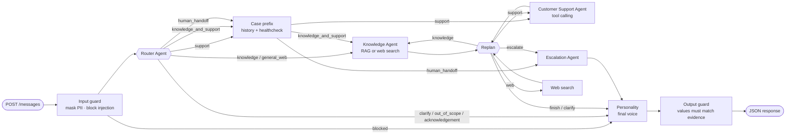

# Getnet Merchant Assistant — Multi-Agent Support System

A multi-agent assistant that answers Getnet merchants over a single HTTP endpoint. A **Router** decides who handles
each message; a **Knowledge Agent** answers from Getnet's official website (RAG) or the web; a **Customer Support
Agent** uses tools over the merchant's (synthetic) account data; an **Escalation Agent** hands the case to a human;
and a **Personality** step writes every final reply in one consistent voice. Built for the *AI Hardcore Engineer —
Multi-Agent Support System* challenge.

```bash
cp .env.example .env          # add your OPENAI_API_KEY
docker compose up --build
TOKEN=$(curl -s localhost:8000/v1/auth/token -d grant_type=password -d username=cliente1988 \
  -d password=cliente1988-fictitious -d client_id=merchant-assistant-cli | python -c "import sys,json;print(json.load(sys.stdin)['access_token'])")
curl -s localhost:8000/messages -H "Authorization: Bearer $TOKEN" -H 'content-type: application/json' \
  -d '{"message": "When will the money from yesterday'"'"'s sales be deposited?"}'
```

Since v0.7.0 `POST /messages` requires a token: the merchant comes from the token, not from the body. The user and password above are fictitious demo values from `.env.example`.

**Status:** v0.8.0, validated by independent reviews and a real-model QA ([pre-holdout](docs/evidence/v080-d12-pre-holdout-r6.md), [holdout](docs/evidence/v080-holdout-r7.md)); the [human calibration](docs/evidence/v080-calibracao.md) of the judge is done (24 answers: agreement within one point 0.83–1.00, the judge stricter than the owner). Offline, the backend strict suite passes (**1,997 tests**, Ruff clean). Against real models, the four replanning scenarios pass 3/3 each with at most 2 hops, the business journeys pass **13/13, 12/13 and 12/13** in three repetitions (13/13 each by the independent judge), the multi-turn conversations **4/4**, and the Docker smoke 10/10. The sealed v0.8.0 holdout, run once and reported separately, scored **62/75**. The v0.8.0 QA campaign spent **US$0.84** of its US$1.40 cap. The v0.7.0 human-in-the-loop story is [validated](docs/evidence/v070-resultado.md) and unchanged.

### Where each part of the challenge lives

| Challenge item | Section | Code |
| --- | --- | --- |
| Three or more cooperating agents and how they communicate | [Architecture](#architecture), [Message workflow](#message-workflow) | `orchestration/graph.py`, `orchestration/state.py` |
| Router as entry point and workflow manager | [Architecture](#architecture) | `agents/router.py`, `prompts/router.v6.md` |
| Knowledge Agent: RAG over Getnet's site plus web search | [RAG pipeline](#rag-pipeline) | `rag/`, `agents/knowledge.py` |
| Customer Support Agent with tools | [Support tools and data](#support-tools-and-synthetic-data) | `tools/`, `agents/support.py` |
| HTTP endpoint with a JSON body | [Run it](#run-it), [Message workflow](#message-workflow) | `api/app.py`, `api/schemas.py` |
| Docker | [Run it](#run-it) | `Dockerfile`, `docker-compose.yml` |
| Testing strategy | [Testing and evaluation](#testing-and-evaluation) | `tests/`, `evaluation/` |
| Prompts and use of LLM tools | [How the LLM tools are used](#how-the-llm-tools-are-used) | `prompts/`, `llm/` |
| Bonus: human escalation agent, guardrails, handoff, evaluation and observability | [Guardrails and reliability](#guardrails-and-reliability), [Observability](#observability), [Testing and evaluation](#testing-and-evaluation) | `agents/escalation.py`, `guardrails/`, `observability/` |

Code paths are shortened from `src/merchant_assistant/`; `prompts/`, `tests/`, `Dockerfile` and `docker-compose.yml` are at the repository root. Features built beyond the challenge (an interface, model profiles, an alternative Router engine, a versioned knowledge base, MCP) are described in [Beyond the challenge](#beyond-the-challenge).

---

## Contents

1. [Run it](#run-it) · 2. [Configuration](#configuration) · 3. [Architecture](#architecture) ·
4. [Message workflow](#message-workflow) · 5. [RAG pipeline](#rag-pipeline) · 6. [Support tools and data](#support-tools-and-synthetic-data) ·
7. [How the LLM tools are used](#how-the-llm-tools-are-used) · 8. [Guardrails and reliability](#guardrails-and-reliability) ·
9. [Observability](#observability) · 10. [Testing and evaluation](#testing-and-evaluation) · 11. [Design decisions](#design-decisions) ·
12. [Beyond the challenge](#beyond-the-challenge) · 13. [Limitations and next steps](#limitations-and-next-steps) · 14. [Repository layout](#repository-layout)

---

## Run it

### With Docker (recommended)

Requirements: Docker with Compose v2 and an OpenAI API key.

```bash
cp .env.example .env               # set OPENAI_API_KEY; nothing else is required
docker compose up --build          # API on http://localhost:8000, ticketing on http://127.0.0.1:8002, plus Qdrant and mocks
```

On first start the container seeds the synthetic data (dates relative to *today*) and builds the vector index from
the versioned snapshots (about 37k embedding tokens, ≈ US$0.001). Later starts reuse the index. Startup to healthy:
about 20 s.

Try it (two calls: a token, then the message):

```bash
TOKEN=$(docker compose exec -T api merchant-assistant auth token --url http://localhost:8000)   # cliente1988, demo password
curl -s localhost:8000/messages -H "Authorization: Bearer $TOKEN" -H 'content-type: application/json' \
  -d '{"message": "My card machine won'"'"'t connect to the internet, what should I do?"}'
```

Useful endpoints:

| Endpoint | Purpose |
| --- | --- |
| `POST /v1/auth/token` | OAuth 2.0 token (form encoded): `grant_type=password` for the demo users, `client_credentials` for the ticketing service; returns a JWT (RS256) |
| `POST /messages` | The assistant. Header `Authorization: Bearer <token>`. Body: `{"message": "...", "conversation_id": "conv_..." (optional), "user_id": "..." (optional; must match the token, otherwise `403 identity_mismatch`)}` |
| `GET /health`, `GET /ready` | Liveness; readiness reports index size, database and remaining budget |
| `GET /traces/{request_id}` | Step-by-step trace with a token: merchants see only their own (demo mode, on by default in compose) |
| `GET /.well-known/jwks.json` | Public keys that validate the tokens |
| `GET /docs` | OpenAPI UI with the 10 challenge examples preloaded |

Run the 10 challenge examples against the running API (≈ US$0.03); the command gets the token itself:

```bash
docker compose exec api merchant-assistant smoke --url http://localhost:8000
```

Stop and clean: `docker compose down` (add `-v` to drop the index, traces and budget ledger).

The optional interface, the `/v1` API and the MCP server are described in [Beyond the challenge](#beyond-the-challenge).

### Locally (development)

```bash
uv venv .venv -p 3.13 && uv pip install -e ".[ingest,dev]"   # or: python -m venv .venv && pip install -e ".[ingest,dev]"
merchant-assistant bootstrap                                  # seed data + build the index (embedded Qdrant)
uvicorn --factory merchant_assistant.main:create_application --reload
merchant-assistant ask "Qual a cotação do euro hoje?" --trace  # one message, in process, with its trace
```

### Tests and evaluation

```bash
pytest                                   # backend tests; use tools/scripts/lint_and_tests.py --strict for strict validation
ruff check .
merchant-assistant eval --scripted       # end-to-end evaluation offline (wiring only, zero cost)
merchant-assistant eval --judge          # real evaluation; paid, check the current budget before running
merchant-assistant eval --judge --include-replan --split dev --limit 5 --no-conversations --name v080-cost-sample  # five-case cost sample
merchant-assistant eval-estimate --from docs/evidence/v080-cost-sample.json --out docs/evidence/v080-cost-estimate.json  # D12 estimate; no model call
merchant-assistant eval --campaign v080-qa --include-replan --judge --repeat 3 --split all  # fixed QA cap + installation ledger
merchant-assistant eval --campaign v080-qa --judge-repeat 3 --answers-from docs/evidence/v080-all.json --name v080-all-judge  # judge variation; the agent does not run
merchant-assistant eval --campaign v080-qa --judge --repeat 3 --split holdout_v080  # sealed holdout: once, as the last technical step
merchant-assistant eval-calibrate --sample 24 --from docs/evidence/v080-all-r3.json   # CSV for the owner to rate, without the judge's scores; no model call
merchant-assistant eval-calibrate --import docs/evidence/v080-calibracao-amostra.csv  # human × judge agreement and kappa; no model call
merchant-assistant eval-retrieval        # Recall@k of the RAG index (≈ US$0.001)
merchant-assistant ingest                # re-collect the official pages into snapshots (network)
```

`eval --judge` uses the independent judge (`JUDGE_PROVIDER`, `JUDGE_MODEL`). `--repeat 3` measures the variation of the assistant (the judge grades each answer once); `--judge-repeat 3 --answers-from` measures the variation of the judge over recorded answers. `--campaign v080-qa` mounts its fixed cap once (US$0.50; US$1.00 or US$1.10 with `--campaign-estimate` and a verified `eval-estimate`). That campaign is already mounted at US$1.40 after the approved contingency: `--campaign-cap-usd 1.40 --campaign-estimate docs/evidence/v080-custo-estimativa-r3.json` only continues it and never mounts a new one.

The seed dates the synthetic sales relative to the day it ran ("yesterday" is the day before the seeding). A paid QA run must run `merchant-assistant bootstrap` (or a container start, which seeds) on the same local day, or the date-dependent cases are invalid.

## Configuration

All settings come from environment variables (or `.env`). Defaults are safe for a reviewer's own key.

| Variable | Default | Meaning |
| --- | --- | --- |
| `OPENAI_API_KEY` | — | Required for real calls (agents, embeddings, web search) |
| `AGENT_MODEL` | `gpt-6-luna` | Default model for every agent; the `/v1` model profiles can set another model per agent |
| `EMBEDDING_MODEL` | `text-embedding-3-small` | RAG embeddings |
| `QDRANT_URL` | empty (embedded store) | Compose sets `http://qdrant:6333` |
| `BUDGET_RUNTIME_DIR` | `data/runtime` locally, `/app/runtime` in Docker | Persistent budget ledgers; keep this pointed at the project budget volume when `RUNTIME_DIR` is isolated for a QA run |
| `MOCKS_URL` | `http://mocks:8001` | Internal synthetic pricing and charge service; Compose only |
| `BUDGET_LIMIT_USD` | `1.00` | Hard cap for all paid calls of this installation (persistent ledger). Accepted range 0–5.00 (absolute project ceiling); the first limit recorded beside a ledger (`budget.sqlite3.limit`, native 1.00 for a ledger that predates it) can never be raised by a later value |
| `MAX_REQUEST_COST_USD` | `0.05` | Cap per request |
| `MAX_MODEL_CALLS`, `MAX_TOOL_CALLS`, `MAX_REQUEST_SECONDS` | `8`, `8`, `90` | Per-request limits |
| `WEB_SEARCH_MAX_CALLS` | `1` | Searches per general question |
| `DEMO_MODE` | `false` (`true` in compose) | Enables `GET /traces/{id}` |
| `TIMEZONE` | `America/Sao_Paulo` | Used to resolve "yesterday", "today" |
| `DEMO_SESSION_MESSAGE_LIMIT` | `20` | Paid actions one demo session may start: messages, new comparison executions, Router comparisons and AI evaluations; refusals and skipped comparison cells without a model call do not count (they are given back); enforced by the backend |
| `EVALUATOR_PROVIDER`, `EVALUATOR_MODEL` | `openai`, `gpt-6-luna` | Fixed on-demand evaluator, independent of the evaluated profile and recorded with every evaluation |
| `JUDGE_PROVIDER`, `JUDGE_MODEL` | `deepseek`, `deepseek-flash` | Independent judge for `eval --judge`; the default requires `DEEPSEEK_API_KEY` and must differ from the agent model |
| `DEMO_USER_PASSWORDS` | fictitious values in `.env.example` | `user:password` pairs of the synthetic users (`cliente1988`, `cliente_demo_002`, operators `op_ana`, `op_bruno`); stored as PBKDF2 hashes |
| `API_DEMO_PASSWORD`, `API_ADMIN_PASSWORD` | empty (off) | Passwords of the `demo` and `admin` users of the `/v1` interface |
| `JWT_ISSUER`, `JWT_PRIVATE_KEY_PATH`, `JWT_JWKS_URL` | own issuer, key generated in the runtime | Token issuer; `JWT_JWKS_URL` switches verification to an external OIDC issuer |
| `RATE_LIMIT_PER_MINUTE` | `30` | Requests per principal |
| `TICKETING_WEBHOOK_URL`, `CONVERSATION_WEBHOOK_URL` and their secrets | Compose values | Signed webhooks to the ticketing service and to the merchant receiver; an empty URL turns a destination off; a URL without a secret is warned at startup |
| `WEBHOOK_MAX_ATTEMPTS`, `WEBHOOK_RETRY_WAITS_S`, `WEBHOOK_TIMEOUT_S` | `3`, `1,2`, `3` | Delivery attempts (total per event and destination, also across restarts) |

`DEEPSEEK_API_KEY` is required for the default `eval --judge` evaluator and optional for the DeepSeek model profiles (Hybrid: Router; Adjusted: Router and Support). `TYPESAFE_API_KEY` enables the alternative Router engine; neither key is needed for `POST /messages`. Every secret in `.env.example` is a fictitious demo value named as such; the API warns at startup when one of them is in use. The web app signs in with a user and password and never receives a provider key.

## Architecture



This is the workflow from the challenge diagram (Router → specialists with tools → **Personality** → output), with
the "custom agent" slot filled by the Escalation Agent. After each Knowledge, web-search or Support result, the
replanner can finish, call a different specialist, search the web, escalate or ask a clarifying question. Clear cases
are decided by rules; `replan.v2` is reserved for ambiguous decisions, and at most three plan changes are allowed.
The reported route remains the Router's initial plan; the trace records the path that actually ran.

| Component | Kind | Responsibility |
| --- | --- | --- |
| Router Agent | LLM, structured output | Picks one of the 8 routes below, the language, the support topic and a safety label |
| Knowledge Agent | LLM + RAG / web search | Answers from retrieved official passages (with citations) or one web search; gives the official procedure on combined routes |
| Customer Support Agent | LLM + function calling | Looks up the merchant's data with 9 tools (plus 2 run by code at case opening) and explains it; asks to choose when needed; flags escalation |
| Replanner | Rules + LLM on ambiguity | Reviews specialist evidence after each step and selects the next action within a three-hop limit |
| Escalation Agent | LLM + persistence | Writes the handover summary, opens an idempotent case with an `HO-` protocol and pauses the graph until an operator acts on the ticket ([human in the loop](#identity-and-human-in-the-loop-v070)) |
| Personality | LLM | Turns the agents' structured contributions into one reply, in the merchant's language, without changing facts |
| Input / output guards, case prefix | Deterministic code | Masking and injection blocking; history + healthcheck at case opening; evidence check of values |

**Communication mechanism.** A LangGraph `StateGraph` over a typed Pydantic state. Agents are plain functions that
read the state and return updates (direct calls, no queue). The Router's decision is validated by code and then
applied by conditional edges. A per-request context (passed through the graph config) carries the model client,
tools, budget meter, limits and the trace recorder.

**Routes.**

| Route | When | Path |
| --- | --- | --- |
| `knowledge` | Product and service questions (Get Smart vs Clássica, Pix, antecipação, crediário, Payment Link) | Knowledge (RAG, official pages only) |
| `general_web` | Harmless general questions (weather, exchange rate) | Knowledge (one web search) |
| `support` | Needs the merchant's own data (yesterday's sales) | Prefix → Support |
| `knowledge_and_support` | A problem with an official procedure *and* account data (machine offline, declined sale) | Prefix → Knowledge (procedure) → Support |
| `human_handoff` | Merchant asks for a person | Prefix → Escalation |
| `clarify` | Too vague | Personality asks one question |
| `out_of_scope` | Unsafe, sensitive or injection | Personality declines and says what it can do |
| `acknowledgement` | Reaction to the previous reply with no new request ("it works now", "thanks") | Personality; case state updated |

## Message workflow

Example: *"When will the money from yesterday's sales be deposited?"* (`cliente1988`).

1. **Input guard** masks card numbers (Luhn), CPF/CNPJ, e-mails and credentials, and blocks clear prompt-injection
   patterns before any model call.
2. **Router** returns `{"route": "support", "topic": "receivables", "language": "en", "safety": "none", ...}`.
3. **Case prefix** (no model): `get_complaint_history` and `run_customer_healthcheck` for the topic, once per case.
4. **Customer Support** calls `get_receivables_schedule(period="yesterday")`, then
   `get_payout_status([...ids])`, and returns structured points.
5. **Personality** writes the reply; the **output guard** checks that every amount and date appears in the tool
   results.

```json
{
  "answer": "Yesterday's sales have different payment dates: R$ 80,00 from Pix was credited on October 25, 2026; R$ 148,06 from debit is expected today, October 26, 2026; and R$ 1.162,20 from credit is expected on October 27, 2026. The debit and credit payouts are scheduled, but their credits have not yet been confirmed in your account.",
  "status": "answered",
  "route": "support",
  "agents": ["router", "customer_support", "personality"],
  "language": "en",
  "sources": [
    {"type": "tool", "title": "Receivables schedule (your account)", "observed_at": "..."},
    {"type": "tool", "title": "Payout status (your account)", "observed_at": "..."}
  ],
  "request_id": "req_...",
  "conversation_id": "conv_...",
  "resolution": {"state": "awaiting_customer", "evidence": null},
  "handoff": null
}
```

`status` is one of `answered`, `needs_clarification`, `handoff`, `refused`. `resolution` is separate from the
request status: answering does not close the case. Handoffs add `{"protocol": "HO-…", "reason": "..."}`; replies also carry `via` (`agent`, or `operator` for a human reply).

## Conversations and case follow-up

Since v0.2.0 a conversation carries memory and a case state.

- **Ownership.** `conversation_id` belongs to the merchant that started it; another merchant's token gets
  `404 conversation_not_found`. Without an id, the server creates one and returns it.
- **History.** The last turns (up to 10 messages / 1,200 tokens, masked) go to the Router, Customer Support and
  Personality as data, so "I already did that" is understood in context.
- **Case state.** `in_progress` → `awaiting_customer` after each reply → `resolved` only with evidence
  (`customer_confirmed` when the merchant says it works, or `tool_verified` when a tool shows it) → or `handoff`.
  "Thanks" alone never resolves. The state is returned in `resolution`.
- **Technical follow-up.** Each suggested step is recorded per cycle with the merchant's feedback; steps are never
  repeated; after two failed cycles (or on request) the case goes to a human with the attempts. A case already with
  a human keeps one protocol.
- **Prefix reuse.** History and healthcheck run once per case and topic, refreshed after 30 minutes or when the
  topic changes.

```bash
curl -s localhost:8000/messages -H "Authorization: Bearer $TOKEN" -H 'content-type: application/json' \
  -d '{"message": "Já fiz isso e continua sem conexão", "conversation_id": "conv_..."}'
```

## RAG pipeline

**Ingestion → storage → retrieval → generation.**

1. **Sources.** [`data/sources/public-sources.json`](data/sources/public-sources.json): 32 official pages verified
   by hand on 2026-10-26: `https://www.getnet.net/en/` (required) plus the Brazilian site pages behind the challenge
   examples (card machines, Pix, crediário, Payment Link, antecipação, Wi-Fi setup, machine errors, sales status,
   FAQ). `robots.txt` allows all of them.
2. **Collection** (`merchant-assistant ingest`, explicit, never at startup). HTTP fetch with an identified user
   agent and 1 s delay; extraction with trafilatura and BeautifulSoup, keeping the richer result; removal of
   repeated site boilerplate; pages with too little text fail loudly. Two pages are built by JavaScript (the card
   machine catalogue and the rates table); their rendered text was captured in a browser and is versioned in
   `data/snapshots/public/rendered/`.
3. **Snapshots.** Every page is stored as JSON in `data/snapshots/public/pages/` (URL, title, collection date,
   capture method, content hash, text). The index is always rebuilt from these files, so Docker builds and
   evaluations never depend on the live site.
4. **Demo corpus.** Eight synthetic operating procedures (`data/knowledge-demo/`, `source_kind =
   simulated_internal`) describe how the demo back-ends behave (for example, documented decline codes). They are
   cited as demo procedures, never as official Getnet rules.
5. **Chunking.** Section-aware (Markdown headings or paragraphs), ~1,200 characters with overlap; each chunk keeps
   its title, URL, source kind, collection date and hash. 40 documents → 145 chunks.
6. **Storage.** Qdrant (service in compose, embedded locally, in-memory in tests), `text-embedding-3-small`. The
   index manifest records model, corpus hash and size; bootstrap builds the index only when its collection does not exist and never rebuilds or replaces an existing one (a new knowledge base version is always a new collection, created through the admin API).
7. **Retrieval.** Top-6 by cosine similarity with a minimum score and a source-kind filter (official pages only for
   product questions; official + demo procedures for problems).
8. **Generation.** Numbered passages go to the Knowledge Agent, which must answer only from them, list the passages
   it used and set `evidence_sufficient = false` when they do not cover the question. Citations are built by code
   from the passage numbers.

**Retrieval quality** (14 questions, the 7 knowledge examples in English and Portuguese): Recall@6 = 1.00 and
MRR = 1.00 in both languages. English questions retrieve Portuguese content directly, so no query translation is
used ([evidence](docs/evidence/2026-10-26-pipeline-rag.md)).

## Support tools and synthetic data

The Support Agent has nine tools, plus two used by code at case opening.

| Tool | Arguments from the model | Returns |
| --- | --- | --- |
| `get_receivables_schedule` | `period` (yesterday, today, last/next 7 days) or dates; filter by sale or payment date | Net/gross amounts, fees, expected payment dates, original and normalized status |
| `get_payout_status` | `receivable_ids` | Payout stage and whether the credit is confirmed |
| `get_device_status` | `device_id` (optional) | Model, connectivity, status, last signal; asks to choose when there are several |
| `find_authorization_events` | `period`, `status`, `limit` (no transaction id needed) | Declines with documented reason and next step; unknown codes stay unknown |
| `get_contract_snapshot` | — | Products, settlement account type and plan |
| `simulate_pricing` | `period`, `payment_type`, `installments`, `sale_date` (optional filters) | Independent pricing rule and charge evidence, compared in integer cents |
| `get_fee_breakdown` | Same bounded sale filters | Read-only recorded charge components |
| `get_enablement_requests` | `scheme` (optional) | Existing protocol, request/activation status and device availability |
| `get_sale_cancellation_context` | `period` | Existing sale cancellation status; no action is executed |
| `get_complaint_history` *(prefix)* | `topic` | Previous cases and attempts |
| `run_customer_healthcheck` *(prefix)* | `topic` | Predefined checks: ok, pending, attention, unknown, unavailable |

- **Customer binding.** The customer comes from the request context (`user_id`), never from model arguments; no tool
  schema contains a customer field. Asking for another merchant's resource returns `FORBIDDEN_RESOURCE`, no data,
  and an audit record. `user_id` identifies a demo scenario and does not prove identity; in production it would come
  from authentication.
- **Synthetic data** (SQLite, seeded at startup): `cliente1988` has three sales from *yesterday* (debit, credit, Pix),
  a Get Smart that went offline three hours ago, a declined transaction today and a previous Wi-Fi case;
  `cliente_demo_002` exists to test isolation. All dates are relative to the clock, so "yesterday" always works.
  Tests use a fixed clock (2026-10-26). Unknown `user_id`s can still ask product questions.
- **Status vocabulary.** Original status names are preserved and mapped by a versioned glossary (for example
  `LOT_DONE` = batch processed, *not* money in the account). The agent only says a credit is confirmed when the
  payout tool says so.
- **Pricing services.** Compose runs an internal `mocks` HTTP service with separate versioned pricing and charge
  fixtures. The app selects sales from the bound merchant's synthetic records; no tool accepts a customer ID or
  requires a sale ID from the merchant. Comparisons require matching customer, transaction, currency, conditions
  and internally consistent component/instalment totals. The four outcomes are consistent, different conditions,
  divergence and insufficient evidence. All values and rules are fictional.
- **Read-only journeys.** A pending card-scheme request reuses its protocol; account activation and device
  availability remain separate facts. Sale cancellation is a lookup. Contract termination goes to an attendant and
  does not call sale tools. No financial, enablement, cancellation or contract action is executed.

## How the LLM tools are used

All calls go through one provider-agnostic interface (OpenAI Responses API in production, a scripted model in
tests), with `store=false`:

- **Structured outputs** (`responses.parse` with Pydantic models) for the Router decision, Knowledge drafts,
  Support results, Escalation summaries and the Personality reply. Invalid outputs fall back to safe paths.
- **Function calling** for the Support Agent: a loop that executes the tools the model requests (several per turn
  when it asks), returns results as `function_call_output`, enforces the per-request tool limit and ends with a
  structured answer.
- **Built-in web search** for general questions, capped at one search per question; sources come from the answer's
  citations or from the search call itself.
- **Reasoning effort** is `none` for Router, Escalation and Personality and `low` for the specialists, to keep cost
  and latency down.
- **Prompts** are versioned files in [`prompts/`](prompts/) (`id` + `version`), and every trace records which
  version ran.
- **Prompt design.** Each prompt states the agent's role and what it may use (routes with examples, tools, numbered
  passages), injects the current date and the case facts the code already checked, lists the rules it must never
  break (no refund promises, no internal IDs asked from the merchant, no gaps filled from outside knowledge) and ends
  in a typed output schema. Retrieved passages, tool results and history are marked as data, not instructions.

## Guardrails and reliability

| Risk | Control |
| --- | --- |
| Sensitive data in messages | Masked before any model call, log or web query (cards with Luhn check, CPF, CNPJ, e-mail, credentials) |
| Prompt injection | Pattern block at input; Router safety label forces `out_of_scope`; retrieved text and tool results are framed as data |
| Unsafe or off-topic requests | Declined with what the assistant *can* do; harmless general questions go to web search |
| Hallucinated values | Output guard: every amount, date and percentage in the reply must appear in this request's evidence (tool results, retrieved passages, web answer). Offending sentences are dropped or a deterministic reply is used |
| Missing evidence | "I couldn't find this in the official sources", never a guess; status stays honest |
| Cross-customer access | Server-side binding, `FORBIDDEN_RESOURCE`, audit log |
| Dependency failure | Every agent catches provider, limit and budget errors; failed tools escalate; human handoff works even if all tools fail |
| Runaway cost or loops | Per-request limits (model calls, tool calls, time, cost) and a persistent installation budget with atomic reservations before each paid call; unknown prices block the call |
| Duplicate handoffs | Idempotency key per conversation, message and reason |

## Observability

- **Structured JSON logs** on stdout: one line per step and per request (`request_id`, route, agents, tools,
  duration, tokens, cost, model, errors). Message text is not logged.
- **Traces** in SQLite (`runtime/traces.sqlite3`): every node and tool call with duration, status, prompt version,
  retrieval hits and guard results. `GET /traces/{request_id}` in demo mode.
- **Budget ledger** (`runtime/budget.sqlite3`): every paid call with reserved and actual cost; `/ready` shows what
  is left.
- **Production next steps:** export the same spans to OpenTelemetry/Langfuse, dashboards for route mix, handoff
  rate, guard blocks, p95 latency and cost per resolved case, and alerts on error rate, budget burn and retrieval
  score drift.

## Testing and evaluation

**Strategy.**

| Level | What | Cost |
| --- | --- | --- |
| Unit | Tools (binding, filters, dates, errors), clock and seed, chunking, guards, pricing, budget atomicity, Router rules | 0 |
| Contract | API schemas and error body, agent output schemas, tool schemas without customer fields | 0 |
| Integration (deterministic) | Full graph through HTTP with a **scripted model**, hashing embedder, in-memory Qdrant, seeded data and fixed clock: the 10 examples, Portuguese variants, refusal, injection, masking, handoff idempotency, tool and index failures, unknown user, limits, output guard, traces; multi-turn conversations, ownership, case states, two technical cycles; MCP through an in-process client | 0 |
| Release validation (real) | The 40 labeled cases and 4 multi-turn conversations against real models on each release candidate, inside a fixed campaign budget; see the [v0.6.0 result](docs/evidence/v060-resultado.md) | Paid and capped (v0.6.0 QA: US$0.088) |
| Retrieval | Recall@k and MRR on labeled questions | ≈ US$0.001 |
| Docker smoke | Clean build, startup, 10 examples over HTTP | ≈ US$0.03 |

The scripted model follows simple rules for each agent, so the whole system (routing, tool execution, guards,
persistence, tracing) runs without network. It checks the wiring, not answer quality; quality comes from the real
evaluation.

**Validated v0.6.0 evidence:** the strict suites pass (backend **349 tests**, web **42 tests**, Ruff clean). The real-model
regression on the release candidate passed the 10 challenge examples and the 17 core cases (**27/27**) and the 4
multi-turn conversations (**4/4**). Business journeys passed 7/13 under the literal rubric: four pricing cases used
different wording with the right tool, values and status, and one English pricing-conditions question went to
`clarify`. Retrieval: Recall@6 = 1.00 and MRR = 1.00 on 14 labeled questions. The
[v0.6.0 result](docs/evidence/v060-resultado.md) links the independent review and QA reports.

## Design decisions

Recorded as ADRs (in Portuguese) in [`docs/architecture/decisions/`](docs/architecture/decisions/):

- **Python 3.13 + FastAPI + Pydantic v2** for strict contracts and OpenAPI out of the box.
- **LangGraph with typed state** so every request follows an explicit, testable path; agents stay plain functions,
  so the framework is confined to one module.
- **Qdrant + versioned snapshots**: reproducible builds and evaluations independent of the live site.
- **Synthetic data in SQLite, tools as domain functions**: testable without network; one place enforces customer
  isolation. The MCP server (v0.2.0) exposes the same functions.
- **OpenAI baseline with a persistent budget guard**: a reviewer needs only one key; spending is capped before it
  happens.

Other choices: a deterministic case prefix (history + healthcheck) instead of letting the model decide; Personality
as a separate, guarded step (from the challenge diagram) so tone changes cannot alter facts; answers in the
merchant's language while code, prompts and this README are in English.

## Beyond the challenge

Later increments built on the same core (graph, agents, tools and guards), each with its own specification, independent review and QA. None of them is needed to evaluate the challenge: `POST /messages` works without them.

| Version | Added | Why |
| --- | --- | --- |
| v0.2.0 | [Conversations and case follow-up](#conversations-and-case-follow-up); MCP server | Multi-turn continuity; the same tools for external agents |
| v0.3.0 | Read-only journeys: pricing disputes with an independent pricing service, card-scheme enablement, sale-cancellation status | The questions where a wrong answer becomes a financial promise |
| v0.4.0 | Authenticated `/v1` API, per-agent model profiles (Reference: all `gpt-6-luna`; Hybrid: Router on DeepSeek; Adjusted: Router and Support on DeepSeek), per-request Router engine (LLM or TypeSafe JEV), Streamlit interface | Controlled configuration and comparison; the same validated Router contract for every engine |
| v0.5.0 | Versioned knowledge base: draft, candidate collection, test, activation and rollback by an administrator | Documentation changes are tested before they apply and can be undone |
| v0.6.0 | Interface with Attendance, Results and Administration; labeled scenarios; deterministic checks and on-demand model evaluation of stored replies; small profile comparison | A demonstrable, auditable closing of the case |
| v0.7.0 | JWT identity with scopes checked on every tool call; real human in the loop: the graph pauses on a handoff, a separate ticketing service and its operator screen work the ticket, and the operator's action resumes the graph | The merchant comes from a verified token, and a human answer reaches the merchant in the same conversation |
| v0.8.0 | Replanning after each specialist (rules first, model on ambiguity, three-hop budget, origin in the trace); four-criterion `judge.v3` by an independent judge, repeated runs and a human calibration sample; sealed v0.8.0 holdout | The assistant reacts to what a specialist returned, and answer quality is measured semantically, not only by literal labels |

### Identity and human in the loop (v0.7.0)

**Two breaking changes.** `POST /messages` requires `Authorization: Bearer <token>` (the merchant comes from the token; a different `user_id` in the body gets `403 identity_mismatch`), and `POST /v1/sessions` / `DELETE /v1/sessions/current` were replaced by `POST /v1/auth/token` and `POST /v1/auth/revoke`. The evaluator's two calls are in [Run it](#run-it); `merchant-assistant smoke` and `merchant-assistant auth token` get the token themselves.

- **Identity** ([ADR 0017](docs/architecture/decisions/0017-identidade-principal-escopos.md)). The assistant issues RS256 JWTs (own issuer, JWKS and discovery; an external OIDC issuer is a configuration change). Roles `merchant`, `operator`, `service`, `demo` and `admin` carry scopes; every tool call checks scope and merchant and writes an audit row with principal, scope and result. Tokens can be revoked; requests are rate-limited per principal and login attempts are limited.
- **Pause and resume** ([ADR 0018](docs/architecture/decisions/0018-interrupcao-retomada-webhooks.md)). When the Escalation agent opens a case, the end-of-turn state goes to a review graph checkpointed in SQLite that stops at `human_review` with LangGraph `interrupt()`; the attendance path without a handoff reads no checkpoint. An operator's `approve`, `reply` or `reject` resumes it with `Command(resume)`: approve and reply go to Personality, reject re-runs Support once with the operator's instruction. The reply is a turn marked `via=operator`, delivered on the merchant's next message (route `human_reply`, no model call), in `GET /v1/conversations/{id}` and by webhook. It survives an API restart.
- **Queue.** States `open → claimed → answered | rejected → closed`; claim and actions are idempotent (`idempotency_key`), a second resume gets `409 already_resumed`, another operator's claim `409 claimed_by_other`. API (`GET /v1/handoffs`, `POST /v1/handoffs/{id}/claim`, `POST /v1/handoffs/{id}/actions`), CLI (`merchant-assistant operator list|show|act`) and the ticketing service go through the same service.
- **Ticketing service.** A separate service in Compose (own database, published on `127.0.0.1:8002`), with the ticket cycle `new → open → pending → solved` and an operator screen in the web project. It talks to the assistant only through signed webhooks in both directions (HMAC-SHA256 over `timestamp.body`, 300 s window, one secret per direction) and a `client_credentials` token. Incoming events are idempotent by id and a repeated refused event gets the original `409`/`422` back.
- **Durable delivery.** Each outgoing event and destination is written to an outbox (migration 0010) in the same transaction as the change it reports; a dispatcher delivers it with up to three attempts in total, recorded and visible in the case, and recovers pending deliveries when the API starts.

### Demonstration API (v0.6.0)

These additive `/v1` routes back the Streamlit interface:

| Route | Role | Behaviour |
| --- | --- | --- |
| `GET /v1/scenarios` | demo, admin | Short catalog of labeled synthetic scenarios (`data/scenarios/catalog.json`) |
| `POST /v1/messages` + `scenario_id` | demo, admin | Optional; validated against the catalog (message must match) and stored in the run; demo sessions limited by `DEMO_SESSION_MESSAGE_LIMIT` (`429 demo_message_limit_reached`) |
| `GET /v1/runs/{id}` | owner | Adds `steps` (with retrieved passages), `route`, `prompts_used`, deterministic `checks` (scenario labels or label-independent, critical failures listed one by one) and `evaluations` |
| `POST /v1/runs/{id}/evaluations/estimate` | owner | Price of one `judge` call over the persisted reply; no paid call |
| `POST /v1/runs/{id}/evaluations` | owner | Confirmed estimate required; reserves, grades the stored reply with the fixed evaluator and records method, rubric, evaluator, evidence and a separate cost; same configuration returns the existing record unless `repeat=true` |
| `POST /v1/comparisons/estimate` | demo, admin | 2–3 published profiles × up to 3 scenarios × up to 2 repetitions: cells, reused recorded runs, new executions, fixed factors, exploratory flag and an upper-bound estimate |
| `POST /v1/comparisons` | demo, admin | Confirmed estimate required; `202` and execution in a thread of the API process with one knowledge-base version, domain effects in a temporary copy of the synthetic database and traces/snapshots marked `purpose=comparison` |
| `GET /v1/comparisons/{id}` | owner | State, configuration, cells, failures and aggregates for the cost × quality and cost-by-agent/model charts |

Migration 0008 (reversible) adds `run_evaluations`, `comparisons` and `api_sessions.message_count`. Legacy `POST /messages`, MCP and the existing `/v1` behaviour are unchanged. In Compose the API is published only on `127.0.0.1:8000`.

### Streamlit interface

The separate `ai-getnet-case-web` sibling project (see its README) is a Streamlit client of the versioned `/v1` API and, for operators, of the ticketing service. It never reads backend files or receives provider keys. Use **Simulado** or **Gravado** for fixture-only behavior, or select **Real (API)** and sign in with a user and password of that backend: merchants and demo see Attendance and Results, operators see Ticketing, admin also sees Administration. The client reuses one HTTP client per Streamlit session, revokes the token and clears the previous user's state at logout, and sends requests only after explicit actions.

```powershell
# In the web project, with its own Python environment:
python -m pip install -e ".[test]"
$env:BACKEND_API_URL = "http://localhost:8000"
streamlit run app.py
```

For a no-key local HTTP exercise, use the synthetic backend harness with a new runtime directory under `.pytest_cache`, then point `BACKEND_API_URL` to that loopback server. The harness has programmed providers, a fresh isolated SQLite/Qdrant runtime, and no provider credentials; it is not a production configuration. Detailed commands are in the [developer passage](docs/evidence/v040-developer-r1.md).

### MCP server

The Customer Support tools are also available over [MCP](https://modelcontextprotocol.io) (stdio), on top of the
same domain functions, validation, customer isolation, audit log and structured errors. The merchant comes from the
token in `MERCHANT_ASSISTANT_TOKEN`, checked again on every call, never from a tool argument.

```bash
export MERCHANT_ASSISTANT_TOKEN=$(merchant-assistant auth token)   # cliente1988 against a running API
merchant-assistant mcp                            # stdio server (for an MCP client such as Claude Desktop)
merchant-assistant mcp-demo                       # starts the server as a subprocess and calls it as a client
```

The demo lists the support tools, reads yesterday's receivables and recent declines, and shows that a receivable of
another merchant returns `is_error=true` with `FORBIDDEN_RESOURCE`. Example client configuration:

```json
{"mcpServers": {"getnet-merchant-support": {"command": "merchant-assistant", "args": ["mcp"], "env": {"MERCHANT_ASSISTANT_TOKEN": "<token>"}}}}
```

## Limitations and next steps

- The ticketing service is the project's own (Zendesk/Freshdesk-style contract); a commercial ticketing system would be a mapping and configuration change. A delivery that exhausts its three attempts, or that the receiver refuses, has no automatic or manual resend yet and holds the later events of the same case and destination. If the API dies in the middle of the turn that opens a case, the case is completed when the merchant sends the same message again; otherwise it stays open without a ticket. The case does not show the ticket id yet (task 68b). The cross-process locks were exercised on Windows only.
- Business journeys are measured by a literal rubric: real runs bring correct paraphrases it refuses (v0.8.0 passed 13/13, 12/13 and 12/13; the judge 13/13 each). The handoff sentence and the journey labels were fixed in v0.8.0. The judge does not see the web search text, so `general_web` answers score lower and vary more. The human calibration of the judge is pending, and the v0.8.0 holdout has been seen once.
- Snapshots fix the site content of 2026-10-26; JavaScript-rendered pages need a browser capture to refresh.
- Troubleshooting steps are identified by the model's short label; informational answers wait for the merchant's
  confirmation before a case is resolved.
- v0.6.0 closes the functional scope (ADR 0015): no Evaluation Agent, no improvement-proposal workflow and no experiment platform. Model evaluation is an on-demand judge over persisted replies and is not human review.
- Profile comparisons are small and run in a thread of the API process; restarting the API marks a running comparison as failed. The comparison estimate is an upper bound (request cost cap per new execution).
- The Results area lists the runs of the current browser session; there is no general run listing.
- Public sharing depends on the owner's router, firewall and the absence of CGNAT; a tunnel is a documented alternative.
- Sale cancellation is read-only: the assistant reports the status of an existing request; asking it to cancel a
  new sale is not covered.
- Identity uses the assistant's own issuer and synthetic demo users; there is no authorization-code flow, refresh token or external OIDC provider running in the demo.

## Repository layout

```text
src/merchant_assistant/
  api/            FastAPI app and the public contract
  orchestration/  graph, typed state, run context (limits, metering), budget guard
  agents/         router, knowledge, support, escalation, personality
  guardrails/     input masking/injection, output evidence check
  rag/            collection, documents, chunking, embeddings, index
  tools/          domain tools, registry and allowlists
  data/           clock, SQLite schema, seed, status glossary
  llm/            provider interface, OpenAI client, scripted model, prompts, prices
  evaluation/     retrieval and end-to-end evaluation, scripted policy
  observability/  JSON logging, traces
prompts/          versioned prompts (router, knowledge_*, support, escalation, personality, judge)
data/             sources, snapshots, demo corpus (runtime/ is generated and ignored)
tests/            unit, integration, labeled scenarios
docs/             specification, plan, tasks, ADRs, evidence (Portuguese, spec-driven workflow)
```

The project follows a spec-driven workflow from the ai-dev-template (agent roles, skills and validation scripts in
`skills/`, `docs/wiki/agents/` and `tools/scripts/`). The specification is
[docs/specs/assistente-multiagente-lojista.md](docs/specs/assistente-multiagente-lojista.md).

All merchant data in this repository is synthetic. Public content was collected from Getnet's website for retrieval
and is cited with its URL.
