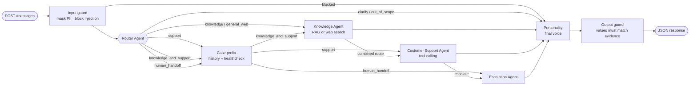

# Getnet Merchant Assistant — Multi-Agent Support System

A multi-agent assistant that answers Getnet merchants over a single HTTP endpoint. A **Router** decides who handles
each message; a **Knowledge Agent** answers from Getnet's official website (RAG) or the web; a **Customer Support
Agent** uses tools over the merchant's (synthetic) account data; an **Escalation Agent** hands the case to a human;
and a **Personality** step writes every final reply in one consistent voice. Built for the *AI Hardcore Engineer —
Multi-Agent Support System* challenge.

```bash
cp .env.example .env          # add your OPENAI_API_KEY
docker compose up --build
curl -s localhost:8000/messages -H 'content-type: application/json' \
  -d '{"message": "When will the money from yesterday'"'"'s sales be deposited?", "user_id": "cliente1988"}'
```

**Status:** version 0.2.0 ([changelog](CHANGELOG.md)): the core delivery plus conversation memory, case states,
technical follow-up and an MCP server. 141 offline tests; the 10 challenge examples, 17 held-out cases and 4
multi-turn conversations pass the automated checks against the real model
([regression report](docs/evidence/2026-10-26-regressao-v020.md)). Total API spend so far: US$0.45 of a US$5
project budget. Next versions are planned in the [increments spec](docs/specs/incrementos-pos-nucleo.md).

---

## Contents

1. [Run it](#run-it) · 2. [Configuration](#configuration) · 3. [Architecture](#architecture) ·
4. [Message workflow](#message-workflow) · 5. [RAG pipeline](#rag-pipeline) · 6. [Support tools and data](#support-tools-and-synthetic-data) ·
7. [How the LLM tools are used](#how-the-llm-tools-are-used) · 8. [Guardrails and reliability](#guardrails-and-reliability) ·
9. [Observability](#observability) · 10. [Testing and evaluation](#testing-and-evaluation) · 11. [Design decisions](#design-decisions) ·
12. [Limitations and next steps](#limitations-and-next-steps) · 13. [Repository layout](#repository-layout)

---

## Run it

### With Docker (recommended)

Requirements: Docker with Compose v2 and an OpenAI API key.

```bash
cp .env.example .env               # set OPENAI_API_KEY; nothing else is required
docker compose up --build          # API on http://localhost:8000, Qdrant as a second service
```

On first start the container seeds the synthetic data (dates relative to *today*) and builds the vector index from
the versioned snapshots (about 37k embedding tokens, ≈ US$0.001). Later starts reuse the index. Startup to healthy:
about 20 s.

Try it:

```bash
curl -s localhost:8000/messages -H 'content-type: application/json' \
  -d '{"message": "My card machine won'"'"'t connect to the internet, what should I do?", "user_id": "cliente1988"}'
```

Useful endpoints:

| Endpoint | Purpose |
| --- | --- |
| `POST /messages` | The assistant. Body: `{"message": "...", "user_id": "...", "conversation_id": "conv_..." (optional)}` |
| `GET /health`, `GET /ready` | Liveness; readiness reports index size, database and remaining budget |
| `GET /traces/{request_id}` | Step-by-step trace (demo mode only, on by default in compose) |
| `GET /docs` | OpenAPI UI with the 10 challenge examples preloaded |

Run the 10 challenge examples against the running API (≈ US$0.03):

```bash
docker compose exec api merchant-assistant smoke --url http://localhost:8000
```

Stop and clean: `docker compose down` (add `-v` to drop the index, traces and budget ledger).

### Locally (development)

```bash
uv venv .venv -p 3.13 && uv pip install -e ".[ingest,dev]"   # or: python -m venv .venv && pip install -e ".[ingest,dev]"
merchant-assistant bootstrap                                  # seed data + build the index (embedded Qdrant)
uvicorn --factory merchant_assistant.main:create_application --reload
merchant-assistant ask "Qual a cotação do euro hoje?" --trace  # one message, in process, with its trace
```

### MCP server

The Customer Support tools are also available over [MCP](https://modelcontextprotocol.io) (stdio), on top of the
same domain functions, validation, customer isolation, audit log and structured errors. The merchant is fixed when
the server starts, never passed as a tool argument.

```bash
merchant-assistant mcp --customer cliente1988     # stdio server (for an MCP client such as Claude Desktop)
merchant-assistant mcp-demo                       # starts the server as a subprocess and calls it as a client
```

The demo lists the five tools, reads yesterday's receivables and recent declines, and shows that a receivable of
another merchant returns `is_error=true` with `FORBIDDEN_RESOURCE`. Example client configuration:

```json
{"mcpServers": {"getnet-merchant-support": {"command": "merchant-assistant", "args": ["mcp", "--customer", "cliente1988"]}}}
```

### Tests and evaluation

```bash
pytest                                   # 141 tests, no network, no cost (scripted model + hashing embedder)
ruff check .
merchant-assistant eval --scripted       # end-to-end evaluation offline (wiring only, zero cost)
merchant-assistant eval --judge          # real evaluation of the 27 labeled cases (≈ US$0.05)
merchant-assistant eval-retrieval        # Recall@k of the RAG index (≈ US$0.001)
merchant-assistant ingest                # re-collect the official pages into snapshots (network)
```

## Configuration

All settings come from environment variables (or `.env`). Defaults are safe for a reviewer's own key.

| Variable | Default | Meaning |
| --- | --- | --- |
| `OPENAI_API_KEY` | — | Required for real calls (agents, embeddings, web search) |
| `AGENT_MODEL` | `gpt-6-luna` | Model used by all agents |
| `EMBEDDING_MODEL` | `text-embedding-3-small` | RAG embeddings |
| `QDRANT_URL` | empty (embedded store) | Compose sets `http://qdrant:6333` |
| `BUDGET_LIMIT_USD` | `1.00` | Hard cap for all paid calls of this installation (persistent ledger) |
| `MAX_REQUEST_COST_USD` | `0.05` | Cap per request |
| `MAX_MODEL_CALLS`, `MAX_TOOL_CALLS`, `MAX_REQUEST_SECONDS` | `8`, `8`, `90` | Per-request limits |
| `WEB_SEARCH_MAX_CALLS` | `1` | Searches per general question |
| `DEMO_MODE` | `false` (`true` in compose) | Enables `GET /traces/{id}` |
| `TIMEZONE` | `America/Sao_Paulo` | Used to resolve "yesterday", "today" |

`TYPESAFE_API_KEY` and `DEEPSEEK_API_KEY` are optional and unused by the core (planned router comparison).

## Architecture



This is the workflow from the challenge diagram (Router → specialists with tools → **Personality** → output), with
the "custom agent" slot filled by the Escalation Agent.

| Component | Kind | Responsibility |
| --- | --- | --- |
| Router Agent | LLM, structured output | Picks one of 7 routes, the language, the support topic and a safety label |
| Knowledge Agent | LLM + RAG / web search | Answers from retrieved official passages (with citations) or one web search; gives the official procedure on combined routes |
| Customer Support Agent | LLM + function calling | Looks up the merchant's data with 5 tools and explains it; asks to choose when needed; flags escalation |
| Escalation Agent | LLM + persistence | Writes the handover summary and stores an idempotent, clearly simulated case with a protocol |
| Personality | LLM | Turns the agents' structured contributions into one reply, in the merchant's language, without changing facts |
| Input / output guards, case prefix | Deterministic code | Masking and injection blocking; history + healthcheck at case opening; evidence check of values |

**Communication mechanism.** A LangGraph `StateGraph` over a typed Pydantic state. Agents are plain functions that
read the state and return updates (direct calls, no queue). The Router's decision is validated by code and then
applied by conditional edges. A per-request context (passed through the graph config) carries the model client,
tools, budget meter, limits and the trace recorder.

**Routes.**

| Route | When | Path |
| --- | --- | --- |
| `knowledge` | Product and service questions (Get Smart vs Clássica, Pix, antecipação, crediário, Payment Link) | Knowledge (RAG, official pages only) |
| `general_web` | Harmless general questions (weather, exchange rate) | Knowledge (one web search) |
| `support` | Needs the merchant's own data (yesterday's sales) | Prefix → Support |
| `knowledge_and_support` | A problem with an official procedure *and* account data (machine offline, declined sale) | Prefix → Knowledge (procedure) → Support |
| `human_handoff` | Merchant asks for a person | Prefix → Escalation |
| `clarify` | Too vague | Personality asks one question |
| `out_of_scope` | Unsafe, sensitive or injection | Personality declines and says what it can do |
| `acknowledgement` | Reaction to the previous reply with no new request ("it works now", "thanks") | Personality; case state updated |

## Message workflow

Example: *"When will the money from yesterday's sales be deposited?"* (`cliente1988`).

1. **Input guard** masks card numbers (Luhn), CPF/CNPJ, e-mails and credentials, and blocks clear prompt-injection
   patterns before any model call.
2. **Router** returns `{"route": "support", "topic": "receivables", "language": "en", "safety": "none", ...}`.
3. **Case prefix** (no model): `get_complaint_history` and `run_customer_healthcheck` for the topic, once per case.
4. **Customer Support** calls `get_receivables_schedule(period="yesterday")`, then
   `get_payout_status([...ids])`, and returns structured points.
5. **Personality** writes the reply; the **output guard** checks that every amount and date appears in the tool
   results.

```json
{
  "answer": "Yesterday's sales have different payment dates: R$ 80,00 from Pix was credited on October 25, 2026; R$ 148,06 from debit is expected today, October 26, 2026; and R$ 1.162,20 from credit is expected on October 27, 2026. The debit and credit payouts are scheduled, but their credits have not yet been confirmed in your account.",
  "status": "answered",
  "route": "support",
  "agents": ["router", "customer_support", "personality"],
  "language": "en",
  "sources": [
    {"type": "tool", "title": "Receivables schedule (your account)", "observed_at": "..."},
    {"type": "tool", "title": "Payout status (your account)", "observed_at": "..."}
  ],
  "request_id": "req_...",
  "conversation_id": "conv_...",
  "resolution": {"state": "awaiting_customer", "evidence": null},
  "handoff": null
}
```

`status` is one of `answered`, `needs_clarification`, `handoff`, `refused`. `resolution` is separate from the
request status: answering does not close the case. Handoffs add `{"protocol": "SIM-…", "simulated": true}`.

## Conversations and case follow-up

Since v0.2.0 a conversation carries memory and a case state.

- **Ownership.** `conversation_id` belongs to the merchant that started it; another `user_id` gets
  `404 conversation_not_found`. Without an id, the server creates one and returns it.
- **History.** The last turns (up to 10 messages / 1,200 tokens, masked) go to the Router, Customer Support and
  Personality as data, so "I already did that" is understood in context.
- **Case state.** `in_progress` → `awaiting_customer` after each reply → `resolved` only with evidence
  (`customer_confirmed` when the merchant says it works, or `tool_verified` when a tool shows it) → or `handoff`.
  "Thanks" alone never resolves. The state is returned in `resolution`.
- **Technical follow-up.** Each suggested step is recorded per cycle with the merchant's feedback; steps are never
  repeated; after two failed cycles (or on request) the case goes to a human with the attempts. A case already with
  a human keeps one protocol.
- **Prefix reuse.** History and healthcheck run once per case and topic, refreshed after 30 minutes or when the
  topic changes.

```bash
curl -s localhost:8000/messages -H 'content-type: application/json' \
  -d '{"message": "Já fiz isso e continua sem conexão", "user_id": "cliente1988", "conversation_id": "conv_..."}'
```

## RAG pipeline

**Ingestion → storage → retrieval → generation.**

1. **Sources.** [`data/sources/public-sources.json`](data/sources/public-sources.json): 32 official pages verified
   by hand on 2026-10-26: `https://www.getnet.net/en/` (required) plus the Brazilian site pages behind the challenge
   examples (card machines, Pix, crediário, Payment Link, antecipação, Wi-Fi setup, machine errors, sales status,
   FAQ). `robots.txt` allows all of them.
2. **Collection** (`merchant-assistant ingest`, explicit, never at startup). HTTP fetch with an identified user
   agent and 1 s delay; extraction with trafilatura and BeautifulSoup, keeping the richer result; removal of
   repeated site boilerplate; pages with too little text fail loudly. Two pages are built by JavaScript (the card
   machine catalogue and the rates table); their rendered text was captured in a browser and is versioned in
   `data/snapshots/public/rendered/`.
3. **Snapshots.** Every page is stored as JSON in `data/snapshots/public/pages/` (URL, title, collection date,
   capture method, content hash, text). The index is always rebuilt from these files, so Docker builds and
   evaluations never depend on the live site.
4. **Demo corpus.** Eight synthetic operating procedures (`data/knowledge-demo/`, `source_kind =
   simulated_internal`) describe how the demo back-ends behave (for example, documented decline codes). They are
   cited as demo procedures, never as official Getnet rules.
5. **Chunking.** Section-aware (Markdown headings or paragraphs), ~1,200 characters with overlap; each chunk keeps
   its title, URL, source kind, collection date and hash. 40 documents → 145 chunks.
6. **Storage.** Qdrant (service in compose, embedded locally, in-memory in tests), `text-embedding-3-small`. The
   index manifest records model, corpus hash and size; bootstrap rebuilds only when they change.
7. **Retrieval.** Top-6 by cosine similarity with a minimum score and a source-kind filter (official pages only for
   product questions; official + demo procedures for problems).
8. **Generation.** Numbered passages go to the Knowledge Agent, which must answer only from them, list the passages
   it used and set `evidence_sufficient = false` when they do not cover the question. Citations are built by code
   from the passage numbers.

**Retrieval quality** (14 questions, the 7 knowledge examples in English and Portuguese): Recall@6 = 1.00 and
MRR = 1.00 in both languages. English questions retrieve Portuguese content directly, so no query translation is
used ([evidence](docs/evidence/2026-10-26-pipeline-rag.md)).

## Support tools and synthetic data

The challenge asks for at least two tools; the Support Agent has five, plus two used by code at case opening.

| Tool | Arguments from the model | Returns |
| --- | --- | --- |
| `get_receivables_schedule` | `period` (yesterday, today, last/next 7 days) or dates; filter by sale or payment date | Net/gross amounts, fees, expected payment dates, original and normalized status |
| `get_payout_status` | `receivable_ids` | Payout stage and whether the credit is confirmed |
| `get_device_status` | `device_id` (optional) | Model, connectivity, status, last signal; asks to choose when there are several |
| `find_authorization_events` | `period`, `status`, `limit` (no transaction id needed) | Declines with documented reason and next step; unknown codes stay unknown |
| `get_contract_snapshot` | — | Products, settlement account type and plan |
| `get_complaint_history` *(prefix)* | `topic` | Previous cases and attempts |
| `run_customer_healthcheck` *(prefix)* | `topic` | Predefined checks: ok, pending, attention, unknown, unavailable |

- **Customer binding.** The customer comes from the request context (`user_id`), never from model arguments; no tool
  schema contains a customer field. Asking for another merchant's resource returns `FORBIDDEN_RESOURCE`, no data,
  and an audit record. `user_id` identifies a demo scenario and does not prove identity; in production it would come
  from authentication.
- **Synthetic data** (SQLite, seeded at startup): `cliente1988` has three sales from *yesterday* (debit, credit, Pix),
  a Get Smart that went offline three hours ago, a declined transaction today and a previous Wi-Fi case;
  `cliente_demo_002` exists to test isolation. All dates are relative to the clock, so "yesterday" always works.
  Tests use a fixed clock (2026-10-26). Unknown `user_id`s can still ask product questions.
- **Status vocabulary.** Original status names are preserved and mapped by a versioned glossary (for example
  `LOT_DONE` = batch processed, *not* money in the account). The agent only says a credit is confirmed when the
  payout tool says so.

## How the LLM tools are used

All calls go through one provider-agnostic interface (OpenAI Responses API in production, a scripted model in
tests), with `store=false`:

- **Structured outputs** (`responses.parse` with Pydantic models) for the Router decision, Knowledge drafts,
  Support results, Escalation summaries and the Personality reply. Invalid outputs fall back to safe paths.
- **Function calling** for the Support Agent: a loop that executes the tools the model requests (several per turn
  when it asks), returns results as `function_call_output`, enforces the per-request tool limit and ends with a
  structured answer.
- **Built-in web search** for general questions, capped at one search per question; sources come from the answer's
  citations or from the search call itself.
- **Reasoning effort** is `none` for Router, Escalation and Personality and `low` for the specialists, to keep cost
  and latency down.
- **Prompts** are versioned files in [`prompts/`](prompts/) (`id` + `version`), and every trace records which
  version ran.

## Guardrails and reliability

| Risk | Control |
| --- | --- |
| Sensitive data in messages | Masked before any model call, log or web query (cards with Luhn check, CPF, CNPJ, e-mail, credentials) |
| Prompt injection | Pattern block at input; Router safety label forces `out_of_scope`; retrieved text and tool results are framed as data |
| Unsafe or off-topic requests | Declined with what the assistant *can* do; harmless general questions go to web search |
| Hallucinated values | Output guard: every amount, date and percentage in the reply must appear in this request's evidence (tool results, retrieved passages, web answer). Offending sentences are dropped or a deterministic reply is used |
| Missing evidence | "I couldn't find this in the official sources", never a guess; status stays honest |
| Cross-customer access | Server-side binding, `FORBIDDEN_RESOURCE`, audit log |
| Dependency failure | Every agent catches provider, limit and budget errors; failed tools escalate; human handoff works even if all tools fail |
| Runaway cost or loops | Per-request limits (model calls, tool calls, time, cost) and a persistent installation budget with atomic reservations before each paid call; unknown prices block the call |
| Duplicate handoffs | Idempotency key per conversation, message and reason |

## Observability

- **Structured JSON logs** on stdout: one line per step and per request (`request_id`, route, agents, tools,
  duration, tokens, cost, model, errors). Message text is not logged.
- **Traces** in SQLite (`runtime/traces.sqlite3`): every node and tool call with duration, status, prompt version,
  retrieval hits and guard results. `GET /traces/{request_id}` in demo mode.
- **Budget ledger** (`runtime/budget.sqlite3`): every paid call with reserved and actual cost; `/ready` shows what
  is left.
- **Production next steps:** export the same spans to OpenTelemetry/Langfuse, dashboards for route mix, handoff
  rate, guard blocks, p95 latency and cost per resolved case, and alerts on error rate, budget burn and retrieval
  score drift.

## Testing and evaluation

**Strategy.**

| Level | What | Cost |
| --- | --- | --- |
| Unit | Tools (binding, filters, dates, errors), clock and seed, chunking, guards, pricing, budget atomicity, Router rules | 0 |
| Contract | API schemas and error body, agent output schemas, tool schemas without customer fields | 0 |
| Integration (deterministic) | Full graph through HTTP with a **scripted model**, hashing embedder, in-memory Qdrant, seeded data and fixed clock: the 10 examples, Portuguese variants, refusal, injection, masking, handoff idempotency, tool and index failures, unknown user, limits, output guard, traces; multi-turn conversations, ownership, case states, two technical cycles; MCP through an in-process client | 0 |
| Evaluation (real) | 27 labeled scenarios and 4 multi-turn conversations through the real system: route, status, language, expected tools, required values, required/forbidden content, sources, guard violations, latency, cost, plus a model-graded rubric | ≈ US$0.05 |
| Retrieval | Recall@k and MRR on labeled questions | ≈ US$0.001 |
| Docker smoke | Clean build, startup, 10 examples over HTTP | ≈ US$0.03 |

The scripted model follows simple rules for each agent, so the whole system (routing, tool execution, guards,
persistence, tracing) runs without network. It checks the wiring, not answer quality; quality comes from the real
evaluation.

**Latest real evaluation** ([report](docs/evidence/2026-10-26-avaliacao-nucleo.md), [analysis of the three runs](docs/evidence/2026-10-26-avaliacao-analise.md)):

| Split | Cases | Passed all checks |
| --- | --- | --- |
| Challenge examples (dev, English) | 10 | 10 |
| Held-out (Portuguese variants + 7 edge cases) | 17 | 17 |
| **Total** | **27** | **27** |

Latency p50 7.8 s and p95 15.7 s per request (sequential model calls); cost US$0.051 for the 27 cases.

Model-graded rubric (1–5, not a human review): answers the question 4.48, clarity and tone 4.70, honesty 4.22.
The analysis explains run-to-run variance (one earlier run passed 25/27), the prompt changes it led to, and the
judge's limitations.

## Design decisions

Recorded as ADRs (in Portuguese) in [`docs/architecture/decisions/`](docs/architecture/decisions/):

- **Python 3.13 + FastAPI + Pydantic v2** for strict contracts and OpenAPI out of the box.
- **LangGraph with typed state** so every request follows an explicit, testable path; agents stay plain functions,
  so the framework is confined to one module.
- **Qdrant + versioned snapshots**: reproducible builds and evaluations independent of the live site.
- **Synthetic data in SQLite, tools as domain functions**: testable without network; one place enforces customer
  isolation. The MCP server (v0.2.0) exposes the same functions.
- **OpenAI baseline with a persistent budget guard**: a reviewer needs only one key; spending is capped before it
  happens.

Other choices: a deterministic case prefix (history + healthcheck) instead of letting the model decide; Personality
as a separate, guarded step (from the challenge diagram) so tone changes cannot alter facts; answers in the
merchant's language while code, prompts and this README are in English.

## Limitations and next steps

- The handoff is simulated (local record and protocol); no real ticketing integration.
- Snapshots fix the site content of 2026-10-26; JavaScript-rendered pages need a browser capture to refresh.
- Troubleshooting steps are identified by the model's short label; informational answers wait for the merchant's
  confirmation before a case is resolved.
- Planned ([increments spec](docs/specs/incrementos-pos-nucleo.md)): v0.3.0 pricing/contestation, card-brand
  enablement and sale cancellation over synthetic back-ends; v0.4.0 the Jev Router toggle, per-agent models and the
  Streamlit interface; v0.5.0–v0.7.0 knowledge-base versions, per-step evaluation with supervised improvement,
  experiments and sharing.
- `user_id` is not authentication. Production would bind it to an authenticated session and authorize every tool
  call against it.

## Repository layout

```text
src/merchant_assistant/
  api/            FastAPI app and the public contract
  orchestration/  graph, typed state, run context (limits, metering), budget guard
  agents/         router, knowledge, support, escalation, personality
  guardrails/     input masking/injection, output evidence check
  rag/            collection, documents, chunking, embeddings, index
  tools/          domain tools, registry and allowlists
  data/           clock, SQLite schema, seed, status glossary
  llm/            provider interface, OpenAI client, scripted model, prompts, prices
  evaluation/     retrieval and end-to-end evaluation, scripted policy
  observability/  JSON logging, traces
prompts/          versioned prompts (router, knowledge_*, support, escalation, personality, judge)
data/             sources, snapshots, demo corpus (runtime/ is generated and ignored)
tests/            unit, integration, labeled scenarios
docs/             specification, plan, tasks, ADRs, evidence (Portuguese, spec-driven workflow)
```

The project follows a spec-driven workflow from the ai-dev-template (agent roles, skills and validation scripts in
`skills/`, `docs/wiki/agents/` and `tools/scripts/`). The specification is
[docs/specs/assistente-multiagente-lojista.md](docs/specs/assistente-multiagente-lojista.md).

All merchant data in this repository is synthetic. Public content was collected from Getnet's website for retrieval
and is cited with its URL.
