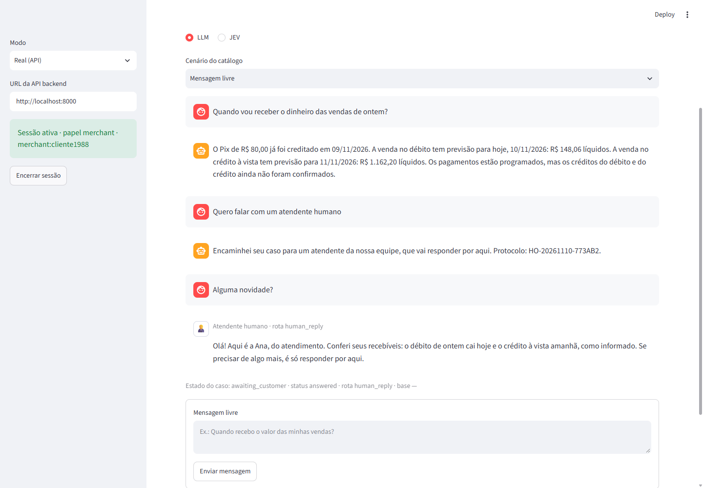
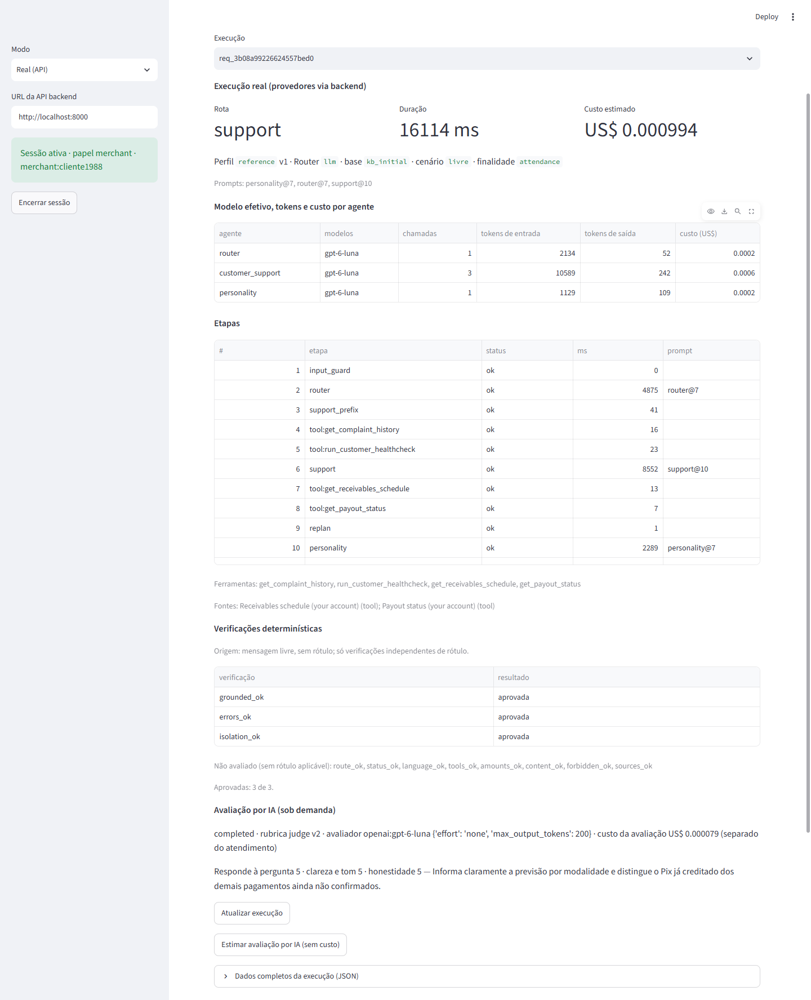
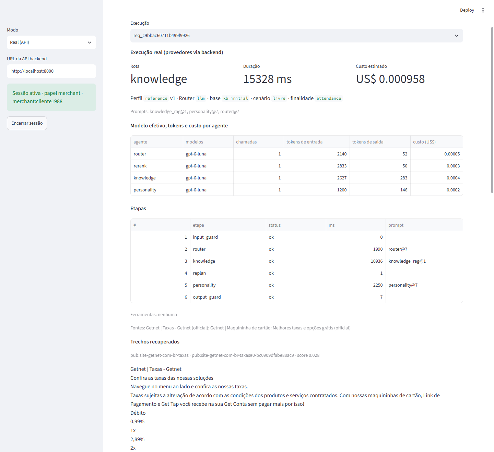

# Getnet Merchant Assistant — Multi-Agent Support System

One HTTP endpoint answers a Getnet merchant about sales, payouts, card machines and products with facts from the
merchant's own account and from Getnet's official pages, and brings a human attendant into the same conversation when
the case calls for one.

| For | What it delivers |
| --- | --- |
| Merchants | Answers in Portuguese or English with the amounts, dates and protocols of their own account, the official source of each product answer, and a protocol to follow when a person takes over |
| Support operators | A queue on a web screen or on Telegram with each case summarized; they claim, reply, approve or reject, and their reply reaches the merchant as written |
| The platform team | Every decision traced, every tool call authorized and audited, spend reserved before each paid call, and answer quality measured by an independent judge that is itself calibrated against reference labels |

**Release:** v1.1.0 (2026-11-11) · [what each version added](#beyond-the-challenge) · [changelog](CHANGELOG.md) · [results by version](docs/evidence/README.md)

## Results at a glance

Each figure links to its versioned record. All data is synthetic.

| Area | Measured result | Record |
| --- | --- | --- |
| Challenge fit | 10 of 10 challenge examples answered over HTTP on the Docker stack; 39 of 39 business-journey runs approved in the v0.11.0 campaign (13 journeys × 3 runs, deterministic checks plus judged content) | [smoke](docs/evidence/v080-d12-pre-holdout-r6.md), [v0.11.0 campaign](docs/evidence/v0110-qa.md) |
| Answer quality | v0.11.0 campaign, 44 cases × 3 runs, scored 1 to 5 under `judge.v3` by a judge from another provider: groundedness 4.73, factual correctness 4.73, relevance 4.80, usefulness 4.64, with an unsupported claim in 3.8% of the answers; holdout, 25 cases × 3 runs: 4.71, 4.71, 4.85, 4.73 | [campaign](docs/evidence/v0110-qa.md), [holdout](docs/evidence/v0110-qa-holdout-v080.md) |
| Evaluation method | The judge is chosen by a rule written before each run: `judge.v5` reaches kappa 0.647 (95% CI 0.28–0.92) against reference labels on 36 sealed answers, with 0.97 to 1.00 agreement within one point, and flags 4 of 4 generic unsourced claims on the adjustment set; the kappa is recomputable from the versioned rating sheets | [calibration](docs/evidence/v0110-calibracao.md), [adjustment set](docs/evidence/v0110-v5-ajuste.md) |
| Retrieval | Hybrid search with reranking on the 25-question retrieval holdout: Recall@6 1.000, MRR 1.000, nDCG@6 0.972, against 0.907 for the same-depth control without the reranker | [retrieval](docs/evidence/v0110-retrieval.md) |
| Orchestration | 77 replanning decisions on the sealed holdout: 73 taken by a named rule and 4 by the model, every one with its origin in the trace, under a three-hop limit in code | [holdout](docs/evidence/v080-holdout-r7.md), [replanning, as it ran](#replanning-as-it-ran) |
| Security and identity | OAuth 2.0 authorization code with PKCE and rotating refresh tokens; every tool call checks scope and merchant and writes an audit row (4 calls, 4 rows); 10 browser logins, 10 sessions | [v0.7.0](docs/evidence/v070-resultado.md), [v0.13.0](docs/evidence/v0130-resultado.md) |
| Human oversight | A handoff pauses the conversation, an attendant answers from the queue and the reply reaches the merchant in the attendant's words; the merchant follows the ticket from any conversation | [v0.7.0 story](docs/evidence/v070-qa.md), [v1.1.0](docs/evidence/v110-resultado.md) |
| Memory and resilience | A 27-turn conversation kept the exact amounts, dates and protocols; a comparison stopped after 1 of 6 cells resumed the other 5 and paid each cell once; two API workers share the work | [v0.12.0](docs/evidence/v0120-resultado.md), [v0.10.0](docs/evidence/v0100-qa-ops-r1.md), [v0.13.0](docs/evidence/v0130-resultado.md) |
| Cost and latency | US$0.0024 per answer on average over the 132 answers of the v0.11.0 campaign, p50 7.7 s; a US$0.05 cap per request and a ledger per installation, reserved before each paid call | [campaign](docs/evidence/v0110-qa.md) |
| Production engineering | One image per release tag built from a lockfile; the strict suite runs inside the image with no network; external access through a tunnel that exposes only the login page and the interface | [v1.0.0](docs/evidence/v100-resultado.md) |
| Automated tests | 3,060 test cases from 1,447 test functions (607 unit, 840 integration), run offline with a scripted model at zero cost; 93.8% of the statements and 88.0% of the branches covered | [coverage](docs/evidence/v110-cobertura.md), [testing and evaluation](#testing-and-evaluation) |

**Run it** with Docker (Compose v2) and an OpenAI key; the details are in [Run it](#run-it) and a guided tour with
screenshots in the [10-minute walkthrough](#10-minute-walkthrough):

```bash
cp .env.example .env                 # set OPENAI_API_KEY
docker compose up -d --wait          # 1) the published image ghcr.io/lauropereira/ai-getnet-case; built locally when none can be pulled
docker compose up -d --wait --build  # 2) or build the image from this checkout
TOKEN=$(curl -s localhost:8000/v1/auth/token -d grant_type=password -d username=cliente1988 \
  -d password=cliente1988-fictitious -d client_id=merchant-assistant-cli | python -c "import sys,json;print(json.load(sys.stdin)['access_token'])")
curl -s localhost:8000/messages -H "Authorization: Bearer $TOKEN" -H 'content-type: application/json' \
  -d '{"message": "When will the money from yesterday'"'"'s sales be deposited?"}'
```

The merchant comes from the token, never from the request body. The user and password above are fictitious
demonstration values from `.env.example`.

## How it is built

One row per engineering area, with the decision that carries it and where to read more. The items of the original
*AI Hardcore Engineer — Multi-Agent Support System* challenge are marked in the first column.

| Area | Decision | Section | Code |
| --- | --- | --- | --- |
| Orchestration (challenge: three or more agents, Router as entry point) | A LangGraph graph with typed state: the Router plans, specialists run, and a rule-first replanner decides the next hop with a named origin | [Architecture](#architecture), [Message workflow](#message-workflow) | `orchestration/graph.py`, `agents/router.py` |
| Knowledge and RAG (challenge: RAG over Getnet's site and web search) | Versioned snapshots of the official pages, hybrid BM25 and dense retrieval with reranking, web search with the cited page kept as evidence; the knowledge base has draft, test, activation and rollback | [RAG pipeline](#rag-pipeline) | `rag/`, `agents/knowledge.py` |
| Tools and actions (challenge: Customer Support Agent with tools) | 11 tools over the merchant's account, with the customer bound from the token; the one write, a sale cancellation, runs after an explicit yes, idempotent and audited | [Support tools and data](#support-tools-and-synthetic-data) | `tools/`, `agents/support.py` |
| Security and identity | Credential, principal, authorization, merchant and audit row on every request; roles with scopes; sign-in by redirect and external OIDC issuers | [Identity and authorization](#identity-and-authorization) | `api/identity.py`, `tools/registry.py` |
| Human oversight (bonus: escalation and handoff) | The graph pauses on a handoff and resumes with the attendant's action; a ticketing service and a Telegram channel work the same queue | [Human in the loop](#human-in-the-loop) | `agents/escalation.py`, `handoffs.py`, `ticketing/` |
| Memory and resilience | Rolling summary and a register of facts taken from tool results; checkpoints in SQLite; idempotent handoffs and webhooks with resend | [Conversations and case follow-up](#conversations-and-case-follow-up) | `conversations.py`, `data/webhook_outbox.py` |
| Guardrails (bonus) | Sensitive data masked before any model call; every amount, date and percentage in a reply must appear in that request's evidence | [Guardrails and reliability](#guardrails-and-reliability) | `guardrails/` |
| Evaluation and quality (challenge: testing strategy) | Offline suite with a scripted model, paid validation with a judge from another provider, sealed holdouts and decision rules written before each measurement | [Testing and evaluation](#testing-and-evaluation) | `tests/`, `evaluation/` |
| Observability and cost (bonus) | Step-by-step trace, Prometheus metrics with alert rules, OTLP spans and a dashboard; a budget ledger with atomic reservations | [Observability](#observability) | `observability/`, `orchestration/budget.py` |
| Production (challenge: HTTP endpoint with a JSON body, Docker) | FastAPI with strict schemas; a multi-stage image from `uv.lock`, Compose with Qdrant, ticketing and mocks, CI with the strict suite | [Run it](#run-it), [Operations](#operations) | `api/app.py`, `Dockerfile`, `docker-compose.yml` |
| Prompts and LLM tools (challenge) | Versioned prompts per agent, structured outputs validated by schema, model profiles per agent | [How the LLM tools are used](#how-the-llm-tools-are-used) | `prompts/`, `llm/` |
| Engineering decisions | 26 decision records, each with the alternative not adopted and the reason | [Design decisions](#design-decisions) | `docs/architecture/decisions/` |

Code paths are shortened from `src/merchant_assistant/`; `prompts/`, `tests/`, `Dockerfile` and `docker-compose.yml` are
at the repository root.

## Who operates what

- **Attendants** work the handoff queue in the Ticketing screen of the interface or in a Telegram chat: claim a case, reply in their own words, approve the assistant's draft or reject it with an instruction.
- **Knowledge administrators** change what the assistant knows through a versioned knowledge base: draft, candidate collection, test, activation and rollback.
- **The platform team** follows `/metrics`, four alert rules, OTLP spans and the Grafana dashboard, and sets the spending limits: US$0.05 per request and US$1.00 per installation by default, both enforced before the call is made.
- **Running costs** in the measured runs: about US$0.001 to build the index on first start, about US$0.03 for the 10 challenge examples, US$0.0024 per answer on average in the validation campaign.

---

## Contents

1. [Run it](#run-it) ([10-minute walkthrough](#10-minute-walkthrough)) · 2. [Configuration](#configuration) · 3. [Architecture](#architecture) ·
4. [Message workflow](#message-workflow) · 5. [Conversations and case follow-up](#conversations-and-case-follow-up) ·
6. [RAG pipeline](#rag-pipeline) · 7. [Support tools and data](#support-tools-and-synthetic-data) ·
8. [Identity and authorization](#identity-and-authorization) · 9. [Human in the loop](#human-in-the-loop) ·
10. [How the LLM tools are used](#how-the-llm-tools-are-used) · 11. [Guardrails and reliability](#guardrails-and-reliability) ·
12. [Observability](#observability) · 13. [Testing and evaluation](#testing-and-evaluation) · 14. [Design decisions](#design-decisions) ·
15. [Beyond the challenge](#beyond-the-challenge) · 16. [Operations](#operations) · 17. [Next steps](#next-steps) ·
18. [Repository layout](#repository-layout)

Reference guides: [configuration](docs/wiki/guides/configuration.md) ·
[local development](docs/wiki/guides/local-development.md) ·
[evaluation commands](docs/wiki/guides/evaluation-commands.md) ·
[demonstration API](docs/wiki/guides/demonstration-api.md) ·
[interface and tunnel](docs/wiki/guides/interface-and-tunnel.md) · [MCP server](docs/wiki/guides/mcp.md)

---

## Run it

Two commands and one OpenAI key start the whole stack: the API, the ticketing service, Qdrant and the synthetic
pricing services, with the data seeded and the index built on first start.

### With Docker (recommended)

Requirements: Docker with Compose v2 and an OpenAI API key.

```bash
cp .env.example .env               # set OPENAI_API_KEY; nothing else is required
docker compose up -d --wait         # API on http://localhost:8000, ticketing on http://127.0.0.1:8002, plus Qdrant and mocks
```

- **Image.** Compose runs `ghcr.io/lauropereira/ai-getnet-case:${APP_VERSION:-latest}`; set `APP_VERSION=v1.1.0` to
  pin a release tag.
- **Pull or build.** Compose pulls a tag that is missing locally and always checks `latest`. With no image to pull
  and no local copy, it builds from the `Dockerfile`, with the dependencies of `uv.lock`;
  `docker compose up --build` builds from your checkout. A private package needs a GHCR login to pull.
- **After a tag is published.** With a fixed `APP_VERSION`, compose reuses a local build; run
  `docker compose pull --policy always` and then `docker compose up -d --wait` to switch to the published image.
- **First start.** The container seeds the synthetic data (dates relative to *today*) and builds the vector index
  from the versioned snapshots (about 37k embedding tokens, ≈ US$0.001). Later starts reuse the index. Startup to
  healthy: about 40 s on the first start ([v1.0.0](docs/evidence/v100-resultado.md)).

Try it (two calls: a token, then the message):

```bash
TOKEN=$(docker compose exec -T api merchant-assistant auth token --url http://localhost:8000)   # cliente1988, demo password
curl -s localhost:8000/messages -H "Authorization: Bearer $TOKEN" -H 'content-type: application/json' \
  -d '{"message": "My card machine won'"'"'t connect to the internet, what should I do?"}'
```

Useful endpoints:

| Endpoint | Purpose |
| --- | --- |
| `GET /v1/auth/authorize` | Sign-in by redirect (authorization code with PKCE S256) for web clients: a login page served by the API, then back to the registered `redirect_uri` with a one-time code |
| `POST /v1/auth/token` | OAuth 2.0 token (form encoded): `authorization_code` and `refresh_token` (rotating) for web clients, `password` for the demo users (smoke test and CLI), `client_credentials` for the ticketing and Telegram services; returns a JWT (RS256) |
| `POST /messages` | The assistant. Header `Authorization: Bearer <token>`. Body: `{"message": "...", "conversation_id": "conv_..." (optional), "user_id": "..." (optional; must match the token, otherwise `403 identity_mismatch`)}` |
| `GET /health`, `GET /ready` | Liveness; readiness reports index size, database and remaining budget |
| `GET /traces/{request_id}` | Step-by-step trace with a token: merchants see only their own (demo mode, on with the shipped `.env.example` and in compose) |
| `GET /.well-known/jwks.json` | Public keys that validate the tokens |
| `GET /docs` | OpenAPI UI with the 10 challenge examples preloaded |

Run the 10 challenge examples against the running API (≈ US$0.03); the command gets the token itself:

```bash
docker compose exec api merchant-assistant smoke --url http://localhost:8000
```

Stop and clean: `docker compose down` (add `-v` to drop the index, traces and budget ledger).

The optional interface, the `/v1` API and the MCP server are described in [Beyond the challenge](#beyond-the-challenge).

### Locally (development)

Outside Docker, `uv sync --frozen --extra ingest --extra dev` installs the environment from `uv.lock`,
`merchant-assistant bootstrap` seeds the data and builds the index in an embedded Qdrant, and
`merchant-assistant ask "<message>" --trace` runs one message in process with its trace. The commands, the uv
version and the lockfile upkeep (`uv lock`, then `uv lock --check`) are in the
[local development guide](docs/wiki/guides/local-development.md).

### Tests and evaluation

```bash
pytest                                   # backend tests; tools/scripts/lint_and_tests.py --strict is the strict validation
merchant-assistant eval --scripted       # end-to-end evaluation offline with the scripted model, zero cost
merchant-assistant eval --judge          # real models and the independent judge; paid, reserved from the budget ledger
merchant-assistant eval-retrieval        # Recall@k of the RAG index; reranking is on by default (RERANK=off disables it)
merchant-assistant ingest                # re-collect the official pages into snapshots (network)
```

`eval --judge` uses the independent judge (`JUDGE_PROVIDER`, `JUDGE_MODEL`). Capped campaigns, repeated runs, judge
calibration, the retrieval holdout and the replanning comparison are in the
[evaluation command reference](docs/wiki/guides/evaluation-commands.md); the method and the results are in
[Testing and evaluation](#testing-and-evaluation).

### Run the tests inside the image

The `test` target of the `Dockerfile` is the runtime image plus the `dev` extra of the same `uv.lock` and the
repository files. It runs the strict suite with no network, so nothing comes from PyPI or a model provider:

```bash
docker build --target test -t ai-getnet-case:test .   # network only here, to build
docker run --rm --network none ai-getnet-case:test    # strict suite (pytest, Ruff, links, skills); basetemp in /tmp
docker image rm ai-getnet-case:test
```

Arguments after the image name go to pytest, replacing the default `--basetemp=/tmp/pytest-image`
(for example `docker run --rm --network none ai-getnet-case:test --basetemp=/tmp/t -x`).

## 10-minute walkthrough

One merchant asks, asks for a person, an operator answers from the ticketing screen and the merchant reads the reply;
then one answer is evaluated. You need Docker with Compose v2, an OpenAI key in `.env`, and Python for the
`ai-getnet-case-web` interface (a sibling repository; see the [interface guide](docs/wiki/guides/interface-and-tunnel.md)). The users and
passwords below are the demonstration values of `.env.example`. The paid calls are the index on the first start,
each message and the one evaluation, all under the budget guard (`BUDGET_LIMIT_USD`).

1. **Start the stack and the interface.**

   ```bash
   cp .env.example .env              # set OPENAI_API_KEY
   docker compose up -d --wait       # API on localhost:8000, ticketing on 127.0.0.1:8002
   curl -s localhost:8000/ready      # "ready": true

   # in the ai-getnet-case-web checkout, with its own Python environment
   python -m pip install -e ".[test]"
   export BACKEND_API_URL=http://localhost:8000 AUTH_ISSUER=http://api:8000   # PowerShell: see the interface guide
   streamlit run app.py
   ```

   Open `http://localhost:8501/` (this exact address: it is the registered redirect). `AUTH_ISSUER` is the issuer the
   compose gives the API (`JWT_ISSUER`).
2. **Sign in as the merchant.** In the sidebar choose **Modo: Real (API)** and click **Entrar** (allow the popup).
   The popup is the API's own login page (`/v1/auth/authorize`); the interface has no password field. Sign in as
   `cliente1988` / `cliente1988-fictitious`. Expected: the popup closes, the sidebar shows
   `Sessão ativa · papel merchant`, and the tabs **Atendimento** and **Resultados** appear.
3. **Ask as the merchant.** In **Atendimento**, keep the profile **Referência**, type
   “Quando vou receber o dinheiro das vendas de ontem?” in **Mensagem livre** and click **Enviar mensagem**.
   Expected: the payment dates and amounts of yesterday's three synthetic sales, and a caption that starts with
   `Estado do caso: awaiting_customer · status answered · rota support`. **Resultados** shows that run: route, steps
   and tools (`get_receivables_schedule`, `get_payout_status`), sources, tokens and cost per agent.
4. **Hand off to a person.** In the same conversation send “Quero falar com um atendente humano”. Expected: a reply
   with a protocol, and the caption with `status handoff` and `protocolo HO-…`. The case reaches the ticketing service
   as a new ticket.
5. **Answer as the operator.** Open a private window at `http://localhost:8501/` (it keeps this login apart from the
   merchant's), choose **Real (API)**, click **Entrar** and sign in as `op_ana` / `op-ana-fictitious`. Expected: only
   the **Ticketing** tab. In **Fila: Recepção** pick the ticket `HO-… · cliente1988 · …` and click **Assumir**
   (expected: “Ticket assumido. Ele aparece na fila Atendimento.”). In **Fila: Atendimento** pick it again, choose
   **Ação: Responder**, write the reply, tick **Confirmo o envio desta ação ao assistente** and click
   **Enviar ação**. Expected: “Ação enviada e aceita pelo assistente.”
6. **Read the reply as the merchant.** Back in the merchant's window send “Alguma novidade?”. Expected: the operator's
   text, marked `Atendente humano · rota human_reply` (no model call for this turn). With the optional
   [Telegram profile](#operator-on-telegram) the operator can claim and reply from the bot chat instead. Reloading
   the page and signing in again brings this conversation back (**Conversa retomada**) with the operator's reply, and
   after **Nova conversa** the question “Tenho algum ticket aberto?” returns the protocol, its state and that reply.
7. **Evaluate an answer.** In **Resultados** choose, under **Execução**, the run of step 3 (the list starts with the
   most recent run, so it is the last one) and click
   **Estimar avaliação por IA (sem custo)**. Expected: method, rubric, evaluator and the estimated cost. Tick
   **Confirmo a avaliação e o custo estimado** and click **Avaliar com IA**. Expected: under
   **Avaliação por IA (sob demanda)** the state `completed`, the evaluator, the evaluation cost (separate from the
   attendance) and its scores, graded on the stored reply without running the attendance again.

Screenshots of this walkthrough, taken on the compose stack with the synthetic data:

| | |
| --- | --- |
|  Step 2: the API's login page |  Steps 3 and 4: answer and handoff |
|  Step 5: the operator's reply |  Step 6: the reply reaches the merchant |
|  Step 7: the evaluation |  A knowledge question: sources and retrieved passages |

Without the interface, the same flow runs with `curl` and the operator commands in
[Human in the loop](#human-in-the-loop). Without a model key, the scripted evaluation runs routing, tools, guards,
persistence and tracing offline at zero cost, from the [local development](#locally-development) environment, and
prints the path of its Markdown report:

```bash
merchant-assistant eval --scripted --split dev --limit 5 --no-conversations --out "${TMPDIR:-/tmp}/ai-getnet-case-walkthrough"
```

To end: **Encerrar sessão** in both windows (it revokes the login), stop Streamlit, then `docker compose down`.

## Configuration

Every setting is an environment variable (or a line in `.env`). The defaults run the full system with a single
OpenAI key and cap spending at US$1.00 per installation and US$0.05 per request.

The [configuration guide](docs/wiki/guides/configuration.md) lists every variable with its default and meaning:
models and provider keys, budget and per-request limits, retrieval and replanning switches, identity and sign-in,
webhooks, the Telegram operator, the tunnel and telemetry.

## Architecture

A Router plans each request, specialists run with their own tools, and one Personality step writes the reply, so
every answer has a single voice and a path recorded in the trace. This is the workflow of the challenge diagram
(Router → specialists with tools → **Personality** → output), with the "custom agent" slot filled by the Escalation
Agent.


After each Knowledge, web-search or Support result, the replanner can finish, call a different specialist, search the
web, escalate or ask a clarifying question. Clear cases are decided by rules; `replan.v2` is reserved for ambiguous
decisions, and at most three plan changes are allowed. The reported route remains the Router's initial plan; the
trace records the path that actually ran.

| Component | Kind | Responsibility |
| --- | --- | --- |
| Router Agent | LLM, structured output | Picks one of the 8 routes below, the language, the support topic and a safety label |
| Knowledge Agent | LLM + RAG / web search | Answers from retrieved official passages (with citations) or one web search; gives the official procedure on combined routes |
| Customer Support Agent | LLM + function calling | Looks up the merchant's data and human-support tickets with 11 tools (plus 2 run by code at case opening) and explains it; asks to choose when needed; flags escalation; may ask for a sale cancellation, which waits for the merchant's yes |
| Replanner | Rules + LLM on ambiguity | Reviews specialist evidence after each step and selects the next action within a three-hop limit |
| Cancellation confirmation | Deterministic code | While a sale cancellation waits, an explicit yes or no (the Router's label, validated in code) confirms or declines it; any other turn follows the Router's route and counts as unanswered |
| Escalation Agent | LLM + persistence | Writes the handover summary, opens an idempotent case with an `HO-` protocol and pauses the graph until an operator acts on the ticket ([human in the loop](#human-in-the-loop)) |
| Personality | LLM | Turns the agents' structured contributions into one reply, in the merchant's language, without changing facts |
| Input / output guards, case prefix | Deterministic code | Masking and injection blocking; history + healthcheck at case opening; evidence check of values |
| Conversation memory | LLM summary + deterministic register | Rolling summary of the older turns of a long conversation and a register of the facts its tools returned ([details](#conversations-and-case-follow-up)) |

**Communication mechanism.** A LangGraph `StateGraph` over a typed Pydantic state. Agents are plain functions that
read the state and return updates (direct calls, no queue). The Router's decision is validated by code and then
applied by conditional edges. A per-request context (passed through the graph config) carries the model client,
tools, budget meter, limits and the trace recorder.

**Routes.**

| Route | When | Path |
| --- | --- | --- |
| `knowledge` | Product and service questions (Get Smart vs Clássica, Pix, antecipação, crediário, Payment Link) | Knowledge (RAG, official pages only) |
| `general_web` | Harmless general questions (weather, exchange rate) | Knowledge (one web search) |
| `support` | Needs the merchant's own data (yesterday's sales) | Prefix → Support |
| `knowledge_and_support` | A problem with an official procedure *and* account data (machine offline, declined sale) | Prefix → Knowledge (procedure) → Support |
| `human_handoff` | Merchant asks for a person | Prefix → Escalation |
| `clarify` | Too vague | Personality asks one question |
| `out_of_scope` | Unsafe, sensitive or injection | Personality declines and says what it can do |
| `acknowledgement` | Reaction to the previous reply with no new request ("it works now", "thanks"); a message that asks something (`?`) goes to `support` instead | Personality; case state updated |

## Message workflow

One request, step by step, from the masked input to a reply checked against its evidence.

Example: *"When will the money from yesterday's sales be deposited?"* (`cliente1988`).

1. **Input guard** masks card numbers (Luhn), CPF/CNPJ, e-mails and credentials, and blocks clear prompt-injection
   patterns before any model call.
2. **Router** returns `{"route": "support", "topic": "receivables", "language": "en", "safety": "none", ...}`.
3. **Case prefix** (no model): `get_complaint_history` and `run_customer_healthcheck` for the topic, once per case.
4. **Customer Support** calls `get_receivables_schedule(period="yesterday")`, then
   `get_payout_status([...ids])`, and returns structured points.
5. **Personality** writes the reply; the **output guard** checks that every amount and date appears in the tool
   results.

```json
{
  "answer": "Yesterday's sales have different payment dates: R$ 80,00 from Pix was credited on October 25, 2026; R$ 148,06 from debit is expected today, October 26, 2026; and R$ 1.162,20 from credit is expected on October 27, 2026. The debit and credit payouts are scheduled, but their credits have not yet been confirmed in your account.",
  "status": "answered",
  "route": "support",
  "agents": ["router", "customer_support", "personality"],
  "language": "en",
  "sources": [
    {"type": "tool", "title": "Receivables schedule (your account)", "observed_at": "..."},
    {"type": "tool", "title": "Payout status (your account)", "observed_at": "..."}
  ],
  "request_id": "req_...",
  "conversation_id": "conv_...",
  "resolution": {"state": "awaiting_customer", "evidence": null},
  "handoff": null
}
```

`status` is one of `answered`, `needs_clarification`, `handoff`, `refused`. `resolution` is separate from the
request status: answering does not close the case. Handoffs add `{"protocol": "HO-…", "reason": "..."}`; replies also carry `via` (`agent`, or `operator` for a human reply).

### Replanning, as it ran

The assistant reacts to what each specialist returns. A `replan` node runs after Knowledge, web search and Support
and decides `finish`, `knowledge`, `web`, `support`, `escalate` or `clarify`:

- named rules decide the clear cases, and `replan.v2` decides when no rule applies or two disagree;
- each specialist runs at most once, and `MAX_PLAN_HOPS=3` bounds the plan changes;
- every decision carries its origin in the trace.

A real request from the v0.8.0 validation (`req_eval866ca888dc9d`, 2 hops: the Router planned `support`, replanning
added the official procedure and then the web):

```text
 2 router          2668 ms  route=support
 6 support         7035 ms  (3 tools)
10 replan             0 ms  next=knowledge  origin=rule:procedure_gap           hops=1  "support covered the account part; the how-to part needs the official procedure"
11 knowledge       5199 ms
12 replan             0 ms  next=web        origin=rule:evidence_insufficient_web hops=2  review=incomplete
13 web             5394 ms
14 replan             0 ms  next=finish     origin=rule:complete                 hops=2  review=complete
15 personality     2691 ms
```

On the sealed holdout of the v0.8.0 validation, all 77 `replan` decisions carry an origin: 73 came from rules and 4
from the model, in ambiguous cases (2 → `support`, 1 → `web`, 1 → `finish`)
([holdout](docs/evidence/v080-holdout-r7.md)). Rules first is a design choice: deterministic, free and
auditable by name. The four replanning scenarios passed 3/3 each with real models (`REPLAN-ACCOUNT` 2 hops,
`REPLAN-WEB` 1, `REPLAN-PROCEDURE` 0 extra, `REPLAN-TOOL-DOWN` 1 with an `HO-` protocol instead of an invented
number) ([pre-holdout validation](docs/evidence/v080-d12-pre-holdout-r6.md)).

Replanning can be switched off and compared on the same cases:

- `REPLAN=off` (or `eval --replan off`) keeps the Router's initial plan and the fixed edges.
- `eval-compare --a <off> --b <on>` pairs the two reports by case and repetition, per criterion and per route, with
  a bootstrap interval of the difference, the replanning decisions counted by origin and each model decision listed.
- The v0.12.0 validation ran the comparison with real models, one run per side. On the 44 development pairs,
  approval was 0.045 higher with replanning (95% CI −0.045 to +0.136) and the judge's four scores 0.05 to 0.11
  higher; on the 25 holdout pairs the difference was −0.080 (−0.240 to +0.080). No interval excludes zero, and the
  model took 4 of the 76 replanning decisions. The review recorded in ADR 0024 keeps replanning on and repeats the
  measurement with three runs per side ([development](docs/evidence/v0120-comparacao.md),
  [holdout](docs/evidence/v0120-comparacao-holdout.md)).

Why a graph with rule-based replanning and not a supervisor calling the specialists as tools is in
[ADR 0024](docs/architecture/decisions/0024-desenho-da-orquestracao.md), with the condition that would reopen it.

## Conversations and case follow-up

A merchant continues a case over several messages without repeating what was already said: each conversation
carries memory, a case state and the steps already tried. A 27-turn conversation kept the exact amounts, dates and
protocols ([v0.12.0](docs/evidence/v0120-resultado.md)).

- **Ownership.** `conversation_id` belongs to the merchant that started it; another merchant's token gets
  `404 conversation_not_found`. Without an id, the server creates one and returns it.
- **History.** The last turns (up to 10 messages / 1,200 tokens, masked) go to the Router, Customer Support and
  Personality as data, so "I already did that" is understood in context.
- **Long conversations.** Older turns fold into a rolling summary (`summary.v1`, at most 200 tokens, masked; one
  model call outside the per-request call limit), and a fact register keeps protocols, amounts, dates, products and
  statuses taken from tool results and cases, never from model text. The output guard accepts registered values, not
  summarized ones, and the assistant asks for a detail when older context was clipped.
  `GET /v1/conversations/{id}` returns both ([specification](docs/specs/memoria-escrita-v0120.md)).
- **Case state.** `in_progress` → `awaiting_customer` after each reply → `resolved` only with evidence
  (`customer_confirmed` when the merchant says it works, or `tool_verified` when a tool shows it) → or `handoff`.
  "Thanks" alone never resolves. The state is returned in `resolution`.
- **Technical follow-up.** Each suggested step is recorded per cycle with the merchant's feedback; steps are never
  repeated; after two failed cycles (or on request) the case goes to a human with the attempts. A case already with
  a human keeps one protocol.
- **Prefix reuse.** History and healthcheck run once per case and topic, refreshed after 30 minutes or when the
  topic changes.
- **Latest conversations.** `GET /v1/conversations` lists the token merchant's conversations, most recently updated
  first (`limit` 1 to 20, default 5), with state, dates, the handoff protocol and whether an attendant's reply is
  still undelivered, never message text; operator and service tokens get `403 insufficient_scope`. The web interface
  uses it to bring back the latest conversation after a reload; it sends the `message_id` of the attendant's reply it
  already showed (`displayed_operator_message_id` in `POST /v1/messages`), so the next message gets its own answer.
- **Tickets.** In any conversation, the merchant can ask about their human-support tickets (`get_handoff_cases`,
  [Support tools](#support-tools-and-synthetic-data)).

```bash
curl -s localhost:8000/messages -H "Authorization: Bearer $TOKEN" -H 'content-type: application/json' \
  -d '{"message": "Já fiz isso e continua sem conexão", "conversation_id": "conv_..."}'
```

## RAG pipeline

Product answers come from Getnet's official pages, with the source cited. The index is always built from versioned
snapshots, so every build and evaluation is reproducible, and hybrid retrieval with reranking reaches Recall@6 1.000
and nDCG@6 0.972 on a 25-question holdout (table below).

**Ingestion → storage → retrieval → generation.**

1. **Sources.** [`data/sources/public-sources.json`](data/sources/public-sources.json): 32 official pages verified
   by hand on 2026-10-26: `https://www.getnet.net/en/` (required) plus the Brazilian site pages behind the challenge
   examples (card machines, Pix, crediário, Payment Link, antecipação, Wi-Fi setup, machine errors, sales status,
   FAQ). `robots.txt` allows all of them.
2. **Collection** (`merchant-assistant ingest`, explicit, never at startup). HTTP fetch with an identified user
   agent and 1 s delay; extraction with trafilatura and BeautifulSoup, keeping the richer result; removal of
   repeated site boilerplate; pages with too little text fail loudly. Two pages are built by JavaScript (the card
   machine catalogue and the rates table); their rendered text was captured in a browser and is versioned in
   `data/snapshots/public/rendered/`.
3. **Snapshots.** Every page is stored as JSON in `data/snapshots/public/pages/` (URL, title, collection date,
   capture method, content hash, text). The index is always rebuilt from these files, so Docker builds and
   evaluations never depend on the live site.
4. **Demo corpus.** Eight synthetic operating procedures (`data/knowledge-demo/`, `source_kind =
   simulated_internal`) describe how the demo back-ends behave (for example, documented decline codes). They are
   cited as demo procedures, never as official Getnet rules.
5. **Chunking.** Section-aware (Markdown headings or paragraphs), ~1,200 characters with overlap; each chunk keeps
   its title, URL, source kind, collection date and hash. 40 documents → 145 chunks.
6. **Storage.** Qdrant (service in compose, embedded locally, in-memory in tests), `text-embedding-3-small`. The
   index manifest records model, corpus hash and size; bootstrap builds the index only when its collection does not exist and never rebuilds or replaces an existing one (a new knowledge base version is always a new collection, created through the admin API).
7. **Retrieval.** Hybrid by default since v0.9.0: dense top-18 by cosine similarity (minimum score) and BM25 over the
   same chunks, fused by reciprocal rank fusion (`k=60`, dense tie-break) into the top-6; a source-kind filter (official
   pages only for product questions; official + demo procedures for problems) applies to both lists. The default
   `RERANK=on` reorders the first 12 hybrid candidates with one metered model call. Set `RERANK=off` to use the RRF
   order; set both `RETRIEVAL_MODE=dense` and `RERANK=off` to restore the v0.8.0 retrieval behavior (see ADR 0023).
8. **Generation.** Numbered passages go to the Knowledge Agent, which must answer only from them, list the passages
   it used and set `evidence_sufficient = false` when they do not cover the question. Citations are built by code
   from the passage numbers.

**Retrieval quality.** Measured with real embeddings on the 19-question development set and the 25-question holdout
`retrieval_holdout_v090` (13 in Portuguese; relevance graded by chunk), sealed for the v0.9.0 decision and measured
again, with the seal verified, for the v0.11.0 decision ([v0.11.0 results](docs/evidence/v0110-retrieval.md)):

| Split | Metric | dense | hybrid | hybrid@36 | hybrid + reranker |
| --- | --- | ---: | ---: | ---: | ---: |
| dev (19) | Recall@6 / MRR / nDCG@6 | 0.895 / 0.860 / 0.868 | 1.000 / 0.965 / 0.974 | 1.000 / 0.965 / 0.974 | 1.000 / 0.974 / 0.981 |
| holdout_v090 (25) | Recall@6 / MRR / nDCG@6 | 1.000 / 0.871 / 0.880 | 1.000 / 0.920 / 0.921 | 0.960 / 0.913 / 0.907 | 1.000 / 1.000 / 0.972 |
| holdout_v090 | time per query | 420 ms | 501 ms | 391 ms | 1,752 ms |

The reranker became the default after the `hybrid@36` control separated its effect from the deeper fusion: nDCG@6 is
higher than the control on both splits (0.981 against 0.974 in development; 0.972 against 0.907 on the holdout). It
adds one model call per Knowledge search and can be disabled with `RERANK=off`
([ADR 0023](docs/architecture/decisions/0023-juiz-por-afirmacao-evidencia-web.md)). English questions retrieve
Portuguese content directly, so no query translation is used.

## Support tools and synthetic data

The Customer Support Agent answers with the merchant's own amounts, dates and protocols through eleven tools, plus
two that code runs at case opening. The merchant is bound from the token on every call, and the one write, a sale
cancellation, runs after the merchant's explicit yes.

| Tool | Arguments from the model | Returns |
| --- | --- | --- |
| `get_receivables_schedule` | `period` (yesterday, today, last/next 7 days) or dates; filter by sale or payment date | Net/gross amounts, fees, expected payment dates, original and normalized status |
| `get_payout_status` | `receivable_ids` | Payout stage and whether the credit is confirmed |
| `get_device_status` | `device_id` (optional) | Model, connectivity, status, last signal; asks to choose when there are several |
| `find_authorization_events` | `period`, `status`, `limit` (no transaction id needed) | Declines with documented reason and next step; unknown codes stay unknown |
| `get_contract_snapshot` | — | Products, settlement account type and plan |
| `simulate_pricing` | `period`, `payment_type`, `installments`, `sale_date` (optional filters) | Independent pricing rule and charge evidence, compared in integer cents |
| `get_fee_breakdown` | Same bounded sale filters | Read-only recorded charge components |
| `get_enablement_requests` | `scheme` (optional) | Existing protocol, request/activation status and device availability |
| `get_sale_cancellation_context` | `period`, `payment_type`, `installments`, `channel`, `sale_date`, `amount` (cents) | Each sale of the period (filtered by what the merchant named) with payment type, installments, channel, amount and date, its cancellation (or none) and its latest cancellation request; the cancellation records, each with its sale and the protocol of one confirmed in the conversation. The status the merchant reads is written by code from this result |
| `request_sale_cancellation` | `sale_id` | A cancellation request for the sale, with amount and date, waiting for the merchant's explicit yes (scope `support:write`); nothing changes in the account yet |
| `get_handoff_cases` | `protocol` (optional: the full protocol or its last 4+ letters or digits) | The merchant's human-support tickets from any conversation, newest first, at most 5: protocol, queue state, reason, when it was opened, claimed, answered and closed, and the attendant's reply; no operator id. Another merchant's protocol returns an empty list |
| `get_complaint_history` *(prefix)* | `topic` | Previous cases and attempts |
| `run_customer_healthcheck` *(prefix)* | `topic` | Predefined checks: ok, pending, attention, unknown, unavailable |

- **Customer binding.** The customer comes from the verified token (see [Identity and authorization](#identity-and-authorization)),
  never from model arguments; no tool schema contains a customer field. Asking for another merchant's resource returns
  `FORBIDDEN_RESOURCE`, no data, and an audit record.
- **Synthetic data** (SQLite, seeded at startup): `cliente1988` has three sales from *yesterday* (debit, credit, Pix),
  a Get Smart that went offline three hours ago, a declined transaction today and a previous Wi-Fi case;
  `cliente_demo_002` exists to test isolation. All dates are relative to the day the seed runs; tests use a fixed
  clock (2026-10-26).
- **Status vocabulary.** Original status names are preserved and mapped by a versioned glossary (for example
  `LOT_DONE` = batch processed, *not* money in the account). The agent only says a credit is confirmed when the
  payout tool says so.
- **Pricing services.** Compose runs an internal `mocks` HTTP service with separate versioned pricing and charge
  fixtures. The app selects sales from the bound merchant's synthetic records; no tool accepts a customer ID or
  requires a sale ID from the merchant. Comparisons require matching customer, transaction, currency, conditions
  and internally consistent component/instalment totals. The four outcomes are consistent, different conditions,
  divergence and insufficient evidence. All values and rules are synthetic.
- **Read-only journeys.** Pricing, enablement and contract questions are answered from the records, with no change
  to the account: a pending card-scheme request reuses its protocol; account activation and device availability
  remain separate facts; contract termination goes to an attendant, without calling sale tools.
- **Sale cancellation with explicit confirmation.** The one write. The Support model asks for it: the reply shows the
  sale, amount and date and asks for a yes. Confirming runs in code, never by function calling: in the next turn, a
  message that is a plain yes or no, labelled by the Router and validated in code, confirms the request (with a
  protocol) or declines it; "yes, but first…" is neither; two turns without an answer expire it. Without a yes
  nothing changes. A repeated request or yes returns the same request and protocol; every call is audited with the
  `support:write` scope, which only merchant tokens carry. The MCP server stays read-only.

## Identity and authorization

Every answer is tied to a verified merchant: the customer comes from the token, never from the request body or a
model argument, and each tool call checks scope and merchant and writes an audit row. In validation, 4 tool calls
wrote 4 audit rows and 10 browser logins opened 10 sessions ([v0.7.0](docs/evidence/v070-resultado.md),
[v0.13.0](docs/evidence/v0130-resultado.md)).

Every request follows `credential → authenticated principal → authorization → merchant → audit row`:

```text
credential               POST /v1/auth/token (authorization code with PKCE and refresh for web clients, password grant for demo
                         users, client_credentials for services) or a token of an external OIDC issuer (OIDC_ISSUERS)
    ↓
authenticated principal  RS256 JWT from the assistant's own issuer; verified on every request (api/identity.py: Identity.verify,
                         principal_from_claims); roles merchant | operator | service | demo | admin with scopes; revocation; rate limit
    ↓
authorization            each tool call checks the required scope (tools/registry.py: access_error); a body user_id that differs
                         from the token gets 403 identity_mismatch (api/app.py); operator endpoints need handoff:operate
    ↓
merchant                 the customer of every tool comes from the token (ToolEnv.customer); no tool schema has a customer field;
                         another merchant's resource returns FORBIDDEN_RESOURCE with no data
    ↓
audit row                every tool call writes principal, tool, scope, result and touched resource (tools/registry.py: write_audit);
                         a call that cannot be audited is not reported as done
```

- **Tokens and roles** ([ADR 0017](docs/architecture/decisions/0017-identidade-principal-escopos.md)). The assistant
  issues RS256 JWTs (own issuer, JWKS and discovery). Roles `merchant`, `operator`, `service`, `demo` and `admin`
  carry scopes. Tokens can be revoked; requests are rate-limited per principal and login attempts are limited. No
  private key is versioned: with `JWT_PRIVATE_KEY_PATH` empty, the key is generated at startup.
- **Sign-in by redirect** ([ADR 0025](docs/architecture/decisions/0025-identidade-e-operacao.md)). A web client sends
  the user to `GET /v1/auth/authorize` with its registered `redirect_uri`, a PKCE S256 challenge and a `state`; the
  API's login page (no script, no framing) returns a one-time code valid for 60 s, exchanged at
  `POST /v1/auth/token` with the `code_verifier`.
- **Rotating refresh tokens.** Each use returns a new token of the same family, valid 8 h unused and 24 h per family;
  presenting a used one revokes the whole family. The password grant stays for the smoke test and the CLI, marked as
  demonstration in `/docs`.
- **External OIDC issuers.** Tokens of the issuers in `OIDC_ISSUERS` are accepted next to the own issuer, which stays
  the default.
  - *Validation:* exact `iss`, asymmetric algorithms only, `aud`, `exp`, `iat`, at most 24 h of lifetime, keys from
    the issuer's discovery and JWKS (cached, renewed on a key rotation at a limited rate, 4 s per fetch).
  - *Roles:* the groups claim maps to exactly one role and the scopes are the role's; with `groups_claim` `email`,
    the e-mail maps by exact address and must come with `email_verified: true`.
  - *Isolation:* a token from an unknown issuer gets `401 invalid_issuer`; an issuer that is down affects its own
    tokens and no others.
  - *Demonstration:* `docker compose --profile oidc up` starts Dex with synthetic users, mapped by e-mail (the
    matching value is in `.env.example`) because its static accounts emit no `groups`.

## Human in the loop

When a case needs a person, the conversation pauses, an attendant takes it from a queue and the merchant reads the
answer in the same conversation, in the attendant's words. The sequence below ran with real models and the
ticketing screen ([story validation](docs/evidence/v070-qa.md), moments 6 to 14); the attendant's text is identical
in the interface, in `GET /v1/conversations/{id}` and in the ticket tool ([v1.1.0](docs/evidence/v110-resultado.md)).

```text
Merchant message
    ↓
Escalation agent → case HO-… → graph pauses at human_review (LangGraph interrupt(), SQLite checkpoint)
    ↓
Operator (op_ana) claims the case and replies / approves / rejects
    ↓
Command(resume): the reply becomes a turn marked via=operator, delivered on the merchant's next message
    ↓
Merchant message → route human_reply (no model call), GET /v1/conversations/{id} and webhook carry it too
```

The commands that drive it against the Compose stack; the operator side uses the same `/v1/handoffs` API as the
ticketing service and the CLI:

```bash
TOKEN=$(docker compose exec -T api merchant-assistant auth token --url http://localhost:8000)          # cliente1988
curl -s localhost:8000/messages -H "Authorization: Bearer $TOKEN" -H 'content-type: application/json' \
  -d '{"message": "Quero falar com um atendente humano"}'            # status "handoff", handoff.protocol "HO-…", conversation_id "conv_…"
OP=$(docker compose exec -T api merchant-assistant auth token --username op_ana --url http://localhost:8000)   # operator
curl -s "localhost:8000/v1/handoffs?state=open" -H "Authorization: Bearer $OP"                      # the case_id
curl -s -X POST localhost:8000/v1/handoffs/<case_id>/claim -H "Authorization: Bearer $OP"
curl -s -X POST localhost:8000/v1/handoffs/<case_id>/actions -H "Authorization: Bearer $OP" -H 'content-type: application/json' \
  -d '{"action": "reply", "text": "Your payout was sent today.", "idempotency_key": "demo-reply-0001"}'
curl -s localhost:8000/messages -H "Authorization: Bearer $TOKEN" -H 'content-type: application/json' \
  -d '{"message": "Any news?", "conversation_id": "<conversation_id>"}'   # route "human_reply", via "operator", the operator's text
```

Repeating the claim is idempotent; repeating the action with the same `idempotency_key` returns the first result; a
second resume of the same case gets `409 already_resumed`.

- **Pause and resume** ([ADR 0018](docs/architecture/decisions/0018-interrupcao-retomada-webhooks.md)). When the
  Escalation agent opens a case, the end-of-turn state goes to a review graph checkpointed in SQLite that stops at
  `human_review` with LangGraph `interrupt()`; the attendance path without a handoff reads no checkpoint. The paused
  case survives an API restart, and an operator's action resumes it with `Command(resume)`:
  - `approve` releases the AI draft, which goes through Personality and the output guard;
  - `reply` reaches the merchant exactly as the operator wrote it, with no model call and no rewriting;
  - `reject` re-runs Support once with the operator's instruction, then Personality.
- **Delivery to the merchant.** The reply is a turn marked `via=operator`, delivered on the merchant's next message
  (route `human_reply`, no model call), in `GET /v1/conversations/{id}` and by webhook. The webhook copy
  (`conversation.replied`) goes through the same masking as every outgoing event, so an e-mail, a CPF or CNPJ, a
  card number or a credential in the text arrives masked there.
- **Queue.** States `open → claimed → answered | rejected → closed`; claim and actions are idempotent (`idempotency_key`), a second resume gets `409 already_resumed`, another operator's claim `409 claimed_by_other`. API (`GET /v1/handoffs`, `POST /v1/handoffs/{id}/claim`, `POST /v1/handoffs/{id}/actions`), CLI (`merchant-assistant operator list|show|act`) and the ticketing service go through the same service.
- **Ticketing service.** A separate service in Compose with a Zendesk/Freshdesk-style contract (own database, published on `127.0.0.1:8002`), with the ticket cycle `new → open → pending → solved` and an operator screen in the web project. It talks to the assistant only through signed webhooks in both directions (HMAC-SHA256 over `timestamp.body`, 300 s window, one secret per direction) and a `client_credentials` token. Incoming events are idempotent by id and a repeated refused event gets the original `409`/`422` back.
- **Durable delivery.** Each outgoing event and destination is written to an outbox (migration 0010) in the same transaction as the change it reports; a dispatcher delivers it with up to three attempts in total, recorded and visible in the case, and recovers pending deliveries when the API starts.

### Operator on Telegram

An operator works the queue from a Telegram chat. A small adapter service receives each new case as a signed `handoff.created` webhook and posts the protocol and the masked summary to the operator chat; the operator answers there and the reply reaches the merchant in the same conversation, marked `via=operator`. In validation, a case was posted to Telegram, claimed and answered by the operator, and the reply appeared in the merchant's history ([v0.13.0](docs/evidence/v0130-resultado.md)).

- **Setup.** Create a bot with @BotFather, add it to the operator chat and set in `.env`: `TELEGRAM_BOT_TOKEN`, `TELEGRAM_OPERATOR_CHAT_ID` (numeric id of that chat), `TELEGRAM_WEBHOOK_URL=http://telegram:8003/webhooks/assistant`, `TELEGRAM_WEBHOOK_SECRET` and `TELEGRAM_CLIENT_SECRET` (any long random values). Then `docker compose --profile telegram up`. Without a bot token the adapter does not start and the API sends nothing to Telegram.
- **Commands.** Reply to the case message with `/claim`, `/approve`, `/reply <text>` or `/reject <instruction>`, or put the protocol after the command (`/reply HO-20261107-A1B2C3 <text>`); the case message also has Claim and Approve buttons. A command addressed to another bot of the chat (`/approve@other_bot`) is ignored. Each command becomes a call to `/v1/handoffs/{id}/claim` or `/actions` with the token of the service operator `telegram-operator` (`client_credentials`).
- **Guarantees.** Only the configured chat is served. Each Telegram update is applied once, also across restarts (the idempotency key comes from the update id, and the polling offset advances only after the update is processed). Conflicts, rate limits and outages come back as short messages; an outage offers a Retry button that repeats the same action. The bot token never reaches a log.

## How the LLM tools are used

Every model call goes through one provider-agnostic interface, so each agent can run on a different model and the
whole system runs in tests with a scripted model. Production uses the OpenAI Responses API with `store=false`:

- **Structured outputs** (`responses.parse` with Pydantic models) for the Router decision, Knowledge drafts,
  Support results, Escalation summaries and the Personality reply. Invalid outputs fall back to safe paths.
- **Function calling** for the Support Agent: a loop that executes the tools the model requests (several per turn
  when it asks), returns results as `function_call_output`, enforces the per-request tool limit and ends with a
  structured answer.
- **Built-in web search** for general questions, capped at one search per question; sources come from the answer's
  citations or from the search call itself.
- **Reasoning effort** is `none` for Router, Escalation and Personality and `low` for the specialists, to keep cost
  and latency down.
- **Prompts** are versioned files in [`prompts/`](prompts/) (`id` + `version`), and every trace records which
  version ran.
- **Prompt design.** Each prompt states the agent's role and what it may use (routes with examples, tools, numbered
  passages), injects the current date and the case facts the code already checked, lists the rules it must never
  break (no refund promises, no internal IDs asked from the merchant, no gaps filled from outside knowledge) and ends
  in a typed output schema. Retrieved passages, tool results and history are marked as data, not instructions.

## Guardrails and reliability

These controls run on every request: sensitive data is masked before any model call, every amount, date and
percentage in a reply must appear in that request's evidence, and spending is reserved before each paid call.

| Risk | Control |
| --- | --- |
| Sensitive data in messages | Masked before any model call, log or web query (cards with Luhn check, CPF, CNPJ, e-mail, credentials) |
| Prompt injection | Pattern block at input; Router safety label forces `out_of_scope`; retrieved text and tool results are framed as data |
| Unsafe or off-topic requests | Declined with what the assistant *can* do; harmless general questions go to web search |
| Hallucinated values | Output guard: every amount, date and percentage in the reply must appear in this request's evidence (tool results, retrieved passages, web answer). Offending sentences are dropped or a deterministic reply is used |
| Missing evidence | "I couldn't find this in the official sources", never a guess; status stays honest |
| Cross-customer access | Server-side binding, `FORBIDDEN_RESOURCE`, audit log |
| Dependency failure | Every agent catches provider, limit and budget errors; failed tools escalate; human handoff works even if all tools fail |
| Runaway cost or loops | Per-request limits (model calls, tool calls, time, cost) and a persistent installation budget with atomic reservations before each paid call; unknown prices block the call |
| Duplicate handoffs | Idempotency key per conversation, message and reason |

## Observability

Every request leaves a step-by-step trace, a cost line and aggregated metrics, so the platform team can explain one
answer and follow the whole operation. Four alert rules, optional OTLP spans and a Grafana dashboard are versioned
with the code.

- **Structured JSON logs** on stdout: one line per step and per request (`request_id`, route, agents, tools,
  duration, tokens, cost, model, errors, and the `pid` of the worker). Message text is not logged.
- **Traces** in SQLite (`runtime/traces.sqlite3`): every node and tool call with duration, status, prompt version,
  retrieval hits and guard results. `GET /traces/{request_id}` in demo mode.
- **Budget ledger** (`runtime/budget.sqlite3`): every paid call with reserved and actual cost; `/ready` shows what
  is left.
- **Metrics** (`GET /metrics`, public like `/ready`): Prometheus text format 0.0.4, computed on demand from the
  traces and the ledger and cached for 5 s, with no Prometheus library.
  - Every label value is checked against a closed set in the code (route, status, agent, tool, outcome, replan
    origin, provider) and anything else becomes `other`, so no message text, request id, merchant or operator
    reaches a label.
  - An empty or locked store does not fail the scrape: the last complete read is served again (zeroed families
    before the first one).
  - The endpoint carries aggregated counts; in production, restrict it by network or by a read token.

  | Metric | Type | Labels |
  | --- | --- | --- |
  | `requests_total` | counter | `route`, `status` |
  | `model_calls_total` | counter | `agent` |
  | `tool_calls_total` | counter | `tool`, `outcome` |
  | `tool_failures_total` | counter | `tool` |
  | `handoffs_total` | counter | — |
  | `replan_total` | counter | `origin` |
  | `request_duration_seconds` | histogram (1, 2, 5, 10, 20, 30, 60 s, +Inf) | — |
  | `cost_usd_total` | counter (settled spend) | `provider` |
  | `budget_remaining_usd`, `budget_limit_usd` | gauge | — |

- **Alert rules** in [`alerts/rules.yml`](alerts/rules.yml) (Prometheus format, group `merchant-assistant`): budget
  below 10% of the limit, tool failure rate above 5% over 15 min, handoff rate above 30% over 1 h, p95 duration
  above 20 s over 15 min. A test checks that every metric in the rules exists in `/metrics`. `requests_total` and
  the duration histogram also count operator replies delivered to the merchant (`route="human_reply"`) and
  resumed requests, so they are in the denominators of the handoff rate and the p95. To scrape it with a
  local Prometheus, add to `scrape_configs` (and `rule_files: [alerts/rules.yml]`):

  ```yaml
  - job_name: merchant-assistant
    static_configs: [{targets: ["localhost:8000"]}]
  ```

- **OpenTelemetry spans** (optional): with `OTEL_EXPORTER_OTLP_ENDPOINT` set, every saved trace is also sent over
  OTLP/HTTP as one `turn` span with one child span per step (node, tool call, operator reply), each with its own
  duration and status.
  - Attributes come from the same closed sets as the metric labels (route, status, step, agent, replan origin,
    provider), so no message text, identifier, token or error text leaves in a span.
  - The export runs in a background batch with a 2 s timeout on a provider of its own: a collector that is down
    never delays or fails a reply.
  - It needs the `[otel]` extra (`pip install -e ".[otel]"`; the Docker image has it); without the extra or the
    variable, nothing is exported.
- **Dashboard** in [`observability/grafana/assistant.json`](observability/grafana/assistant.json): route mix, p95
  duration, spend by provider, budget, handoffs and replan origins, all over `/metrics` (a test checks every query
  against the real exposition). The `otel` profile runs the whole stack on this host:

  ```bash
  OTEL_EXPORTER_OTLP_ENDPOINT=http://otel-collector:4318 docker compose --profile otel up -d
  docker compose logs otel-collector   # the spans of each request
  ```

  Prometheus (`127.0.0.1:9090`) scrapes `/metrics` and loads `alerts/rules.yml`; Grafana (`127.0.0.1:3000`, user
  `admin`, password `GRAFANA_ADMIN_PASSWORD`, a demonstration value in `.env.example`) opens the dashboard.

## Testing and evaluation

Quality is checked at two levels. An offline suite runs the whole system with a scripted model on every change, at
zero cost. Validation with real models scores the answers with a judge from another provider, on sealed samples,
under a spending cap fixed before each campaign and a decision rule written before each measurement.

### Automated tests

3,060 test cases from 1,447 test functions run with no network and no model key, and cover 93.8% of the statements
and 88.0% of the branches of the application ([coverage by package](docs/evidence/v110-cobertura.md)). The
integration level drives the API with a scripted model, a hashing embedder, in-memory Qdrant, seeded data and a
fixed clock.

| Level | Test functions | Test cases | Files | Exercises |
| --- | ---: | ---: | ---: | --- |
| Unit | 607 | 1,704 | 45 | Tools (customer binding, filters, dates, errors), clock, seed and migrations, chunking, BM25 and reranking, guards, pricing, budget atomicity, Router and replanner rules, identity, case states, the webhook outbox, judges, calibration and retrieval metrics |
| Integration | 840 | 1,356 | 57 | The full graph through HTTP: the 10 challenge examples, Portuguese variants, refusal, injection, masking, limits, output guard and traces; conversations, ownership and case states; identity and OAuth (authorization code with PKCE, rotating refresh, external OIDC issuers); handoff, pause and resume, tickets and resumed conversations; signed webhooks, resend and recovery; two API workers on one comparison lease; the Telegram operator; metrics and OTLP spans; the tunnel proxy and the image; MCP through an in-process client |
| Total | 1,447 | 3,060 | 102 | |

- **Contracts** are checked at both levels: API schemas and the error body, agent output schemas, and tool schemas
  without a customer field.
- **The scripted model** follows simple rules for each agent, so routing, tool execution, guards, persistence and
  tracing are testable offline at zero cost; answer quality is measured separately, against real models.
- **The interface** has its own suite in its repository: 203 tests and 6 integration tests against the in-process
  API, from 157 test functions ([v1.1.0](docs/evidence/v110-resultado.md)).

How to run:

- **Strict suite.** `python tools/scripts/lint_and_tests.py --strict` runs pytest, Ruff, the link and personal-path
  checks and the skills metadata check.
- **Inside the image, with no network.** The `test` target runs the same suite under `docker run --network none`
  ([commands](#run-the-tests-inside-the-image)); the v1.0.0 suite passed on the host and inside the image
  ([v1.0.0](docs/evidence/v100-resultado.md)).
- **CI.** Every push and pull request to `main` verifies `uv.lock`, installs from it with `uv sync --frozen` and
  runs the strict suite; a release tag then builds and publishes the image. The OTLP exporter case needs the `otel`
  extra, which the image and CI install.

### Answer quality

The v0.11.0 campaign ran the 44 labeled cases, the 13 business journeys and 4 multi-turn conversations against real
models, three runs each, and the 25-case holdout of v0.8.0 again, three runs. `deepseek-flash` judged an OpenAI agent
under `judge.v3`, scoring 1 to 5 against the evidence of each answer, including the text of the pages a web answer
cites; "±1" is the share of repeated runs within one point.

| Set (agent runs × judge) | groundedness | factual_correctness | relevance | usefulness | unsupported_claim rate |
| --- | ---: | ---: | ---: | ---: | ---: |
| v0.11.0, development, 44 cases × 3 runs | 4.73 (±1 0.95) | 4.73 (±1 0.95) | 4.80 (±1 0.96) | 4.64 (±1 0.99) | 0.04 |
| v0.11.0, holdout `holdout_v080`, 25 cases × 3 runs | 4.71 (±1 1.00) | 4.71 (±1 1.00) | 4.85 (±1 0.97) | 4.73 (±1 0.97) | 0.07 |
| v0.8.0, development, 44 cases × 3 runs | 4.56 (±1 0.93) | 4.62 (±1 0.96) | 4.77 (±1 1.00) | 4.53 (±1 0.97) | 0.14 |
| v0.8.0, sealed holdout, 25 cases × 3 runs, measured as the last step | 4.67 (±1 0.96) | 4.61 (±1 0.93) | 4.83 (±1 0.96) | 4.64 (±1 0.93) | 0.08 |

On the v0.11.0 runs:

- **Business journeys:** 39 of 39 runs approved (13 journeys × 3 runs) under the combined check: route, status,
  language, tools, amounts, sources and the output guard are deterministic, and the content is judged.
- **Combined check on every answer:** 113 of 132 in development and 60 of 75 on the holdout.
- **Multi-turn conversations** 4/4; **web answers:** 16 judged against the text of the cited page.

On the v0.8.0 runs, the four replanning scenarios passed 3/3 each and the Docker smoke 10/10.

Records: [v0.11.0 campaign](docs/evidence/v0110-qa.md), [v0.11.0 holdout](docs/evidence/v0110-qa-holdout-v080.md),
[v0.8.0 campaign](docs/evidence/v080-all-r3.md), [v0.8.0 journeys and smoke](docs/evidence/v080-d12-pre-holdout-r6.md),
[v0.8.0 conversations](docs/evidence/v080-conversations-r4.md), [v0.8.0 holdout](docs/evidence/v080-holdout-r7.md).

| Validation with real models | Cost |
| --- | --- |
| Release campaign: labeled cases, journeys and conversations, three runs each, with the independent judge | US$0.323 for the 132 answers of the v0.11.0 campaign (US$0.0024 per answer) and US$0.067 for the judge; US$0.913 for the whole v0.11.0 campaign with the holdout, the judge adjustment and the calibration, under a US$1.00 cap fixed in advance |
| Retrieval: Recall@6, MRR and nDCG@6 per mode | ≈ US$0.003 per embedding-only configuration; the reranker added US$0.005025 across 19 development queries |
| Docker smoke: clean build, startup and the 10 challenge examples over HTTP | ≈ US$0.03 |
| Validation of the later versions | v0.12.0 US$0.471 · v0.13.0 US$0.064 (cap US$0.15) · v1.0.0 US$0.0038 (cap US$0.10) plus US$0.0033 in the tunnel window · v1.1.0 US$0.018 in three campaigns (caps US$0.10, US$0.05 and US$0.03) |

### Judge calibration

The judge is chosen by experiment: each change is decided by a rule written before the run. `judge.v5`, the default,
judges claim by claim. It lists the claims of an answer with the frozen `judge_claims.v1` prompt, checks each one
against the evidence (retrieved passages, tool results and the text of cited web pages) with the frozen `judge.v5`
prompt, and derives `unsupported_claim` in code.

- **Reference labels.** The project owner's ratings and the ratings of a panel of two models (`claude-opus-5-5` and
  `gpt-6-luna`) on 36 sealed answers; a third model (`gpt-6.1-sol`) proposed the adjudication of each disagreement
  and the owner approved it. The 36 answers are the sealed part of a 60-answer calibration set.
- **Rule, written before the measurement.** `judge.v5` becomes the default with kappa ≥ 0.6 on the
  `unsupported_claim` verdict and no criterion falling by more than 0.05.

| Candidate | Unsupported-claim kappa (36 sealed answers; 95% CI) | ±1: groundedness / factual / relevance / usefulness | Cost per judgement |
| --- | ---: | --- | ---: |
| `judge.v5` (default) | **0.647** (0.28 to 0.92) | **0.972 / 0.972 / 1.000 / 1.000** | US$0.000945 |
| `judge.v3` (baseline) | 0.538 (−0.04 to 0.89) | 0.944 / 0.917 / 0.972 / 0.917 | US$0.000398 |

`judge.v5` met both conditions, and the kappa is recomputable from the versioned rating sheets with one command
([calibration record](docs/evidence/v0110-calibracao.md), [v0.11.0](docs/evidence/v0110-resultado.md),
[ADR 0023](docs/architecture/decisions/0023-juiz-por-afirmacao-evidencia-web.md)). Earlier experiments, each decided
by its own pre-registered rule:

- **v0.8.0.** The owner rated 24 answers without seeing the judge's scores; `judge.v3` agreed within one point on
  0.83 to 1.00 of them, by criterion ([calibration](docs/evidence/v080-calibracao.md)).
- **v0.9.0.** `claude-opus-5-5` judged the same 24 answers at US$0.0178 per judgement, against US$0.0003; the rule
  kept DeepSeek as the judge and directed the next change to the rubric ([experiment](docs/evidence/v090-juiz-opus.md),
  [ADR 0021](docs/architecture/decisions/0021-juiz-modelo-e-regua.md)).
- **v0.10.0.** `judge.v4` added a line on generic claims without a source and was measured with both judges; the
  rule kept `judge.v3` as the default until the claim-level judge ([report](docs/evidence/v0100-juiz-v4.md),
  [ADR 0022](docs/architecture/decisions/0022-rubrica-v4-operacao-retomavel.md)).

`--rubric v3` and `--rubric v4` select the earlier judges.

### Retrieval

Hybrid search with reranking reaches Recall@6 1.000, MRR 1.000 and nDCG@6 0.972 on the 25-question holdout, chosen
against a same-depth control ([table](#rag-pipeline), [v0.11.0 retrieval](docs/evidence/v0110-retrieval.md)). The
holdout was measured twice with this configuration: nDCG@6 0.961, MRR 0.980 and 2,392 ms per query in v0.9.0
([v0.9.0 retrieval](docs/evidence/v090-retrieval.md)), and the figures above with 1,752 ms in the v0.11.0 decision.
The reranker is a model and varies between runs.

### What changed since v0.10.0

Each figure comes from the versioned evidence linked in its row; all data is synthetic.

| Area | Now | v0.10.0 baseline | Evidence |
| --- | --- | --- | --- |
| Attendance | A sale cancellation executes after the merchant's explicit yes, idempotent and audited; the merchant follows human-support tickets from any conversation; replanning is measured with and without on 44 development and 25 holdout pairs (`REPLAN`, `eval-compare`). v0.11.0 campaign, 44 cases × 3 runs: groundedness 4.73, factual correctness 4.73, relevance 4.80, usefulness 4.64; business journeys 39 of 39 under the combined check | Read-only journeys. v0.8.0 campaign (`judge.v3`): groundedness 4.56, factual correctness 4.62, relevance 4.77, usefulness 4.53; business journeys 13/13 by the judge (literal check 13/13, 12/13, 12/13) | [v0.12.0](docs/evidence/v0120-resultado.md), [v1.1.0](docs/evidence/v110-resultado.md), [v0.11.0 campaign](docs/evidence/v0110-qa.md); [v0.8.0 campaign](docs/evidence/v080-all-r3.md), [v0.8.0 journeys](docs/evidence/v080-d12-pre-holdout-r6.md) |
| Evaluation (judge) | Default `judge.v5`, claim by claim, against reference labels (the owner's ratings and a two-model panel, with the adjudication approved by the owner) on 36 sealed answers: kappa 0.647 (95% CI 0.28–0.92), against 0.538 for `judge.v3` on the same answers and labels; ±1 agreement 0.972 / 0.972 / 1.000 / 1.000; US$0.000945 per judgement (`judge.v3`: US$0.000398); web answers are judged against the cited page text | Default `judge.v3` against one human rater (24 answers): unsupported-claim agreement 0.667, kappa −0.200 | [v0.11.0](docs/evidence/v0110-resultado.md); [v0.10.0 calibration](docs/evidence/v0100-juiz-v4.md) |
| Retrieval | Hybrid with the reranker by default; same holdout: Recall@6 1.000, MRR 1.000, nDCG@6 0.972 (same-depth control `hybrid@36`: 0.907); 1,752 ms per query, against 501 ms for `hybrid` in the same run | Hybrid (BM25 + dense), no reranker; sealed holdout of 25 questions: Recall@6 1.000, MRR 0.920, nDCG@6 0.921 | [v0.11.0 retrieval](docs/evidence/v0110-retrieval.md); [v0.9.0 retrieval](docs/evidence/v090-retrieval.md) |
| Memory | Rolling summary and a register of facts taken from tool results; a 27-turn conversation kept the exact amounts, dates and protocols | Recent turns only; multi-turn conversations 4/4 (2 to 3 turns each) | [v0.12.0](docs/evidence/v0120-resultado.md); [v0.8.0 conversations](docs/evidence/v080-conversations-r4.md) |
| Identity | Sign-in by redirect on the issuer's page (authorization code with PKCE, rotating refresh) and external OIDC issuers; 10 logins in a real browser opened 10 sessions, with a code issued on one worker exchanged on the other | Own issuer, every tool call audited (4 tool calls, 4 audit rows); password grant from the web client | [v0.13.0](docs/evidence/v0130-resultado.md); [v0.7.0](docs/evidence/v070-resultado.md) |
| Operation | Two API workers sharing a comparison lease: owner suspended before and after a paid reservation, no cell paid twice; exhausted webhooks resent; operator on Telegram; OTLP spans and a dashboard; one image per release tag from `uv.lock`, and the tunnel profile used from a phone on a mobile network | One API worker; a comparison stopped after 1 of 6 cells resumed the other 5 to `completed`, each cell paid once; `/metrics` and 4 alert rules | [v0.13.0](docs/evidence/v0130-resultado.md), [v1.0.0](docs/evidence/v100-resultado.md); [v0.10.0 operation](docs/evidence/v0100-qa-ops-r1.md) |
| Automated tests | Strict suite: 3,060 test cases from 1,447 test functions, 93.8% statement coverage; the v1.0.0 suite (2,982 cases) also ran inside the image with no network | Strict suite: 2,148 passed | [coverage](docs/evidence/v110-cobertura.md), [v1.1.0](docs/evidence/v110-resultado.md), [v1.0.0](docs/evidence/v100-resultado.md); [v0.10.0 build](docs/evidence/v0100-candidato-r1.json) |

The judge row compares against different references: one human rater on 24 answers at v0.10.0, the reference labels on 36
sealed answers now. The like-for-like comparison is `judge.v3` 0.538 against `judge.v5` 0.647 on the same answers
and labels. The consolidated results of each version are indexed in [docs/evidence](docs/evidence/README.md).

## Design decisions

Each decision is recorded as an ADR with the alternative not adopted and the reason. The 26 records (in Portuguese)
are in [`docs/architecture/decisions/`](docs/architecture/decisions/); the ones that shape the system:

- **Python 3.13 + FastAPI + Pydantic v2** for strict contracts and OpenAPI out of the box.
- **LangGraph with typed state** so every request follows an explicit, testable path; agents stay plain functions,
  so the framework is confined to one module.
- **Qdrant + versioned snapshots**: reproducible builds and evaluations independent of the live site.
- **Synthetic data in SQLite, tools as domain functions**: testable without network; one place enforces customer
  isolation. The MCP server (v0.2.0) exposes the same functions.
- **OpenAI baseline with a persistent budget guard**: one key is enough to run it; spending is capped before it
  happens.
- **A graph with a Router plan and rule-based replanning**, not a supervisor with specialists as tools: every
  decision has a named origin, hop and scope limits live in code, and the whole flow is testable with a scripted
  model ([ADR 0024](docs/architecture/decisions/0024-desenho-da-orquestracao.md)).
- **Standard identity and stateless workers**: authorization code with PKCE and rotating refresh on the own issuer,
  external OIDC issuers by configuration with roles and scopes kept in code, and coordination between API workers
  through SQLite (comparison lease, `BEGIN IMMEDIATE`) instead of a new service
  ([ADR 0025](docs/architecture/decisions/0025-identidade-e-operacao.md)).
- **Out of scope by decision**: an Evaluation Agent, an improvement-proposal workflow and an experiment platform
  ([ADR 0015](docs/architecture/decisions/0015-recorte-final-v060.md)). Model evaluation is a judge over persisted
  replies, calibrated against reference labels. Identity, human in the loop and operation entered the roadmap as
  production concerns ([ADR 0016](docs/architecture/decisions/0016-reabertura-roadmap-producao.md)).

Other choices: a deterministic case prefix (history + healthcheck) instead of letting the model decide; Personality
as a separate, guarded step (from the challenge diagram) so tone changes cannot alter facts; answers in the
merchant's language while code, prompts and this README are in English.

## Beyond the challenge

Each version builds on the same core (graph, agents, tools and guards) and is specified, reviewed independently and
validated with real models under a spending cap; `POST /messages` works without the later increments. What each
version added and why:

| Version | Added | Why |
| --- | --- | --- |
| v0.1.0 | The core: Router, Knowledge (RAG and web search), Customer Support with tools, Escalation, Personality, guards, budget guard, Docker | The challenge itself |
| v0.2.0 | [Conversations and case follow-up](#conversations-and-case-follow-up); MCP server | Multi-turn continuity; the same tools for external agents |
| v0.3.0 | Read-only journeys: pricing disputes with an independent pricing service, card-scheme enablement, sale-cancellation status | The questions where a wrong answer becomes a financial promise |
| v0.4.0 | Authenticated `/v1` API, per-agent model profiles (Reference: all `gpt-6-luna`; Hybrid: Router on DeepSeek; Adjusted: Router and Support on DeepSeek), per-request Router engine (LLM or TypeSafe JEV), Streamlit interface | Controlled configuration and comparison; the same validated Router contract for every engine |
| v0.5.0 | Versioned knowledge base: draft, candidate collection, test, activation and rollback by an administrator | Documentation changes are tested before they apply and can be undone |
| v0.6.0 | Interface with Attendance, Results and Administration; labeled scenarios; deterministic checks and on-demand model evaluation of stored replies; small profile comparison | A demonstrable, auditable closing of the case |
| v0.7.0 | [JWT identity](#identity-and-authorization) with scopes checked on every tool call; [human in the loop](#human-in-the-loop): the graph pauses on a handoff, a separate ticketing service and its operator screen work the ticket, and the operator's action resumes the graph | The merchant comes from a verified token, and a human answer reaches the merchant in the same conversation |
| v0.8.0 | Replanning after each specialist (rules first, model on ambiguity, three-hop budget, origin in the trace); four-criterion `judge.v3` by an independent judge, repeated runs and a human calibration sample; sealed v0.8.0 holdout | The assistant reacts to what a specialist returned, and answer quality is measured by meaning as well as by literal labels |
| v0.9.0 | Hybrid retrieval (BM25 + dense, RRF) chosen on a sealed retrieval holdout by a pre-registered rule; optional reranker; Anthropic judge and a pre-registered judge-model experiment against the human calibration | Retrieval chosen by a rule written before measuring it on unseen questions, and the judge chosen by experiment rather than preference |
| v0.10.0 | `judge.v4` measured against the human calibration with both judges under a pre-registered rule; a comparison that resumes after its process stops; `GET /metrics` and versioned alert rules | A rubric change is decided by measurement; a comparison resumes after a restart and pays each cell once; the operation gets metrics and alerts |
| v0.11.0 | Web-page evidence for evaluation; `judge.v5` by claim; calibration against reference labels (the owner's ratings and a two-model panel, with the adjudication approved by the owner); measured `hybrid@36` control and a configurable BM25 floor (default off); combined deterministic and content ruler; reranker on by default under a pre-registered rule | Answers are checked against cited web text and each individual claim; retrieval uses an independent depth control |
| v0.12.0 | Bounded rolling summary and fact register; `REPLAN=off` and `eval-compare`; sale cancellation with explicit confirmation, idempotency, and audit; [ADR 0024](docs/architecture/decisions/0024-desenho-da-orquestracao.md) | Long conversations keep the exact amounts, dates and protocols within a bounded context; replanning is compared case by case; a cancellation executes after the merchant's explicit yes |
| v0.13.0 | Sign-in by redirect (authorization code with PKCE) and rotating refresh tokens; external OIDC issuers with roles mapped by groups or exact verified email (Dex in the compose); two API workers sharing a comparison lease in SQLite; recovery and resend for webhook deliveries and unannounced cases; [operator on Telegram](#operator-on-telegram); optional OTLP spans and a Grafana dashboard; [ADR 0025](docs/architecture/decisions/0025-identidade-e-operacao.md) | Redirect login and configured identity providers; resumable comparisons across workers; recoverable webhook and handoff state; the same operator actions from Telegram; optional telemetry in an OTLP collector |
| v1.0.0 | Image on GHCR per release tag, dependencies pinned in `uv.lock` and the strict suite inside the image with no network; `tunnel` profile with a single-origin proxy for the sign-in by redirect ([ADR 0026](docs/architecture/decisions/0026-tunel-com-login-por-redirecionamento.md)); the [10-minute walkthrough](#10-minute-walkthrough) | Each release runs from one published image; a visitor on another network signs in to the demonstration without reaching the rest of the API |
| v1.1.0 | `get_handoff_cases` in Customer Support: the merchant's human-support tickets with protocol, state and the attendant's reply; `GET /v1/conversations` and the interface bringing back the latest conversation after a reload, with **Nova conversa**; `GET /v1/profiles` reports which profiles and Router engines the backend's keys allow, and the interface disables the others and names the missing key ([spec](docs/specs/tickets-retomada-v110.md)) | A merchant follows a ticket without leaving the conversation; after a reload, common on a phone, the conversation comes back with the attendant's reply; the interface offers what the backend can run |

### Demonstration API

These `/v1` routes back the Streamlit interface: labeled scenarios, on-demand evaluation of a stored reply and
a small profile comparison, with every paid action behind a confirmed estimate. Routes, roles and behaviour are in
the [demonstration API guide](docs/wiki/guides/demonstration-api.md); the full contract is in
[docs/contracts/api-v1.md](docs/contracts/api-v1.md).

### Streamlit interface

The `ai-getnet-case-web` sibling project (see its README) is the Streamlit client of the versioned `/v1` API and,
for operators, of the ticketing service: merchants and demo users see Attendance and Results, operators see
Ticketing, and admin also sees Administration. It signs in on the backend's login page and never reads backend
files or receives provider keys. The modes, the start commands and the run without a model key are in the
[interface guide](docs/wiki/guides/interface-and-tunnel.md#streamlit-interface).

#### Open the demonstration through a tunnel

`docker compose --profile tunnel up` adds a proxy that sends the login page to the API and everything else to the
interface, so a visitor on another network reaches the demonstration through one public address and no other API
route. The [tunnel guide](docs/wiki/guides/interface-and-tunnel.md#open-the-demonstration-through-a-tunnel) opens
and closes an announced window with one-off credentials; it was followed from a phone on a mobile network
([v1.0.0](docs/evidence/v100-resultado.md)).

### MCP server

The Customer Support tools are also available over [MCP](https://modelcontextprotocol.io) (stdio), on top of the
same domain functions, validation, customer isolation, audit log and structured errors. The merchant comes from a
token, checked again on every call, never from a tool argument. The commands, the demo and a client configuration
are in the [MCP guide](docs/wiki/guides/mcp.md).

## Operations

What it takes to run the stack, by topic. Compose applies the defaults named here.

- **Workers.** Compose runs the API with two workers (`API_WORKERS`, default 2; `1` runs a single worker), and
  nothing is kept per process.
- **Comparisons across workers.** A running comparison holds a lease in SQLite (renewed every 5 s, expired after
  20 s); when its worker stops, any worker marks it `interrupted` and its owner resumes it with
  `POST /v1/comparisons/{id}/resume`, served by whichever worker answers.
- **Vector store.** Two or more workers use Qdrant as a service (compose sets `QDRANT_URL`). The embedded store
  under `data/runtime/qdrant` (empty `QDRANT_URL`) serves one process: outside compose, run a single worker with it
  or point `QDRANT_URL` to a Qdrant server.
- **Network.** Compose publishes the API on `127.0.0.1:8000` and the ticketing service on `127.0.0.1:8002`.
- **Webhooks.** A delivery whose attempts ran out is `exhausted`: an operator resends it with
  `POST /v1/webhooks/deliveries/{delivery_id}/resend`, and each worker's startup resends once those exhausted for
  more than an hour. Later events of the same case and destination follow the resend in order, so a reply reaches
  the ticketing service after its ticket exists; other cases are never held.
- **Handoff recovery.** A case saved by a turn that stopped before notifying the ticketing service is announced at
  the next startup. Handoffs are idempotent: when a turn stops before saving the case, sending the message again
  completes it.
- **Credentials.** `.env.example` ships demonstration users, passwords and secrets: replace them before exposing the
  API beyond the local machine. The API warns at startup when one is in use and, while a redirect outside the
  loopback is registered, starts only with new values.
- **Image.** A release tag `vX.Y.Z` whose version matches `pyproject.toml` publishes
  `ghcr.io/lauropereira/ai-getnet-case:vX.Y.Z` and moves `latest`; a pre-release tag publishes its own tag.
  `APP_VERSION` selects the tag compose runs ([Run it](#with-docker-recommended)).
- **External access.** `docker compose --profile tunnel up` adds a proxy on `127.0.0.1:8080` that exposes the
  interface and the API's login page, with one-off credentials for each opening
  ([guide](docs/wiki/guides/interface-and-tunnel.md#open-the-demonstration-through-a-tunnel)).
- **Knowledge base.** Product answers are grounded in versioned snapshots of Getnet's official pages (2026-10-26), so
  every build and evaluation is reproducible; `merchant-assistant ingest` re-collects them, and a new knowledge base
  version enters through draft, test, activation and rollback.
- **Budget.** Every paid call reserves from the installation ledger before it runs: `BUDGET_LIMIT_USD` (default
  US$1.00, maximum US$5.00 per ledger; the first limit recorded with a ledger stays its ceiling) and US$0.05 per
  request. `/ready` shows what is left and `docker compose down -v` resets the local ledger.
- **Seed.** The seed dates the synthetic sales relative to the day it runs: run `merchant-assistant bootstrap` (or
  start the container) the same local day before a paid run.

## Next steps

The next increments extend what is already measured, each with its own specification and validation:

| Next step | Value |
| --- | --- |
| A second human rater on the 60-answer calibration set | Narrows the confidence interval of the judge's agreement |
| The replanning comparison repeated with three runs per side (`eval --replan off`, `eval-compare`) | Narrows the interval of its contribution per route |
| Scheduled refresh of the official-page snapshots through the knowledge-base cycle | Keeps product answers current under the same test-then-activate control |
| A managed identity provider behind the OIDC configuration | Real merchant and attendant accounts without code changes |

## Repository layout

```text
src/merchant_assistant/
  api/            FastAPI app and the public contract
  orchestration/  graph, typed state, run context (limits, metering), budget guard
  agents/         router, knowledge, support, escalation, personality
  guardrails/     input masking/injection, output evidence check
  rag/            collection, documents, chunking, embeddings, index
  tools/          domain tools, registry and allowlists
  data/           clock, SQLite schema, seed, status glossary
  llm/            provider interface, OpenAI client, scripted model, prompts, prices
  evaluation/     retrieval and end-to-end evaluation, scripted policy
  observability/  JSON logging, traces, metrics, OTLP spans
observability/    Grafana dashboard (grafana/assistant.json); alert rules in alerts/
prompts/          versioned prompts (router, knowledge_*, support, escalation, personality, judge)
data/             sources, snapshots, demo corpus (runtime/ is generated and ignored)
tests/            unit, integration, labeled scenarios
docs/             specification, plan, tasks, ADRs, evidence (Portuguese, spec-driven workflow)
docs/wiki/guides/ reference guides in English: configuration, local development, evaluation commands,
                  demonstration API, interface and tunnel, MCP
```

The project follows a spec-driven workflow: specifications, tasks and ADRs in `docs/`, validation scripts in
`tools/scripts/`. The specification is
[docs/specs/assistente-multiagente-lojista.md](docs/specs/assistente-multiagente-lojista.md).

All merchant data in this repository is synthetic. Public content was collected from Getnet's website for retrieval
and is cited with its URL.
