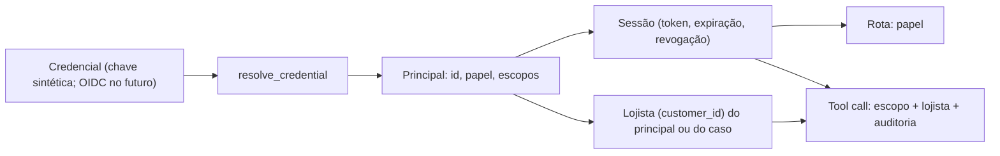

# 0017. Identidade: credencial → principal → escopos → lojista

## Título

Derivar o lojista de um principal autenticado por sessão e verificar escopo e lojista em todo tool call.

## Status

**Proposta** (v0.7.0, 2026-11-03). Passa a aceita depois do QA apto da v0.7.0.

## Contexto

Até a v0.6.0, `POST /messages` aceitava o `user_id` do payload como autoridade; a sessão `/v1` existia só para os papéis `demo` e `admin`, com um lojista fixo da configuração. As ferramentas já recebiam o lojista do servidor, nunca do modelo, mas não sabiam quem as chamava nem com que permissão. O avaliador pediu a cadeia credencial → principal → autorização → lojista e a autorização de cada tool call (RF-76 a RF-79).

## Decisão

- **Uma porta de entrada:** `api/identity.py` com `resolve_credential(credential) -> Principal`. Hoje a credencial é uma chave sintética por lojista (`MERCHANT_ACCESS_KEYS`) ou por operador (`OPERATOR_ACCESS_KEYS`), além de demo e admin; trocar por OIDC/JWT é trocar esta função.
- **Principal** = `principal_id`, `role` (`merchant`, `operator`, `demo`, `admin`), `customer_id` (nulo para operador) e `scopes` derivados do papel (tabela única, [spec v0.7.0](../../specs/identidade-hitl-v070.md) D3).
- **Sessão obrigatória** em `POST /messages` e `/v1/messages`, sem modo aberto; `user_id` opcional e, se divergir, `403 identity_mismatch`.
- **Tool call autorizado:** cada ferramenta declara um escopo; `registry.execute` verifica escopo e lojista antes do allowlist por agente e grava auditoria (principal, ferramenta, escopo, resultado) em todo call, aceito ou recusado. Quando o operador age sobre um caso, o lojista vem do caso, lido pelo servidor.
- **Limite por principal** em janela de 60 s (`429 rate_limited`).
- **MCP** recebe a chave do lojista, não o lojista.

## Alternativas consideradas

- **JWT assinado sem tabela de sessão:** sem revogação imediata e com mais configuração; a sessão em SQLite já existe e é revogável.
- **OIDC real na demo:** dependência externa sem ganho de avaliação; o adaptador único deixa a troca localizada.
- **Modo aberto para desenvolvimento:** descartado na [ADR 0016](0016-reabertura-pos-feedback.md).
- **Escopo só por rota:** não atende "autorizar cada tool call".

## Consequências

`POST /messages` passa a exigir duas chamadas (sessão + mensagem): quebra documentada no CHANGELOG, com chaves fictícias no `.env.example` para o compose subir sem edição. A auditoria cresce uma linha por tool call. Chaves de exemplo públicas não servem para exposição externa: o guia manda trocá-las e a API avisa na subida. Retorno: tag v0.6.0 e migração 0009 descendente.

## Data

2026-11-03
