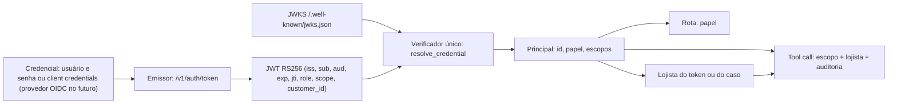

# 0017. Identidade: credencial → JWT → principal → escopos → lojista

## Título

Emitir e validar JWT (RS256, JWKS) no assistente, derivar o lojista do principal do token e verificar escopo e lojista em todo tool call.

## Status

**Proposta** (v0.7.0, 2026-11-03; versão 2 no mesmo dia, com a decisão do responsável por JWT com emissor próprio). Passa a aceita depois do QA apto da v0.7.0.

## Contexto

Até a v0.6.0, `POST /messages` aceitava o `user_id` do payload como autoridade; a sessão `/v1` existia só para `demo` e `admin`, com token opaco e um lojista fixo da configuração. As ferramentas recebiam o lojista do servidor, nunca do modelo, mas não sabiam quem as chamava nem com que permissão. O avaliador pediu a cadeia credencial → principal autenticado → autorização → lojista e a autorização de cada tool call (RF-76 a RF-79). O responsável escolheu tokens JWT, reconhecíveis como padrão de mercado, em vez de chave sintética trocada por sessão opaca.

## Decisão

- **Emissor próprio** no assistente: `POST /v1/auth/token` (RFC 6749: `password` para os usuários da demo, `client_credentials` para serviços), `POST /v1/auth/revoke`, `/.well-known/jwks.json` e `/.well-known/openid-configuration`. Tokens RS256 no perfil RFC 9068 (`typ=at+jwt`) com `iss`, `sub`, `aud`, `exp`, `nbf`, `iat`, `jti`, `client_id`, `role`, `scope` e, para lojista, `customer_id`. Chave privada gerada no runtime ou lida de arquivo, nunca no Git.
- **Um verificador** (`resolve_credential(token) -> Principal`) para API, MCP e CLI: assinatura, `kid`, emissor, audiência, validade, revogação. Configurar `JWT_ISSUER` e `JWT_JWKS_URL` troca o emissor por um provedor OIDC externo sem mexer nas rotas nem nas ferramentas.
- **Principal** = `principal_id`, `role` (`merchant`, `operator`, `service`, `demo`, `admin`), `customer_id` (só lojista e demo) e `scopes` (tabela na [spec v0.7.0](../../specs/identidade-hitl-v070.md)).
- **Token obrigatório** em `POST /messages` e `/v1/messages`, sem modo aberto; `user_id` opcional e, se divergir, `403 identity_mismatch`. `/v1/sessions` sai.
- **Tool call autorizado:** cada ferramenta declara um escopo; `registry.execute` verifica escopo e lojista antes do allowlist por agente e grava auditoria (principal, ferramenta, escopo, resultado, em nome de quem) em todo call. Quando o operador age sobre um caso, o lojista vem do caso, lido pelo servidor.
- **Limite por principal** em janela de 60 s (`429 rate_limited`).
- Credenciais da demo: usuários e client sintéticos com senhas fictícias guardadas como hash; admin e demo desligados até serem configurados.

## Alternativas consideradas

- **Chave sintética trocada por sessão opaca** (versão 1 desta ADR): atendia a cadeia pedida, mas é menos reconhecível como autenticação e não demonstra a troca por um provedor externo.
- **Keycloak (OIDC real) no compose:** cerca de 1 GB de RAM a mais, subida lenta e mais um ponto de falha para o avaliador; o verificador por emissor e JWKS já permite usá-lo por configuração.
- **HS256 com segredo compartilhado:** sem JWKS, o ticketing precisaria do segredo de assinatura para validar tokens.
- **Authorization code + PKCE na demo:** exige redirecionamento e tela de login do provedor; é o caminho de produção, documentado.
- **Escopo só por rota:** não atende "autorizar cada tool call".

## Consequências

Dependência `pyjwt[crypto]`. Duas quebras documentadas no CHANGELOG: `POST /messages` exige token e `/v1/sessions` dá lugar a `/v1/auth/token`. A demo continua subindo sem edição (senhas fictícias no `.env.example`), e a API avisa quando valores de exemplo estão em uso; exposição externa exige trocá-los. A auditoria cresce uma linha por tool call. Retorno: tag v0.6.0 e migração 0009 descendente.

## Data

2026-11-03
