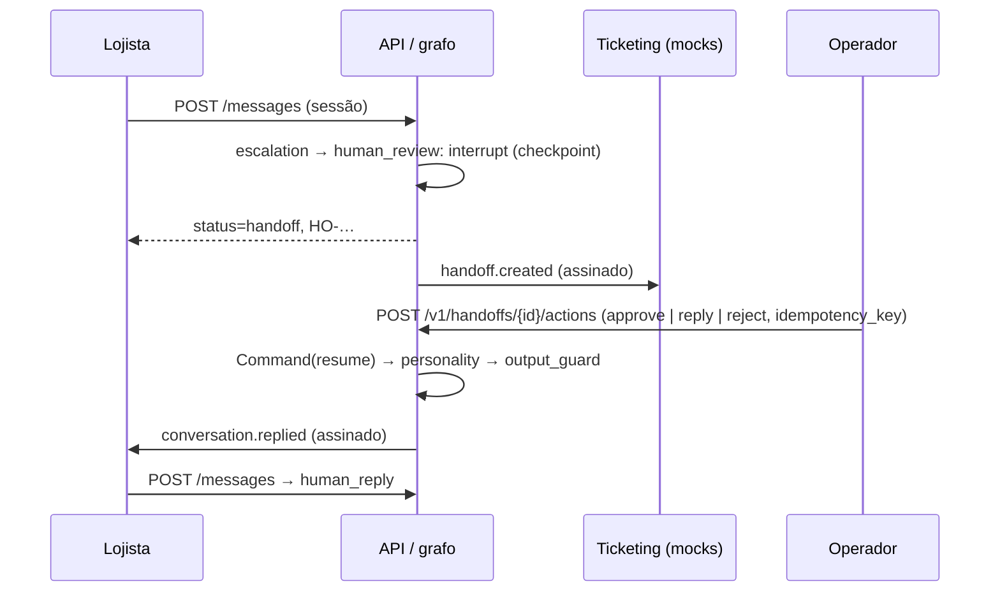

# 0018. HITL: interrupção do grafo, fila de operador e webhooks assinados

## Título

Interromper o grafo no encaminhamento com checkpoint SQLite, retomá-lo pela ação idempotente de um operador e integrar ticketing e lojista por webhooks assinados.

## Status

**Proposta** (v0.7.0, 2026-11-03). Passa a aceita depois do QA apto da v0.7.0.

## Contexto

O Escalation da v0.6.0 gravava um caso `SIM-…` e terminava: nenhum humano respondia e nada voltava ao fluxo. O avaliador deu 4,0 em HITL e pediu interrupt → human → reply → agent resumes, `approve`/`reply`/`reject`, proteção contra retomada dupla e integração com ticketing que devolva a resposta (RF-80 a RF-85, RF-100). Q15 escolheu a interrupção nativa do LangGraph.

## Decisão

- **Interrupção:** nó `human_review` depois de `escalation` chama `interrupt(payload)` (resumo, pergunta pendente, rascunho). O grafo é compilado com `SqliteSaver` em `<runtime>/checkpoints.sqlite3`; `thread_id` = `request_id` da execução que encaminhou, gravado no caso. A resposta HTTP ao lojista termina com `status=handoff` e protocolo `HO-…`.
- **Fila:** `handoff_cases` ganha estado (`open`, `claimed`, `answered`, `rejected`, `closed`), operador e carimbos; `handoff_events` guarda cada ação com chave de idempotência única; reivindicação e ação em `BEGIN IMMEDIATE`. Mesma chave → registro existente; segunda retomada → `409 already_resumed`.
- **Retomada:** `Command(resume={action, text, operator_id})` com `RunContext` novo. `approve` e `reply` → Personality (texto do operador como contribuição válida para a guarda); `reject` → Support com a instrução, um ciclo, sob o principal do operador e o lojista do caso, depois Personality. O turno sai com `via=operator`.
- **Entrega:** próxima mensagem do lojista (rota `human_reply`, sem modelo), consulta da conversa e webhook.
- **Webhooks:** `handoff.created` ao ticketing e `conversation.replied` ao lojista, corpo mascarado, `X-Signature: sha256=HMAC(secret, corpo)`, três tentativas, registro por tentativa em `webhook_deliveries`. O ticketing devolve a ação pela API de operador, autenticado por sessão. A demo tem receptores no serviço `mocks`.

## Alternativas consideradas

- **Retomada em nível de aplicação (sem checkpointer):** mais simples, mas não demonstra a interrupção do grafo pedida. Fica como plano B se o estado não serializar.
- **`thread_id` = conversa:** uma nova mensagem com o caso aberto colidiria com a interrupção pendente.
- **Só consulta, sem webhook:** não atende a integração operacional pedida.
- **Webhook de entrada assinado para a ação do ticketing:** um segundo mecanismo de autenticação para o mesmo ato; a API de operador já autentica, autoriza e audita.
- **Ticketing comercial:** dependência externa sem ganho; o contrato é o mesmo.

## Consequências

Dependência `langgraph-checkpoint-sqlite`; um arquivo de checkpoints no runtime (volume no compose); três tabelas novas e colunas na migração 0009. O caminho sem encaminhamento não lê checkpoint. Webhooks para fora do compose ficam desligados por padrão (URLs vazias) e restritos a hosts permitidos. Retorno: tag v0.6.0, migração 0009 descendente e remoção de `checkpoints.sqlite3`.

## Data

2026-11-03
