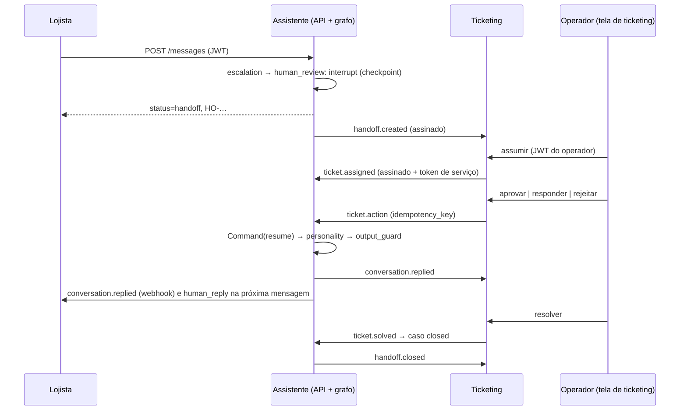

# 0018. HITL: interrupção do grafo, fila idempotente e ticketing integrado por webhooks assinados

## Título

Interromper o grafo no encaminhamento com checkpoint SQLite e retomá-lo pela ação de um operador feita num sistema de ticketing separado, integrado ao assistente por webhooks assinados nos dois sentidos.

## Status

**Proposta** (v0.7.0, 2026-11-03; versão 2 no mesmo dia, com a decisão do responsável por um ticketing próprio com tela no projeto web). Passa a aceita depois do QA apto da v0.7.0.

## Contexto

O Escalation da v0.6.0 gravava um caso `SIM-…` e terminava. O avaliador deu 4,0 em HITL e pediu interrupt → human → reply → agent resumes, `approve`/`reply`/`reject`, proteção contra retomada dupla e integração operacional com humano/ticketing que devolva a resposta ao agente (RF-80 a RF-85, RF-100). Q15 escolheu a interrupção nativa do LangGraph. O responsável pediu o ciclo completo de um ticket (recepção, atendimento, envio, finalização), como num cenário real, em vez de um receptor que só guarda o caso.

## Decisão

- **Interrupção:** nó `human_review` depois de `escalation` chama `interrupt(payload)` (resumo, pergunta pendente, rascunho). O grafo é compilado com `SqliteSaver` em `<runtime>/checkpoints.sqlite3`; `thread_id` = `request_id` da execução que encaminhou, gravado no caso. A resposta ao lojista termina com `status=handoff` e protocolo `HO-…`.
- **Fila no assistente (fonte de verdade da retomada):** estados `open`, `claimed`, `answered`, `rejected`, `closed`; `handoff_events` com chave de idempotência única; reivindicação e ação em `BEGIN IMMEDIATE`. Mesma chave → registro existente; segunda retomada → `409 already_resumed`. API, CLI e ticketing passam pelo mesmo serviço.
- **Retomada:** `Command(resume={action, text, operator_id})` com `RunContext` novo. `approve` e `reply` → Personality; `reject` → Support com a instrução, um ciclo, sob o principal do operador e o lojista do caso, depois Personality. O turno sai com `via=operator`.
- **Ticketing separado:** serviço próprio no compose, com banco próprio e sem importar o assistente; ciclo `new → open → pending → solved`; o operador entra com o JWT do assistente, validado pelo JWKS. Tela no projeto web.
- **Webhooks nos dois sentidos:** envelope com `id`, assinatura `X-Signature: t=…,v1=HMAC-SHA256(segredo, "t.corpo")` com janela de 300 s, um segredo por sentido, `id` repetido sem efeito, até três tentativas registradas. Assistente → ticketing: `handoff.created`, `conversation.replied`, `handoff.closed`. Ticketing → assistente: `ticket.assigned`, `ticket.action`, `ticket.solved`, com assinatura e token `client_credentials` (`handoff:integrate`). `conversation.replied` também vai ao lojista.
- **Entrega ao lojista:** próxima mensagem (rota `human_reply`, sem modelo), consulta da conversa e webhook.

## Alternativas consideradas

- **Receptor passivo de ticketing** (versão 1 desta ADR): mostrava a ida, mas a ação do operador não passava pelo ticketing; não atende "ticketing que devolva a resposta".
- **Só uma tela no projeto web sobre a API de fila do assistente:** o Streamlit não recebe webhooks, e a tela seria a própria fila do assistente com outro nome; sem integração entre sistemas.
- **Retomada em nível de aplicação, sem checkpointer:** não demonstra a interrupção do grafo; fica como plano B se o estado não serializar.
- **`thread_id` = conversa:** uma nova mensagem com o caso aberto colidiria com a interrupção pendente.
- **Ticketing comercial (Zendesk, Freshdesk):** conta e credenciais externas na demo; o contrato de eventos segue o estilo deles, e o adaptador real é mapeamento e configuração.

## Consequências

Dependências `langgraph-checkpoint-sqlite` e `pyjwt[crypto]`; um arquivo de checkpoints no runtime; tabelas novas na migração 0009; um serviço a mais no compose (`ticketing`, publicado só em `127.0.0.1`). O caminho sem encaminhamento não lê checkpoint. Webhooks para fora do compose ficam desligados por padrão (URLs vazias). Retorno: tag v0.6.0, migração 0009 descendente e remoção de `checkpoints.sqlite3` e do banco do ticketing.

## Data

2026-11-03
