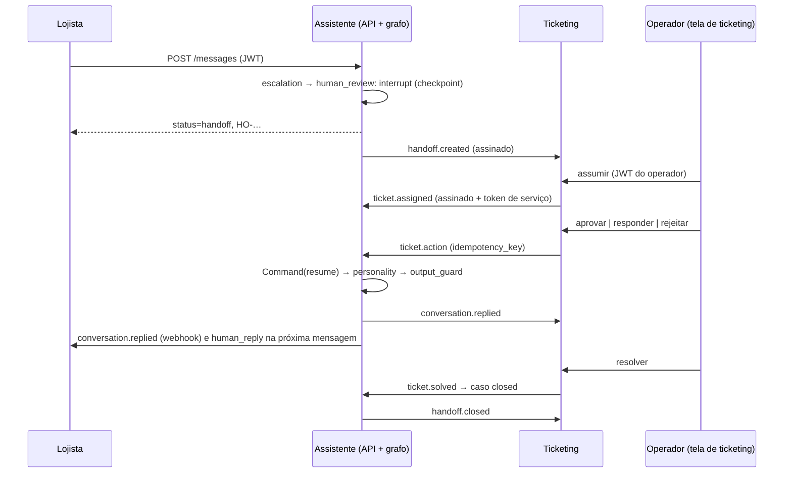

# 0018. HITL: interrupção do grafo, fila idempotente e ticketing integrado por webhooks assinados

## Título

Interromper o grafo no encaminhamento com checkpoint SQLite e retomá-lo pela ação de um operador feita num sistema de ticketing separado, integrado ao assistente por webhooks assinados nos dois sentidos.

## Status

**Aceita** (v0.7.0, 2026-11-04, depois do QA real apto; proposta em 2026-11-03, versão 2 no mesmo dia com a decisão do responsável por um ticketing próprio com tela no projeto web; ajustada no fechamento ao desenho em dois grafos (D25), à entrada idempotente e à outbox durável da migração 0010).

## Contexto

O Escalation da v0.6.0 gravava um caso `SIM-…` e terminava. O avaliador deu 4,0 em HITL e pediu interrupt → human → reply → agent resumes, `approve`/`reply`/`reject`, proteção contra retomada dupla e integração operacional com humano/ticketing que devolva a resposta ao agente (RF-80 a RF-85, RF-100). Q15 escolheu a interrupção nativa do LangGraph. O responsável pediu o ciclo completo de um ticket (recepção, atendimento, envio, finalização), como num cenário real, em vez de um receptor que só guarda o caso.

## Decisão

- **Interrupção em dois grafos (D25):** o grafo de atendimento segue sem checkpointer, e o caminho sem encaminhamento não lê checkpoint. Quando o Escalation abre um caso, o estado do fim do turno entra num grafo de revisão, com as mesmas funções de nó, compilado com `SqliteSaver` em `<runtime>/checkpoints.sqlite3`; ele para em `human_review` com `interrupt(payload)` (resumo, pergunta pendente, rascunho) depois da resposta ao lojista. `thread_id` = `request_id` da execução que encaminhou, gravado no caso. A resposta ao lojista termina com `status=handoff` e protocolo `HO-…`. Checkpoint que não grava marca o caso `checkpoint_failed` (D28).
- **Fila no assistente (fonte de verdade da retomada):** estados `open`, `claimed`, `answered`, `rejected`, `closed`; `handoff_events` com chave de idempotência única; reivindicação e ação em `BEGIN IMMEDIATE`. Mesma chave → registro existente; segunda retomada → `409 already_resumed`. API, CLI e ticketing passam pelo mesmo serviço.
- **Retomada:** `Command(resume={action, text, operator_id})` com `RunContext` novo. `approve` e `reply` → Personality; `reject` → Support com a instrução, um ciclo, sob o principal do operador e o lojista do caso, depois Personality. O turno sai com `via=operator`.
- **Ticketing separado:** serviço próprio no compose, com banco próprio e sem importar o assistente; ciclo `new → open → pending → solved`; o operador entra com o JWT do assistente, validado pelo JWKS. Tela no projeto web.
- **Webhooks nos dois sentidos:** envelope com `id`, assinatura `X-Signature: t=…,v1=HMAC-SHA256(segredo, "t.corpo")` com janela de 300 s, um segredo por sentido. Assistente → ticketing: `handoff.created`, `conversation.replied`, `handoff.closed`. Ticketing → assistente: `ticket.assigned`, `ticket.action`, `ticket.solved`, com assinatura e token `client_credentials` (`handoff:integrate`). `conversation.replied` também vai ao lojista, sem `operator_id` (D29).
- **Entrada idempotente:** cada evento reserva o seu `id` na `webhook_inbox` antes do efeito, com o hash do envelope; a exclusão entre processos (API, CLI e integração) usa faixas limitadas de arquivos de bloqueio SQLite por evento e por caso. `id` repetido devolve a resposta final guardada: `200 replayed` depois de um sucesso e **a mesma recusa `409`/`422` original** depois de uma recusa (decisão do responsável); `503` não é guardado e a repetição retoma (D26).
- **Saída durável (outbox, migração 0010):** a intenção de entrega de cada evento e destinatário é gravada na mesma transação da mudança de domínio (mensagens do turno, turno do operador ou fechamento), com corpo mascarado e `id` estável; só recebe intenção o destino com URL e segredo configurados. Um despachante entrega, registra cada tentativa em `webhook_deliveries` e recupera as intenções pendentes na subida da API. Três tentativas no total por evento e destinatário, inclusive depois de reinício; a ordem por caso e destinatário impede que uma resposta ultrapasse a criação. Um turno que caiu entre abrir o caso e gravar a intenção é completado quando o lojista reenvia a mesma mensagem. A descida da 0010 recusa enquanto houver intenção não entregue.
- **Entrega ao lojista:** próxima mensagem (rota `human_reply`, sem modelo), consulta da conversa e webhook.

## Alternativas consideradas

- **Receptor passivo de ticketing** (versão 1 desta ADR): mostrava a ida, mas a ação do operador não passava pelo ticketing; não atende "ticketing que devolva a resposta".
- **Só uma tela no projeto web sobre a API de fila do assistente:** o Streamlit não recebe webhooks, e a tela seria a própria fila do assistente com outro nome; sem integração entre sistemas.
- **Retomada em nível de aplicação, sem checkpointer:** não demonstra a interrupção do grafo; fica como plano B se o estado não serializar.
- **Um grafo só, com checkpointer em todo turno:** mais simples de ler, mas todo turno passaria a gravar e ler checkpoint, inclusive sem encaminhamento.
- **Entrega em thread curta sem persistir a intenção** (desenho inicial da tarefa 66): uma queda entre a mudança de domínio e o envio perdia o evento, inclusive o `handoff.closed`; a revisão reproduziu a perda.
- **`id` repetido sempre `200`:** uma recusa cuja resposta se perdesse viraria sucesso no ticketing.
- **`thread_id` = conversa:** uma nova mensagem com o caso aberto colidiria com a interrupção pendente.
- **Ticketing comercial (Zendesk, Freshdesk):** conta e credenciais externas na demo; o contrato de eventos segue o estilo deles, e o adaptador real é mapeamento e configuração.

## Consequências

Dependências `langgraph-checkpoint-sqlite` e `pyjwt[crypto]`; um arquivo de checkpoints e arquivos de bloqueio no runtime; tabelas novas nas migrações 0009 (fila, eventos, inbox, entregas) e 0010 (outbox); um serviço a mais no compose (`ticketing`, publicado só em `127.0.0.1`), do qual a `api` depende. O caminho sem encaminhamento não lê checkpoint. Webhooks para fora do compose ficam desligados por padrão (URLs vazias); a API avisa na subida quando um destino tem URL e não tem segredo.

Limitações aceitas na v0.7.0: intenção esgotada (`failed`) ou recusada (`rejected`) não tem reenvio automático nem comando, e prende os eventos seguintes do mesmo caso e destinatário, que ficam pendentes sem tentativa visível; depois de uma queda no meio do turno do encaminhamento, a recuperação depende de o lojista reenviar a mesma mensagem; colisão de faixa de bloqueio com uma retomada longa devolve `503` repetível depois de 5 s; os bloqueios foram exercitados no Windows; a 0009 foi ampliada no lugar durante a versão, então bancos anteriores na versão 9 precisam ser recriados.

Retorno: tag v0.6.0, migrações 0010 e 0009 descendentes (a 0010 só desce com a outbox vazia ou só com entregues) e remoção de `checkpoints.sqlite3`, dos arquivos de bloqueio e do banco do ticketing.

## Data

2026-11-03
